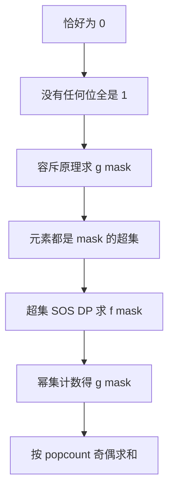

[[TOC]]

本文回答一个问题：CF449D「Jzzhu and Numbers」怎么解析成 SOS DP，尤其是从题面到超集求和的中间推导。算法主体见：[SOS DP](./index.md)。

## 题目

给定 $n$ 个非负整数（$n \leqslant 10^6$，$a_i \leqslant 10^6$，最多 $20$ 位），求非空子序列中按位与结果**恰好为 $0$** 的个数，对 $10^9+7$ 取模。

难在两处：子序列有 $2^n$ 个，不能枚举；"恰好为 $0$"很难直接拆分。

## 第一层：恰好为 0 → 容斥

"AND 结果恰好为 $0$"等价于"没有任何一位全是 $1$"。设属性 $P_j$ 表示"AND 结果第 $j$ 位是 $1$"，目标是所有 $P_j$ 都不成立。按补集的交展开（德摩根律 + 容斥原理）：

$$
Ans = \sum_{mask} (-1)^{|mask|} \cdot g(mask)
$$

其中 $g(mask)$ 表示"至少 $mask$ 指定的那些位全为 $1$"的方案数，$|mask|$ 是 $1$ 的个数，奇减偶加。注意 $g(mask)$ **不约束其他位**，这正是容斥项的口径。

## 第二层：g(mask) → 元素计数 f(mask)

"子序列的 AND 结果在 $mask$ 的位上全为 $1$" 等价于"子序列里**每个数**都是 $mask$ 的超集"。理由是 AND 对应集合交：

$$
M \subseteq \bigcap_{j} A_{i_j} \iff \forall j,\ M \subseteq A_{i_j}
$$

设 $f(mask)$ 是 $n$ 个数中 $mask$ 超集的个数。合法子序列的元素只能从这 $f(mask)$ 个数里挑，每个选或不选，由幂集计数共 $2^{f(mask)}$ 种，去掉空序列：

$$
g(mask) = 2^{f(mask)} - 1
$$

## 第三层：f(mask) 就是超集和

$f(mask)$ 的定义是 $\sum_{sup \supseteq mask} cnt[sup]$（$cnt$ 是每个数的出现次数），正是[超集和](./index.md)的标准模型，转移与主文章一致：$mask$ 的第 $bit$ 位为 $0$ 时 $G[mask] \leftarrow G[mask] + G[mask \oplus 2^{bit}]$。

整条建模链：

## 常见疑问：|U| 怎么"消失"了

容斥的常见写法是 $|U| - \sum|S_i| + \cdots$，但上面的公式里没有单独的 $|U|$。它就是 $mask = 0$ 的那一项：空交集按约定等于全集，$g(0) = 2^n - 1$ 恰好是全部非空子序列数；$popcount(0) = 0$ 为偶数，符号为正。所以代码只需一个从 $0$ 到 $2^{20}-1$ 的循环，不必特殊处理全集。

## 完整流程

1. 统计 `cnt[x]`：每个数的出现次数；
2. 对 `cnt` 做超集 SOS DP，得到 `f[mask]`；
3. 预处理 `pow2`，对每个 `mask` 按 `popcount` 奇偶，加上或减去 `pow2[f[mask]] - 1`。

时间复杂度 $O(20 \cdot 2^{20} + 2^{20})$，空间 $O(2^{20})$。

## 模式识别

- 关键信号："子序列 + 位运算结果恰好为某值"：指数级方案数加上属性否定，先想容斥；
- 中间量是"至少某些位为 $1$"：下钻到元素级的超集计数，交给超集 SOS DP；
- 骨架是容斥，引擎是 SOS DP，$mask = 0$ 项天然就是全集。
