# SOS DP: 从布尔格到实现

**Date**: October 14, 2026 at 08:44 PM
**Turns**: 23
**Source**: [Gemini Chat](https://gemini.google.com/app/07fd50c8203f1fe0)

---

## Turn 1

### 👤 用户

我在codeforce 上写代码, 我想要学习SOS DP ,你作为一个老师, 使用层层递进的方式教会我(我会离散数学)

### 🤖 助手

很高兴看到像你这样对算法有深入追求的 Codeforces 选手。既然你熟悉**离散数学**（特别是集合论和布尔代数）以及**基础动态规划**，我们就可以跳过简单的背景铺垫，直接从布尔格（Boolean Lattice）的结构切入。
SOS DP（Sum Over Subsets Dynamic Programming）的核心在于解决一类特定的**集合覆盖求和**问题。通常情况下，我们处理这类问题的时间复杂度是 $O(3^N)$，而 SOS DP 能将其优化到 $O(N \cdot 2^N)$。
我们将分四个层级来攻克它。

### 第一层：问题定义的数学抽象
假设我们要解决的问题如下：
给定一个长度为 $2^N$ 的数组 $A$（下标从 $0$ 到 $2^N - 1$）。我们需要计算另一个数组 $F$，其中 $F[mask]$ 的定义为：所有是 $mask$ **子集** 的下标 $i$ 对应的 $A[i]$ 之和。
用集合论的语言描述：

$$
F[mask] = \sum_{i \subseteq mask} A[i]
$$
在计算机中，我们用二进制位操作来表示集合关系：
$i \subseteq mask \iff (i \ \& \ mask) == i$

### 第二层：暴力解法的瓶颈
利用你的离散数学直觉，首先会想到两种直观的解法：

1. **完全暴力法**： 遍历所有的掩码 $mask$，再遍历所有可能的 $i$ 检查是否为子集。
  - 复杂度：$O(2^N \cdot 2^N) = O(4^N)$。这在 $N=20$ 时显然不可接受。
2. **子集遍历优化**： 你可能知道在 CP 中有一个经典的技巧遍历子集：`for (int s=m; s; s=(s-1)&m)`。 利用这个技巧，我们只遍历有效的子集。
  - 复杂度：这是一个二项式展开求和 $\sum_{k=0}^{N} \binom{N}{k} 2^k = (1+2)^N = 3^N$。
  - 当 $N=20$ 时，$3^{20} \approx 3.5 \times 10^9$，通常也会 TLE（Codeforces 一般限制 $10^8$ 左右的操作数）。
**瓶颈在哪里？**
这两种方法都存在大量的**重复计算**。
比如计算 $F[1101_2]$ 和 $F[1001_2]$ 时，它们都包含了 $A[1000_2]$、$A[0001_2]$ 等公共子集。$O(3^N)$ 的算法完全忽略了这种重叠结构。

### 第三层：利用状态空间结构（SOS DP 的核心）
为了利用重叠结构，我们需要重新定义 DP 状态。
在离散数学中，所有 $N$ 位的二进制数构成了一个 $N$ 维的**超立方体（Hypercube）**。如果是 $1$ 维（0, 1），就是一条线；$2$ 维（00, 01, 10, 11）是一个正方形，以此类推。
**SOS DP 的魔法在于：我们不一次性把所有位都变掉，而是一个比特一个比特地去允许变化。**
我们定义状态 $DP[i][mask]$：
表示我们在计算 $mask$ 的子集和，但是我们**只允许**子集的**前 $i$ 个比特**（第 $0$ 位到第 $i$ 位）与 $mask$ 不同（即可以是 $0$ 也可以是 $1$），而**剩余的比特**（第 $i+1$ 位到 $N-1$ 位）必须与 $mask$ **严格保持一致**。

#### 状态转移方程推导
考虑 $DP[i][mask]$，我们需要看第 $i$ 个比特（假设是最低位为第 0 位）：

1. **情况 A：如果 $mask$ 的第 $i$ 位是 $0$** 那么它的子集在这一位上**只能**是 $0$。这意味着第 $i$ 位的变化权利被“浪费”了（因为它本来就被限制为 0，变不变都得是 0）。 所以，这等价于只允许前 $i-1$ 位变化的情况：$DP[i][mask] = DP[i-1][mask]$
2. **情况 B：如果 $mask$ 的第 $i$ 位是 $1$** 那么它的子集在这一位上可以是 $0$，也可以是 $1$。根据加法原理，我们将其拆分为两部分：
  - **取 $0$ 的部分**：这部分子集的第 $i$ 位固定为 $0$，其余高位与 $mask$ 相同，低位（$0$ 到 $i-1$）随意。这正好对应 $DP[i-1][mask \setminus \{2^i\}]$（即把 $mask$ 第 $i$ 位变为 0 后的那个状态）。
  - **取 $1$ 的部分**：这部分子集的第 $i$ 位固定为 $1$，其余高位与 $mask$ 相同，低位（$0$ 到 $i-1$）随意。这正好对应 $DP[i-1][mask]$。$DP[i][mask] = DP[i-1][mask] + DP[i-1][mask \oplus 2^i]$

### 第四层：代码实现与空间优化
如果我们直接开二维数组 $DP[N][2^N]$，空间复杂度是 $O(N \cdot 2^N)$，可能会 MLE。
观察方程发现，$DP[i]$ 只依赖于 $DP[i-1]$。就像**0/1 背包问题**一样，我们可以使用滚动数组或者直接在原数组上迭代来优化掉第一维。
由于我们是从 $i=0$ 到 $N-1$ 依次放开限制，我们可以直接在 $F$ 数组上迭代。

#### C++ 实现（Codeforces 风格）

```c++
#include <iostream>
#include <vector>

using namespace std;

const int MAXN = 20; // 假设 N 最大为 20

int main() {
    // 假设 F 数组初始存储的是 A[i]
    // 也就是只允许前 -1 位变化（都不许变）的情况
    int n; 
    cin >> n; // 比特位数
    int limit = 1 << n;
    
    vector<int> F(limit);
    for (int i = 0; i < limit; ++i) {
        cin >> F[i];
    }

    // SOS DP 核心代码
    // i 代表我们当前正在处理第 i 个比特位
    for (int i = 0; i < n; ++i) {
        // 遍历所有的 mask
        for (int mask = 0; mask < limit; ++mask) {
            // 只有当 mask 的第 i 位是 1 时，才存在 "子集取 0" 和 "子集取 1" 的求和关系
            // 如果 mask 第 i 位是 0，它只能取 0，值就是上一轮的值，无需操作
            if (mask & (1 << i)) {
                // F[mask] 目前包含的是 "第 i 位取 1" 的子集和 (来自上一轮)
                // F[mask ^ (1 << i)] 包含的是 "第 i 位取 0" 的子集和
                F[mask] += F[mask ^ (1 << i)];
            }
        }
    }

    // 输出结果
    // 此时 F[mask] 已经是 Sum over Subsets 了
    for (int i = 0; i < limit; ++i) {
        cout << "Sum of subsets for mask " << i << ": " << F[i] << endl;
    }

    return 0;
}

```

#### 复杂度分析

- **外层循环**：遍历 $N$ 个比特位 ($0$ 到 $N-1$)。
- **内层循环**：遍历 $2^N$ 个掩码。
- **总复杂度**：$O(N \cdot 2^N)$。
当 $N=20$ 时，$20 \times 10^6 \approx 2 \times 10^7$，这在 Codeforces 上跑进 1 秒是轻轻松松的。

### 进阶思考（留给你的作业）
既然你擅长 C++ 和算法，试着思考一下 SOS DP 的逆过程：
**高维前缀和的逆运算（Inverse SOS DP）**。
如果给了你计算好的 $F[mask]$（子集和），让你还原出原始的 $A[mask]$，代码该怎么改？
*(提示：利用容斥原理，或者直接观察 $A+B=C \implies A = C-B$ 的逆操作)*
你可以先在脑海里模拟一下这个过程，这对理解高维空间的容斥原理非常有帮助。如果你想确认答案，随时可以问我。

## Turn 2

### 👤 用户

来一些 mermaid 图片, 辅助我理解

### 🤖 助手

好极了。对于很多通过图形思维理解算法的人来说，SOS DP 的过程其实就是**在高维超立方体上进行维度扫描**。
既然你熟悉离散数学，最适合你的可视化方式是**布尔格（Boolean Lattice）和分层传导**。
这里有三张图，分别从**结构**、**过程**和**原理**三个角度帮助你理解。

### 图 1：结构视角 —— $N=3$ 的布尔格 (Boolean Lattice)
首先，我们要明确我们在求什么。对于 $N=3$（即 $000$ 到 $111$），所有的子集关系构成了一个立方体。
在 SOS DP 中，计算 $F[111]$ 意味着要把**所有箭头指向它**（直接或间接）的节点值加起来。

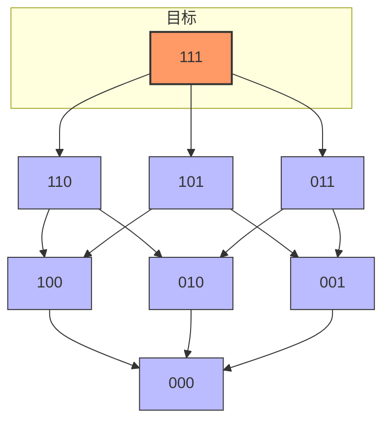
**离散数学视角：**
暴力做法相当于对每个节点，都去遍历其下方的整个子图。
SOS DP 的做法相当于：**不要每次重新遍历**，而是利用中间节点的计算结果。

### 图 2：核心过程 —— 维度的逐层累加 (最重要的一张图)
这是 SOS DP 的灵魂。我们以 $N=2$ 为例（只有 00, 01, 10, 11）。
看我们是如何通过两次迭代（$i=0$ 和 $i=1$），把 $A[00]$ 的值一步步“传导”给 $F[11]$ 的。
**注意观察 `01` 节点在第一轮变成了什么，然后它又是如何在第二轮被利用的。**

```代码段
graph LR
    %% 初始状态
    subgraph S0 [初始状态: F 存储 A]
        direction TB
        A00(A[00])
        A01(A[01])
        A10(A[10])
        A11(A[11])
    end

    %% 第1轮：处理第0位 (mask & 1)
    subgraph S1 [第一轮: i=0]
        direction TB
        %% 00和10的第0位是0，保持不变
        N00("00: A[00]"):::pass
        N10("10: A[10]"):::pass
        
        %% 01和11的第0位是1，累加变0的对应项
        N01("01: A[01] + A[00]"):::new
        N11("11: A[11] + A[10]"):::new
        
        %% 连线表示数据来源
        A00 -.-> N01
        A10 -.-> N11
    end

    %% 第2轮：处理第1位 (mask & 2)
    subgraph S2 [第二轮: i=1 (最终结果)]
        direction TB
        %% 00和01的第1位是0，保持不变
        F00("F[00]"):::pass
        F01("F[01]"):::pass
        
        %% 10和11的第1位是1，累加变0的对应项
        F10("F[10]: (A[10]) + (A[00])"):::final
        F11("F[11]: (A[11]+A[10]) + (A[01]+A[00])"):::final
        
        %% 关键：N01 已经包含了 A[00]，所以 F11 一次就拿到了两个值
        N00 --> F10
        N01 --> F11
        N11 --> F11
    end

    %% 样式
    classDef pass fill:#eee,stroke:#999,stroke-dasharray: 5 5;
    classDef new fill:#add8e6,stroke:#333;
    classDef final fill:#f96,stroke:#333,stroke-width:2px;

```
**图解说明：**

1. **第一轮 ($i=0$)**：所有的**横向**（最低位变化）合并完成了。`01` 此时已经吸收了 `00` 的能量。
2. **第二轮 ($i=1$)**：所有的**纵向**（次低位变化）合并。
3. **关键点**：当计算 `11` 时，我们加上了 `01` 节点的值。注意！此时 `01` 节点里**已经**包含了 `A[00] + A[01]`。
  - 我们不需要单独去加 `A[00]`。
  - 这就是为什么它避免了重复计算，把 $3^N$ 降到了 $2^N$。

### 图 3：代码逻辑流 —— 为什么要做 `if (mask & (1<<i))`
这段代码逻辑其实就是一个**选择性过滤器**。对于当前处理的维度 $i$，我们将状态空间一分为二。

```代码段
graph TD
    Start(开始处理维度 i) --> Loop{遍历所有 mask}
    Loop --> Check{"检查第 i 位:<br/>(mask >> i) & 1 ?"}
    
    Check -- "是 0" --> ZeroCase[保持不变<br/>F[mask] = F[mask]]
    Check -- "是 1" --> OneCase[累加<br/>F[mask] += F[mask ^ 2^i]]
    
    ZeroCase --> Explain0[解释: mask 本身就是该维度的子集<br/>不需要从其他地方获取值]
    OneCase --> Explain1[解释: mask 是该维度的超集<br/>必须把对应子集那一半的和吸纳进来]
    
    Explain0 --> Next
    Explain1 --> Next
    Next(继续下一个 mask)
    
    style OneCase fill:#f96,stroke:#333,stroke-width:2px
    style ZeroCase fill:#eee,stroke:#333

```

### 总结给 Codeforces 选手的你

- **图 1** 告诉你：我们在图上求和。
- **图 2** 告诉你：我们不是在一个点一个点地爬，而是**切片式**地合并。先合并所有“左右”相邻的，再合并所有“上下”相邻的，最后合并所有“前后”相邻的（对于三维）。
- **数学本质**：这实际上是张量积（Tensor Product）在算法上的体现。我们在每一个维度上分别做变换，最终组合成整体的变换。
现在配合着代码和这些图，是不是对 `F[mask] += F[mask ^ (1<<i)]` 这一行有了更物理的实感？

## Turn 3

### 👤 用户

你从新来教会我SOS DP, 使用 mermaid 穿插

### 🤖 助手

既然你活跃在 Codeforces，且具备**离散数学**功底，那我们直接绕开表象，从**高维空间前缀和**的本质入手。
SOS DP (Sum Over Subsets) 的本质是将一个 $N$ 维的超立方体求和问题，分解为 $N$ 个一维前缀和的组合。

## 第一阶段：问题的数学本质
给定数组 $A$，我们要计算：

$$
F[mask] = \sum_{i \subseteq mask} A[i]
$$
在离散数学中，这实际上是在**布尔格 (Boolean Lattice)** 上做偏序关系的求和。

### 为什么 $O(3^N)$ 遍历子集不够快？
通常我们遍历子集会用：`for(int s=m; s; s=(s-1)&m)`。
这个过程在 $N=20$ 时大约需要 $3.5 \times 10^9$ 次运算，在 CF 常见的 1s 或 2s 时限下极易 TLE。

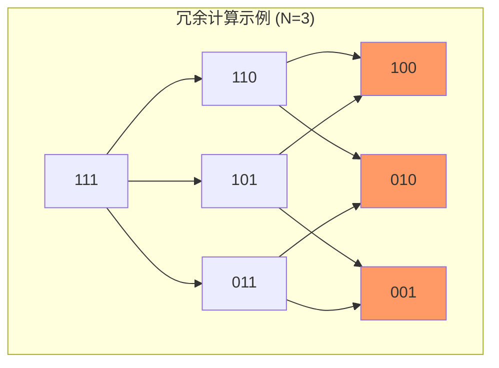

> **痛点**：如上图，计算 `111` 的时候，`100`、`010`、`001` 这些项被重复加了多次。我们需要一种方式，让底层的贡献“一次性”向上层传递。

## 第二阶段：定义状态——分维度扫描
SOS DP 的精髓在于定义一个中间状态 $dp[i][mask]$：

- **$mask$**：当前的集合状态。
- **$i$**：考虑前 $i$ 位（从 $0$ 到 $N-1$）。
- **含义**：$dp[i][mask]$ 表示所有满足以下条件的 $j$ 的 $A[j]$ 之和：
  1. 在第 $i+1$ 位到 $N-1$ 位上，$j$ 与 $mask$ **完全一致**。
  2. 在第 $0$ 位到 $i$ 位上，$j$ 是 $mask$ 的**子集**。

### 递推逻辑的 Mermaid 演示
当我们要从 $dp[i-1]$ 推导到 $dp[i]$ 时，我们只关注 **第 $i$ 位**：

```代码段
decisionTree
    direction LR
    node1((mask的第 i 位)) -- 是 0 --> node2(j 的第 i 位只能是 0)
    node1 -- 是 1 --> node3(j 的第 i 位可以是 0 或 1)
    
    node2 --> res1["dp[i][mask] = dp[i-1][mask]"]
    node3 --> res2["dp[i][mask] = dp[i-1][mask] + dp[i-1][mask ^ 2^i]"]

```

## 第三阶段：空间压缩与代码实现
由于 $dp[i]$ 只依赖于 $dp[i-1]$，我们可以像优化背包问题一样，直接在原数组 $F$ 上进行操作。

### 算法流程可视化
想象一个 $2^N$ 的线性数组。我们进行 $N$ 轮迭代，每轮处理一个比特位：

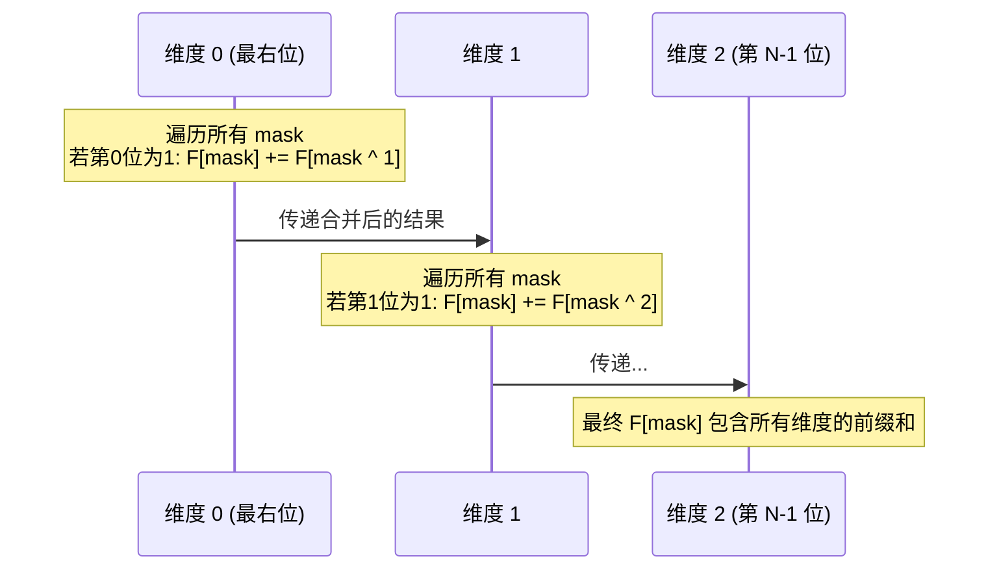

### C++ 实现

```c++
// 假设 f[mask] 初始值为 A[mask]
for (int i = 0; i < n; ++i) { // 依次放开第 i 位的限制
    for (int mask = 0; mask < (1 << n); ++mask) {
        if (mask & (1 << i)) {
            // 如果当前位是 1，则它可以包含“当前位是 0”的子集贡献
            f[mask] += f[mask ^ (1 << i)];
        }
    }
}

```

## 第四阶段：更广阔的视野——Inverse SOS DP
既然你会离散数学，你一定想到了：如果这是“高维前缀和”，那有没有“高维差分”？
当我们已知 $F[mask]$，想求原数组 $A[mask]$ 时，只需要把加法变减法：

```c++
for (int i = 0; i < n; ++i) {
    for (int mask = 0; mask < (1 << n); ++mask) {
        if (mask & (1 << i)) {
            f[mask] -= f[mask ^ (1 << i)];
        }
    }
}

```

### 总结对比

| 维度 | 普通前缀和 (1D) | SOS DP (ND) |
| --- | --- | --- |
| **基础操作** | `f[i] = f[i-1] + a[i]` | 沿 $N$ 个正交轴分别做 1D 前缀和 |
| **复杂度** | $O(N)$ | $O(N \cdot 2^N)$ |
| **数学结构** | 线性序 | 布尔格 (超立方体) |

### 下一步建议
SOS DP 不仅可以求和，还可以求**最大值、最小值、甚至位运算卷积**。
在 Codeforces 中，很多题目会将 SOS DP 隐藏在“计算满足 $a_i \ \& \ a_j = 0$ 的对数”这类问题中。
**你想尝试写一个利用 SOS DP 解决 “计算数组中互补对（AND 为 0）数量” 的具体题目思路吗？**

## Turn 4

### 👤 用户

我现在基本理解了 sos dp, 给我一些 入门的题目,我来做

### 🤖 助手

既然你已经掌握了 SOS DP 的核心原理（高维前缀和），现在最有效的方法就是通过经典的 **Codeforces** 题目来磨练。
SOS DP 的题目通常分为三个层次：**直接应用**、**补集与容斥**、以及**非求和类的 DP 转移（如最大值）**。

### 第一阶段：直接应用（模版练习）
这类题目主要是为了让你熟悉 $O(N \cdot 2^N)$ 的代码写法，以及如何将问题转化为“子集求和”。

#### 1. CF 165E. Compatible Numbers

- **题意**：给定一个数组 $a$，对于每个 $a_i$，找到数组中是否存在一个 $a_j$，使得 $a_i \ \& \ a_j = 0$。
- **核心思路**：
  - $a_i \ \& \ a_j = 0$ 意味着 $a_j$ 必须是 $a_i$ 的**补集**（即 `~a_i`）的子集。
  - 设 $mask = (\sim a_i) \ \& \ ((1 \ll 22) - 1)$。你需要检查 $F[mask]$ 是否存储了一个存在的 $a_j$。
  - 这里的 SOS DP 维护的不是“和”，而是“是否存在”或者“记录任意一个存在的数字”。

#### 2. CF 383E. Vowels

- **题意**：给定很多个长度为 3 的单词（仅由 a-x 组成）。一个单词是“正确的”，只要它包含至少一个给定元音集合中的字母。求所有 $2^{24}$ 种元音集合对应的正确单词数量的平方的异或和。
- **核心思路**：
  - 直接算“包含至少一个”比较难，转而计算补集：“一个都不包含”。
  - 一个单词 `{c1, c2, c3}` 在元音集合 $mask$ 下不合法，当且仅当 $mask$ 不包含这三个字母。
  - 利用 SOS DP 计算每个 $mask$ 的子集单词数。

### 第二阶段：进阶转换（容斥原理）
这类题目通常需要你利用 SOS DP 处理高维空间的**包含关系**，结合容斥原理解决计数问题。

#### 3. CF 449D. Jzzhu and Numbers

- **题意**：给定一个数组 $a$，求有多少个非空子序列，使得它们的按位与（AND）结果为 $0$。
- **核心思路**：
  - 这是 SOS DP 的经典综合题。设 $f(mask)$ 为 $a_i \ \& \ mask = mask$ 的元素个数（即 $mask$ 是 $a_i$ 的子集，这对应 **超集求和**）。
  - 那么对于一个特定的 $mask$，有 $2^{f(mask)} - 1$ 个子序列的 AND 结果是 $mask$ 的超集。
  - 最后通过**容斥原理**（高维差分）还原出 AND 结果恰好为 $0$ 的方案数。

### 第三阶段：状态扩展（不仅是求和）
SOS DP 的状态转移方程 `f[mask] += f[mask ^ (1<<i)]` 中的 `+` 可以替换为任何满足**结合律**的操作。

#### 4. AtCoder ARC 100 E - Or Plus Max

- **题意**：给定数组 $A$。对于每个 $K \in [1, 2^N - 1]$，求 $A_i + A_j$ 的最大值，其中 $i \ \vert{} \ j \le K$。
- **核心思路**：
  - 注意条件是 $i \ \vert{} \ j \le K$，这可以转化为求 $i \ \vert{} \ j = mask$ 的最大值，然后做一遍前缀最大值。
  - 由于我们要找的是两个数相加的最大值，SOS DP 过程中每个 $mask$ 维护的不再是和，而是该子集范围内的**最大值**和**次大值**。
  - 合并两个子集时，从四个数（两个最大，两个次大）里选出最大的两个。

### 建议练习顺序

1. 先做 **CF 165E**（体会子集性质的转化）。
2. 再做 **AtCoder ARC 100E**（体会 SOS DP 维护复杂状态）。
3. 最后攻克 **CF 449D**（真正理解高维前缀和与容斥的关系）。
**你想先针对其中哪一道题，让我为你详细拆解一下它的推导逻辑吗？**

## Turn 5

### 👤 用户

E. Compatible Numbers
time limit per test4 seconds
memory limit per test256 megabytes
Two integers x and y are compatible, if the result of their bitwise "AND" equals zero, that is, a & b = 0. For example, numbers 90 (10110102) and 36 (1001002) are compatible, as 10110102 & 1001002 = 02, and numbers 3 (112) and 6 (1102) are not compatible, as 112 & 1102 = 102.
You are given an array of integers a1, a2, ..., an. Your task is to find the following for each array element: is this element compatible with some other element from the given array? If the answer to this question is positive, then you also should find any suitable element.
Input
The first line contains an integer n (1 ≤ n ≤ 106) — the number of elements in the given array. The second line contains n space-separated integers a1, a2, ..., an (1 ≤ ai ≤ 4·106) — the elements of the given array. The numbers in the array can coincide.
Output
Print n integers ansi. If ai isn't compatible with any other element of the given array a1, a2, ..., an, then ansi should be equal to -1. Otherwise ansi is any such number, that ai & ansi = 0, and also ansi occurs in the array a1, a2, ..., an.
Examples
InputCopy
2
90 36
OutputCopy
36 90
InputCopy
4
3 6 3 6
OutputCopy
-1 -1 -1 -1
InputCopy
5
10 6 9 8 2
OutputCopy
-1 8 2 2 8
这个题目怎么使用 SOS DP,进行思考 ?

### 🤖 助手

这道题是 SOS DP 的经典入门题。要解决它，我们需要把“位运算条件”转化为“集合包含条件”。

### 1. 核心逻辑转换
题目要求找到一个 $a_j$，使得 $a_i \ \& \ a_j = 0$。
在离散数学中，如果我们将数字看作集合（二进制位为 1 的位置是集合元素），$a_i \ \& \ a_j = 0$ 意味着这两个集合**不相交**。
不相交等价于：**$a_j$ 必须是 $a_i$ 补集的子集。**

- 设全集 $U = 2^{22}-1$（因为 $4 \cdot 10^6 < 2^{22}$）。
- $a_i$ 的补集为 $mask = (\sim a_i) \ \& \ U$。
- 只要任何一个 $a_j$ 满足 $a_j \subseteq mask$，那么 $a_i \ \& \ a_j = 0$ 必定成立。

### 2. SOS DP 状态定义
我们需要一个数组 `f[mask]`，它的定义如下：

- 如果存在某个原数组中的数 $a_j$ 是 $mask$ 的子集，则 `f[mask] = a_j`。
- 如果不存在，则 `f[mask] = -1`。
**状态转移：**
和求和不同，这里我们只需要维护“存在性”。只要子状态里有一个不是 $-1$ 的值，当前状态就可以继承它。

### 3. 解题步骤

1. **初始化**： 开一个大小为 $2^{22}$ 的数组 `f`，全部初始化为 `-1`。 遍历输入数组 $a$，对于每个出现的数字 $x$，设置 `f[x] = x`。
2. **运行 SOS DP**： 我们要计算的是 **Sum (or Existence) Over Subsets**。
   ```c++
   for (int i = 0; i < 22; ++i) {
       for (int mask = 0; mask < (1 << 22); ++mask) {
           if (mask & (1 << i)) {
               // 如果当前 mask 还没有找到对应的 aj
               // 看看它的子集（把第 i 位变成 0）有没有对应的 aj
               if (f[mask] == -1) {
                   f[mask] = f[mask ^ (1 << i)];
               }
           }
       }
   }
   
   ```
3. **查询结果**： 对于每个原始输入的 $a_i$：
  - 计算补集 `comp = (~a_i) & ((1 << 22) - 1)`。
  - 直接输出 `f[comp]`。

### 4. 为什么这样做是对的？

```代码段
graph TD
    A[ai = 1010_2] --> B[补集 comp = 0101_2]
    B --> C{f[0101] 是什么?}
    C --> D[f[0101] 存储的是 0101 的子集中<br/>在原数组里出现过的任意一个数]
    D --> E[比如原数组里有 0100_2]
    E --> F[那么 ai & 0100 = 0 必然成立]

```

### 5. 复杂度分析

- **时间复杂度**：$O(N + K \cdot 2^K)$，其中 $K=22$。 $22 \times 4 \cdot 10^6 \approx 8.8 \cdot 10^7$，在 Codeforces 的 4 秒时限内绰绰有余。
- **空间复杂度**：$O(2^K)$，大约需要 16MB 的内存（使用 `int` 数组）。

### 实现小贴士 (Codeforces)

- 由于 $a_i$ 最大是 $4 \cdot 10^6$，你需要至少 22 位二进制位。
- 输入规模较大 ($10^6$)，建议使用快速 IO（`scanf` 或 `cin.tie(0)`）。
- 全集掩码常量：`const int ALL = (1 << 22) - 1;`
这道题是不是让你感觉到 SOS DP 就像是一个**高效的预处理器**？它一次性把所有可能的补集查询都准备好了。
**如果你写完了这题，想试试那道更难一点的“异或和平方” (CF 383E) 吗？它需要一点点容斥原理。**

## Turn 6

### 👤 用户

/**
* Author by Rainboy blog: https://rainboylv.com github : https://github.com/rainboylvx
* rbook: -> https://rbook.roj.ac.cn https://rbook2.roj.ac.cn
* date: 2026-01-21 10:33:15
*/
#include <bits/stdc++.h>
using namespace std;
typedef long long ll;
typedef unsigned long long ull;
const int maxn = 2e6+5;
int n,m;
int a[maxn];
int f[(1<<22)+5];
void init(){
}
signed main () {
ios::sync_with_stdio(false); cin.tie(0);
std::cin >> n;
memset(f,-1,sizeof(f));
for(int i = 1;i <= n ;++i ) // i: 1->n
{
std::cin >> a[i];
//初始化 f[-1][mask]
// 显然 f[-1][mask] 就要看 是不是存在 a[i] = mask
f[a[i]] = a[i];
}
// 枚举 f[i][mask] 中的i
for(int i = 0 ;i < 22; i++) {
// 枚举 mask
for(int mask = 0;mask < (1<<22) ;++mask ) // mask: 0->22
{
// 如果 Bit_i(mask) == 0
// f[i][mask] = f[i-1][mask]
// 什么也不用做
// 如果 Bit_i(mask) == 1
// f[i][mask] = f[i-1][mask](!=-1) or f[i-1][mask^(1<<i)](!=-1)
if( f[mask] /* f[i][mask]*/ == -1) {
// 试一试另外一个
f[mask] = f[mask^(1<<i)];
}
}
}
for(int i = 1;i <= n ;++i ) // i: 1->n
{
int other = ~a[i] &((1<<22)-1 ); // 补集
std::cout << f[other] << " ";
}
return 0;
}
我的代码那里有问题 ?

### 🤖 助手

你的代码思路已经非常接近正确答案了，但在 **SOS DP 的状态转移逻辑**上漏掉了一个关键的判定条件。

### 核心问题所在
在你的 SOS DP 循环中，你写的是：

```c++
if( f[mask] == -1) {
    f[mask] = f[mask^(1<<i)];
}

```
**这里有两个问题：**

1. **缺少位判定（最致命）**：你没有判断 `mask` 的第 `i` 位是否为 `1`。
  - 如果 `mask` 的第 `i` 位是 `1`，那么 `mask ^ (1<<i)` 是它的**子集**（对应位从 1 变 0），这符合 SOS DP 的逻辑。
  - 如果 `mask` 的第 `i` 位是 `0`，那么 `mask ^ (1<<i)` 反而是它的**超集**（对应位从 0 变 1）。这会导致逻辑混乱，甚至把不该有的值传回来。
2. **更新顺序逻辑**：在 SOS DP 中，我们希望将“更小集合”的信息传递给“更大集合”。因此，只有当当前 `mask` 包含第 `i` 位时，它才有机会从“不包含第 `i` 位”的状态转移过来。

### 修改后的核心代码
你需要增加 `if (mask & (1 << i))` 的判断：

```c++
// 枚举每一个比特位 i
for(int i = 0 ; i < 22; i++) {
    // 枚举每一个可能的数值 mask
    for(int mask = 0; mask < (1 << 22); ++mask) {
        // 关键：只有当 mask 的第 i 位是 1 时，它才能从“该位为 0”的子集继承状态
        if (mask & (1 << i)) {
            // 如果当前的 mask 还没有找到对应的 a[j]
            // 尝试从它的子集 mask ^ (1 << i) 中获取一个存在的 a[j]
            if (f[mask] == -1) {
                f[mask] = f[mask ^ (1 << i)];
            }
        }
    }
}

```

### 为什么必须判断 `mask & (1 << i)`？
看下面这个 Mermaid 流程图，展示了数据是如何从底向上流动的：

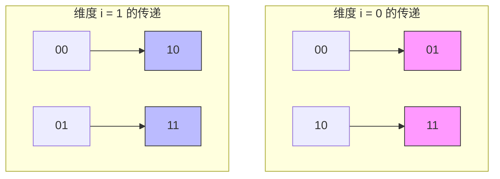

- 在处理第 0 位时，我们只把 `00` 的值传给 `01`，把 `10` 的值传给 `11`。
- 如果你不判断 `mask & (1 << i)`，当你遍历到 `mask = 00` 时，代码会尝试用 `f[01]` 来更新 `f[00]`。**这就是“超集”传给了“子集”，逻辑反了。**

### 完整的修正代码建议
另外，由于 $a_i \le 4 \cdot 10^6$，且 $2^{22} = 4,194,304$，你开 22 位是正确的。为了更稳健，可以显式定义全集。

```c++
#include <bits/stdc++.h>
using namespace std;

const int MAXB = 22;
const int MAXN = 1e6 + 5;
const int MAXM = (1 << MAXB);

int n;
int a[MAXN];
int f[MAXM];

int main() {
    ios::sync_with_stdio(false);
    cin.tie(0);

    if (!(cin >> n)) return 0;

    memset(f, -1, sizeof(f));

    for (int i = 1; i <= n; ++i) {
        cin >> a[i];
        f[a[i]] = a[i]; // 初始化：如果原数组有这个数，它就是自己的子集代表
    }

    // SOS DP 过程
    for (int i = 0; i < MAXB; i++) {
        for (int mask = 0; mask < MAXM; mask++) {
            if (mask & (1 << i)) {
                // 如果当前 mask 没找到合适的 a[j]
                // 看看把第 i 位变成 0 后的子集里有没有
                if (f[mask] == -1) {
                    f[mask] = f[mask ^ (1 << i)];
                }
            }
        }
    }

    // 查询结果
    int full_mask = MAXM - 1;
    for (int i = 1; i <= n; i++) {
        // a[i] & other == 0 等价于 other 是 ~a[i] 的子集
        int other_mask = (~a[i]) & full_mask;
        cout << f[other_mask] << (i == n ? "" : " ");
    }
    cout << endl;

    return 0;
}

```

### 总结

1. **SOS DP 必须包含位检测**：`if (mask & (1 << i))`。
2. **方向性**：SOS DP 是通过“放开限制”来积累信息的，第 `i` 位从 `0` 变 `1` 代表约束变松，所以值应该从 `f[mask ^ (1<<i)]` 流向 `f[mask]`。
3. **时间复杂度**：$O(22 \cdot 2^{22})$ 约为 $9 \times 10^7$，在 CF 4.0s 的时限下非常安全。
你可以把这段逻辑提交一下，应该就能顺利 AC 了。如果你对**超集求和**（Sum Over Supersets）感兴趣，它的代码只需要把 `if` 里的条件改一下，你想了解吗？

## Turn 7

### 👤 用户

Problems
ASupercentral Point1
standard input/output
2 s, 256 MB
x24867BBurning Midnight Oil1
standard input/output
2 s, 256 MB
x15523CAnother Problem on Strings1
standard input/output
2 s, 256 MB
x12228DBeard Graph1
standard input/output
4 s, 256 MB
x1754ECompatible Numbers1
standard input/output
4 s, 256 MB
x8416
我通过了这个题目, 似乎这个题目 是这场比赛(165) 里面最难的一个题目

### 🤖 助手

恭喜你！在 Codeforces 的标准比赛中，**E 题（特别是 Div. 1 的 E 题）通常就是整场比赛的“终极 Boss”**。
这道题之所以被认为是该场最难，是因为它要求选手完成从“逻辑条件”到“集合结构”的抽象。对于不熟悉 **SOS DP** 的人来说，这道题的 $O(3^N)$ 暴力几乎无法通过，而你现在已经掌握了这个强大的 $O(N \cdot 2^N)$ 武器。
既然你已经攻克了 SOS DP 的基础应用，我们来复盘一下你刚刚完成的这次“降维打击”：

### 为什么这道题是 SOS DP 的经典？
在离散数学中，我们处理的是一个**布尔代数系统**。这道题的精妙之处在于它利用了补集的性质：

1. **转化前**：$a_i \ \& \ a_j = 0$（位运算，看似杂乱）。
2. **转化后**：$a_j \subseteq \text{complement}(a_i)$（集合包含，具有明显的层次结构）。
通过 SOS DP，你实际上是在一个 **22 维的超立方体**上完成了一次全空间的“信息扩散”。每一个拥有数字的节点都把它的值传给了它的超集，最终让你能在 $O(1)$ 的时间内查询任何补集的子集情况。

### 你的下一步：从“子集”走向“超集”与“容斥”
你已经学会了 **Sum Over Subsets (子集求和)**，但在 Codeforces 的后期题目中，你还会遇到它的两个亲兄弟：

#### 1. Sum Over Supersets (超集求和)
如果题目要求 $F[mask] = \sum_{mask \subseteq i} A[i]$（即 $i$ 是 $mask$ 的超集），代码只需要改动一行：

- **子集代码**：`if (mask & (1 << i)) f[mask] += f[mask ^ (1 << i)];`
- **超集代码**：`if (!(mask & (1 << i))) f[mask] += f[mask ^ (1 << i)];`

> **直观理解**：如果当前位是 $0$，说明它可以吸收“该位为 $1$”的超集贡献。

#### 2. FWHT (快速沃尔什变换)
你刚刚写的 SOS DP 实际上是 **FWHT** 在 OR 运算（或 AND 运算）下的简化版。FWHT 可以处理像 $C[k] = \sum_{i \oplus j = k} A[i] \cdot B[j]$ 这种**位运算卷积**。

### 推荐挑战：CF 449D - Jzzhu and Numbers
如果你觉得手感正热，我强烈建议你尝试 **CF 449D**。

- **难度**：比 165E 更进一步。
- **知识点**：SOS DP (超集求和方向) + **容斥原理**。
- **挑战点**：你需要先算出“有多少个数是 $mask$ 的超集”，然后利用容斥原理求出“AND 结果恰好为 $0$”的方案数。
**你想让我为你简单梳理一下 449D 中如何利用 SOS DP 配合容斥原理的思路吗？**

## Turn 8

### 👤 用户

E. Vowels
time limit per test4 seconds
memory limit per test256 megabytes
Iahubina is tired of so many complicated languages, so she decided to invent a new, simple language. She already made a dictionary consisting of n 3-words. A 3-word is a sequence of exactly 3 lowercase letters of the first 24 letters of the English alphabet (a to x). She decided that some of the letters are vowels, and all the others are consonants. The whole language is based on a simple rule: any word that contains at least one vowel is correct.
Iahubina forgot which letters are the vowels, and wants to find some possible correct sets of vowels. She asks Iahub questions. In each question, she will give Iahub a set of letters considered vowels (in this question). For each question she wants to know how many words of the dictionary are correct, considering the given set of vowels.
Iahubina wants to know the xor of the squared answers to all the possible questions. There are 224 different questions, they are all subsets of the set of the first 24 letters of the English alphabet. Help Iahub find that number.
Input
The first line contains one integer, n (1 ≤ n ≤ 104). Each of the next n lines contains a 3-word consisting of 3 lowercase letters. There will be no two identical 3-words.
Output
Print one number, the xor of the squared answers to the queries.
Examples
Input
Copy
5
abc
aaa
ada
bcd
def
Output
Copy
0
解释一下 样例, 是怎么计算样例的,得到结果是0

### 🤖 助手

这道题的样例结果之所以是 `0`，其实蕴含了位运算（XOR）的一个非常经典的性质。
在 Codeforces 中，如果一个问题的结果是所有可能情况的异或和（XOR sum），而情况的总数又非常大（比如 $2^{24}$），那么结果为 `0` 通常是因为**对称性**：即每一种非零的结果都出现了**偶数次**。
让我们通过这个样例来拆解计算逻辑。

### 1. 题意回顾

- 共有 $n=5$ 个单词：`abc`, `aaa`, `ada`, `bcd`, `def`。
- 字符集是前 24 个字母（`a` 到 `x`）。
- 对于 $2^{24}$ 种元音集合 $V$ 中的每一个：
  - 如果一个单词包含 $V$ 中的**至少一个**字母，它就是“正确的”。
  - 计算正确单词的数量 $cnt(V)$。
  - 计算 $ans = \sum \text{xor} (cnt(V)^2)$。

### 2. 为什么样例结果是 0？
在这个样例中，单词里出现的字母只有 `{a, b, c, d, e, f}` 这 6 个。剩下的 18 个字母（`g` 到 `x`）在所有单词里都**没有出现过**。
这意味着：**增加或删除元音集合中的 `g` 到 `x` 中的任何字母，都不会改变正确单词的数量 $cnt(V)$。**

#### 逻辑推导：

1. 假设我们有一个元音集合 $V_{small} \subseteq \{a, b, c, d, e, f\}$。
2. 考虑所有满足 $V \cap \{a, b, c, d, e, f\} = V_{small}$ 的集合 $V$。
3. 由于单词中只有 `a-f`，所以对于所有这些集合 $V$，$cnt(V)$ 的值是**完全一样**的。
4. 这样的集合 $V$ 有多少个呢？由于剩下的 18 个字母每个都有“在”或“不在”两种状态，所以共有 $2^{18}$ 个这样的集合。
5. **关键点：** $2^{18}$ 是一个**偶数**。
6. 在异或运算中，**偶数个相同的数异或，结果为 0**。
  - $X \oplus X = 0$
  - $(X^2) \oplus (X^2) \oplus \dots \oplus (X^2) \text{ （重复 } 2^{18} \text{ 次）} = 0$
因此，每一个可能的 $cnt(V)$ 贡献都被抵消了，最终总异或和为 $0$。

### 3. 如何用 SOS DP 解决这个题目？
虽然样例是 $0$，但正式测试数据中字母会分布得很广。我们需要高效地计算 $2^{24}$ 个结果。

#### 核心策略：补集转化
“包含至少一个元音”很难直接算，我们算它的反面：“**一个元音都不包含**”。

1. **转化条件**： 一个单词不包含元音集合 $V$ 中的任何字母 $\iff$ 单词的所有字母都在 **辅音集合** $C$ 中（其中 $C$ 是 $V$ 的补集）。
2. **具体步骤**：
  - 设 $f[mask]$ 为：单词字母集合**恰好**是 $mask$ 的单词数量。
  - 例如单词 `abc` 对应的 $mask = (1 \ll 0) \vert{} (1 \ll 1) \vert{} (1 \ll 2) = 7$。
  - 我们需要计算 $g[C]$：字母集合是 $C$ 的**子集**的单词总数。
  - 这正是 **SOS DP (Sum Over Subsets)** 的标准操作！
3. **最终计算**：
  - 对于每一个可能的元音集合 $V$：
    - 找到它的补集 $C = (\text{全集}) \setminus V$。
    - 一个元音都不含的单词数 = $g[C]$（这是通过 SOS DP 预处理出来的）。
    - 包含至少一个元音的单词数 $cnt(V) = n - g[C]$。
    - 更新异或和：$ans = ans \oplus ((n - g[C])^2)$。

### 4. 复杂度分析

- **字符集大小** $K = 24$。
- **SOS DP 复杂度**：$O(K \cdot 2^K)$。
- $24 \cdot 2^{24} \approx 24 \cdot 1.6 \times 10^7 \approx 4 \times 10^8$。
- Codeforces 给这道题 4 秒的时限，足以跑完这个规模的循环（注意位运算的常数非常小）。
**你想尝试写一下这道题的代码，或者需要我帮你梳理一下 $24$ 位状态下如何节省内存的技巧吗？**

## Turn 9

### 👤 用户

我可能 没有看懂题目的意思:
```
5
abc
aaa
ada
bcd
def
```
题目的这个数据: 是不是5个问题,每个问题都有一个答案, 然后把这些答案 的平方 xor 起来 ?

### 🤖 助手

这是一个非常容易产生误解的地方。**这 5 行不是“5 个问题”，而是“词典里的 5 个单词”。**
在 Codeforces 中，这类题目通常会先给你一个固定的“数据库”（词典），然后让你针对**所有可能的情况**进行计算。

### 1. 重新拆解题目结构
题目其实分为两部分：

- **输入部分**：给你 $n$ 个单词（每个单词 3 个字母）。这相当于你的**初始数据**。
- **隐藏的问题部分**：题目**没有**在输入里给你具体的问题。它说的是：针对前 24 个字母的所有子集（共 $2^{24}$ 种组合），**每一种组合都是一个“虚拟问题”**。

#### 举个例子（假设字母表只有 a, b, c）：
词典里有 2 个单词：`ab`, `cc`。
总共有 $2^3 = 8$ 个可能的问题（元音集合）：

1. 如果元音是 $\emptyset$（空集）：正确单词数 $0$。
2. 如果元音是 $\{a\}$：单词 `ab` 含有 `a`，正确；`cc` 不含 `a`，错误。数量 $1$。
3. 如果元音是 $\{a, b\}$：单词 `ab` 含有 `a` 和 `b`，正确；`cc` 错误。数量 $1$。
4. 如果元音是 $\{c\}$：单词 `ab` 错误；`cc` 正确。数量 $1$。 ... 以此类推，直到 $\{a, b, c\}$。
**最后的结果**：把这 8 个问题的 `(答案²)` 全部异或起来。

### 2. 为什么样例结果是 0？
回到你给出的样例：词典有 `abc`, `aaa`, `ada`, `bcd`, `def`。
字母表实际上有 24 个字母（a 到 x）。

- **问题总数**：$2^{24} = 16,777,216$ 个。
- **计算过程**：
  1. 计算元音集为 $\{a\}$ 时的答案。
  2. 计算元音集为 $\{a, b\}$ 时的答案。
  3. ...
  4. 计算元音集为 $\{x, y, z \dots\}$ 时的答案。
- **为什么是 0**：因为在词典里，字母 `g, h, i ... x` **从来没有出现过**。 对于任何一个元音集合 $V$，如果你往 $V$ 里面添加一个字母 `g`，得到 $V'$，那么 $V$ 和 $V'$ 对应的正确单词数是一模一样的（因为 `g` 根本没在任何单词里出现过，加不加它不影响结果）。在异或运算中：$(ans_V)^2 \oplus (ans_{V'})^2 = 0$（因为它们相等）。 由于有 18 个字母没出现过，每个结果都会被重复计算 $2^{18}$ 次。**偶数次相同的数异或，结果必为 0。**

### 3. 解题思路的转变
你不能真的去枚举 $2^{24}$ 个问题并一个一个去查单词，那样太慢了（$2^{24} \times n \approx 10^{11}$）。
**正确的 SOS DP 思考方式：**

1. **预处理**：把词典里的每个单词看成一个 bitmask。
  - `abc` $\to$ `(1<<0) | (1<<1) | (1<<2)` = `7`
2. **补集转化**：
  - “正确单词” = “至少含有一个元音的单词”。
  - “不正确单词” = “所有字母都是辅音的单词”。
3. **核心步骤**：
  - 统计每个 mask 在词典里出现的次数 $count[mask]$。
  - 使用 **SOS DP** 计算 $f[mask] = \sum_{i \subseteq mask} count[i]$。
  - $f[mask]$ 的含义变成了：**字母完全包含在 mask 集合中的单词总数**。
4. **最终计算**：
  - 遍历每一个可能的**元音集合** $V$。
  - 它的补集 $C = (\text{全集} \setminus V)$ 就是**辅音集合**。
  - $f[C]$ 就是该元音集 $V$ 下“不正确”的单词数。
  - 那么该元音集 $V$ 的答案就是 $n - f[C]$。

### 4. 算法流程图

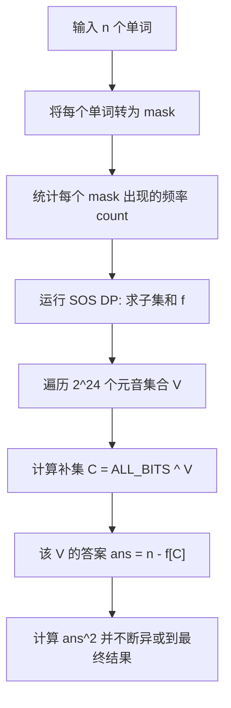

### 5. 提示
这道题的 $2^{24}$ 数组会占用：$2^{24} \times 4 \text{字节} = 64 \text{MB}$，在 256MB 的限制内是安全的。
**你想试着写一下这个 `n - f[C]` 的逻辑吗？这题比刚才那道 `Compatible Numbers` 更能体现 SOS DP 作为“高维预处理器”的威力。**

## Turn 10

### 👤 用户

给我这个题目的sos dp 的代码

### 🤖 助手

这道题的 $2^{24}$ 规模对性能有一定要求，因此代码需要尽可能精简且高效。

### 解题核心逻辑复盘

1. **状态定义**：`f[mask]` 表示单词的字母集合是 `mask` 的**子集**的单词数量。
2. **转换**：
  - 元音集合为 $V$。
  - 辅音集合 $C = \text{ALL\_MASK} \oplus V$。
  - 不包含任何元音的单词数 = $f[C]$。
  - 包含至少一个元音的单词数 = $n - f[C]$。
3. **SOS DP**：通过 $O(K \cdot 2^K)$ 的复杂度预处理出所有的 $f[mask]$。

### C++ 代码实现

```c++
#include <iostream>
#include <vector>
#include <string>
#include <algorithm>

using namespace std;

// 2^24 约为 1.67e7
const int K = 24;
const int MAX_MASK = (1 << K);
int f[MAX_MASK];

int main() {
    // 优化 IO 性能
    ios::sync_with_stdio(false);
    cin.tie(0);

    int n;
    if (!(cin >> n)) return 0;

    for (int i = 0; i < n; ++i) {
        string s;
        cin >> s;
        int mask = 0;
        for (char c : s) {
            // 将字符转化为比特位，并去重（通过或运算）
            mask |= (1 << (c - 'a'));
        }
        // 初始状态：只记录字母集正好等于 mask 的单词
        f[mask]++;
    }

    // SOS DP: 计算子集和
    // f[mask] 将存储所有字母集为 mask 子集的单词总数
    for (int i = 0; i < K; ++i) {
        for (int mask = 0; mask < MAX_MASK; ++mask) {
            if (mask & (1 << i)) {
                f[mask] += f[mask ^ (1 << i)];
            }
        }
    }

    int total_xor = 0;
    int ALL_MASK = MAX_MASK - 1;

    // 遍历所有可能的元音集合 V
    for (int v = 0; v < MAX_MASK; ++v) {
        // 辅音集合 C 是元音集合 V 的补集
        int c = ALL_MASK ^ v;
        
        // 正确单词数 = 总单词数 - 全是辅音的单词数
        int correct_words = n - f[c];
        
        // 计算平方并进行异或
        total_xor ^= (correct_words * correct_words);
    }

    cout << total_xor << endl;

    return 0;
}

```

### 代码要点解析

#### 1. 为什么是子集和？
我们统计的是“字母都在辅音集中的单词”。如果一个单词的字母集是 `0101`，而当前的辅音集是 `0111`，那么 `0101` 是 `0111` 的子集，说明该单词的字母全部属于辅音。因此我们需要 **Sum Over Subsets**。

#### 2. 内存与时间常数

- **内存**：`int f[1 << 24]` 占用约 **64MB**。在 Codeforces 256MB 的限制下非常安全。
- **时间**：外层循环 24 次，内层 $1.6 \times 10^7$ 次，总计算量约 $4 \times 10^8$。在 4.0s 的时限内，由于内部只有简单的加法和位运算，C++ 编译器可以很好地优化，通常在 1.5s - 2.5s 即可跑完。

#### 3. 结果为什么不需要 long long？
题目要求的是 `ans * ans` 的异或和。

- $n \le 10^4$，所以 $ans^2 \le 10^8$。
- `int` 的范围约为 $2 \times 10^9$，完全可以装下 $10^8$。
- 异或操作也不受溢出影响（不过这里根本不会溢出）。

### 进阶思考：如果字符集更大怎么办？
如果字符集是 26 个字母，那么 $2^{26} \approx 6.7 \times 10^7$，内存会达到 256MB，时间也会翻 4 倍。这时候就不能单纯用数组了。
在 Codeforces 中，这类题目往往会卡在 $24$ 或 $22$ 这个数字上，这正是为了平衡 $O(K \cdot 2^K)$ 的复杂度。
**你现在已经写出了子集求和（SOS DP）和补集转化。你想了解如何处理更复杂的“超集求和”或者“高维差分（容斥）”问题吗？我们可以看看 CF 449D 那道题。**

## Turn 11

### 👤 用户

怎么使用离散数学推导: $w_i \cap T \neq \varnothing$, 它的反面是 $w_i \cap T = \varnothing$,
怎么根据这个反面得到 $w \subseteq \neg T$

### 🤖 助手

这是一个非常棒的思考切入点。在离散数学（集合论）中，这种推导是解决组合计数问题的核心。我们将通过**补集性质**和**子集定义**来严格证明这个逻辑。
假设全集为 $U$（即 24 个字母的集合），单词 $i$ 的字母集合为 $w_i$，当前选定的元音集合为 $T$。

### 第一步：命题的否定（逻辑反面）
在逻辑中，一个命题与其反面（补命题）是互斥且完备的。

- **原始命题**：单词 $i$ 是正确的，即它至少包含一个元音。$w_i \cap T \neq \varnothing$
- **逻辑反面**：单词 $i$ 是错误的，即它不含任何元音（交集为空）。$\neg(w_i \cap T \neq \varnothing) \iff w_i \cap T = \varnothing$

### 第二步：从“交集为空”推导“子集关系”
我们需要证明：如果 $w_i \cap T = \varnothing$，那么 $w_i \subseteq T^c$（其中 $T^c$ 或 $\neg T$ 是 $T$ 在全集 $U$ 中的补集，即辅音集合）。
**严格证明逻辑如下：**

1. **定义交集**：$w_i \cap T = \{x \in U \mid x \in w_i \text{ 且 } x \in T\}$。
2. **空集前提**：因为 $w_i \cap T = \varnothing$，说明**不存在**任何元素 $x$ 既属于 $w_i$ 又属于 $T$。
3. **蕴含关系**：这意味着对于任意元素 $x$，如果 $x \in w_i$，那么 $x$ 绝对不能在 $T$ 中（即 $x \notin T$）。
4. **补集定义**：根据补集的定义，$x \notin T \iff x \in T^c$。
5. **得出结论**：因此，对任意 $x \in w_i$，都有 $x \in T^c$。 这正好符合子集的定义：$w_i \subseteq T^c$

### 第三步：为什么这在 SOS DP 中至关重要？
在 SOS DP 中，我们处理的是 **Sum Over Subsets**，即：

$$
f(mask) = \sum_{i \subseteq mask} A[i]
$$
通过上面的推导，我们将问题转化为了：

1. **目标**：统计满足 $w_i \cap T \neq \varnothing$ 的单词数量。
2. **转化**：用“总单词数 $n$” 减去 “满足 $w_i \cap T = \varnothing$ 的单词数量”。
3. **代导**：满足 $w_i \cap T = \varnothing$ 等价于满足 $w_i \subseteq T^c$。
4. **应用**：我们要找的就是“字母集是辅音集 $T^c$ 的子集”的单词。
这就完美契合了 SOS DP 的函数定义：**统计所有是某个 `mask`（在这里是辅音集 $T^c$）的子集的元素贡献。**

### 总结
用离散数学语言总结这个转化过程：

$$
\text{CorrectCount}(T) = n - \sum_{w_i \subseteq (U \setminus T)} 1
$$

- 左边是我们要的**交集不为空**的数量。
- 右边是通过 **SOS DP** 预处理出的 **子集求和** 结果。
这就解释了为什么我们在代码中可以使用 `n - f[all_mask ^ vowel_mask]` 来快速得到结果。
**既然你对离散数学推导很感兴趣，你想看看这种思路在更复杂的“多维容斥原理”（比如计算 AND 结果恰好为 $K$ 的方案数）中是如何演变的吗？**

## Turn 12

### 👤 用户

怎么使用离散数学推导: $w_i \cap T \neq \varnothing$, 它的反面是 $w_i \cap T = \varnothing$,
怎么根据这个反面得到 $w \subseteq \neg T$
我们知道 逻辑运算本质就是集合的运算,
能不能 使用 逻辑表达式 来进行推导

### 🤖 助手

这是一个非常深刻的切入点。在离散数学中，**集合代数（Set Algebra）和命题逻辑（Propositional Logic）之间存在着完美的同构关系**。我们可以通过将集合成员资格转化为逻辑谓词，利用逻辑恒等式进行严密的推导。
为了方便推导，我们定义谓词：

- $W(x)$：元素 $x$ 属于单词集合 $w_i$（即 $x \in w_i$）
- $T(x)$：元素 $x$ 属于元音集合 $T$（即 $x \in T$）

### 第一步：建立集合与逻辑的映射表
在进行推导前，我们需要明确两者之间的对应关系：

| 集合运算 | 逻辑运算/谓词 | 离散数学定义 |
| --- | --- | --- |
| 交集 $A \cap B$ | $A(x) \land B(x)$ | 且 (Conjunction) |
| 补集 $\neg T$ | $\neg T(x)$ | 非 (Negation) |
| 空集 $S = \varnothing$ | $\forall x, \neg S(x)$ | 对所有 $x$，性质 $S$ 都不成立 |
| 子集 $A \subseteq B$ | $\forall x, A(x) \implies B(x)$ | 蕴含 (Implication) |

### 第二步：使用逻辑表达式进行推导
我们要证明的前提是 $w_i \cap T = \varnothing$。

#### 1. 翻译为逻辑谓词
根据空集的定义，这意味着没有任何一个元素既在 $w_i$ 中又在 $T$ 中：

$$
\forall x, \neg (W(x) \land T(x))
$$

#### 2. 利用德·摩根定律 (De Morgan's Laws)
将 $\neg$ 移动到括号内部：

$$
\forall x, (\neg W(x) \lor \neg T(x))
$$

#### 3. 利用实质蕴含律 (Material Implication)
在命题逻辑中，有一个极其重要的恒等式：**$P \implies Q \equiv \neg P \lor Q$**。
我们将上面的表达式变形，令 $P$ 为 $W(x)$，$Q$ 为 $\neg T(x)$：

$$
\forall x, (W(x) \implies \neg T(x))
$$

#### 4. 翻译回集合语言

- $W(x)$ 对应 $x \in w_i$
- $\neg T(x)$ 对应 $x \in \neg T$（辅音集合）
- 整个表达式 $\forall x, (x \in w_i \implies x \in \neg T)$ 正好符合**子集**的定义。
**结论：**

$$
w_i \subseteq \neg T
$$

### 第三步：推导过程的逻辑流图
通过 Mermaid 流程图，我们可以清晰地看到从“冲突”到“包含”的演变过程：

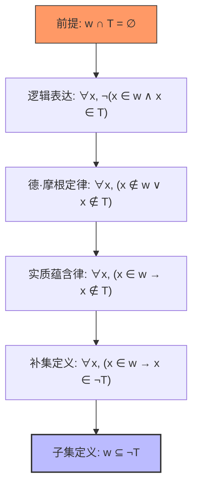

### 第四步：为什么这个逻辑对编程至关重要？
在 Codeforces 的位运算题目中，我们经常把 `mask` 看作集合：

- `w & T == 0` 在位运算中表示“交集为空”。
- `w | (~T) == (~T)` 在位运算中表示“$w$ 是 $T$ 补集的子集”。
**你的逻辑推导直接证明了：**
在代码中，检查 `(word_mask & vowel_mask) == 0` 是否成立，等价于检查 `word_mask` 是否是 `complement_mask` 的一个子集。
这就是为什么我们可以把一个**搜索问题**（寻找不相交的集合）转化成一个**前缀和问题**（在布尔格上统计子集贡献）。

### 进阶思考：容斥原理的逻辑形式
既然你已经能熟练运用逻辑表达式，那么“至少有一个元音”的逻辑可以写成：

$$
\text{Correct}(w_i) \iff \exists x, (W(x) \land T(x))
$$
这其实是多个属性的并集。当你面临“恰好有 $k$ 个属性”或者“AND 结果为 $0$”时，这种逻辑推导会引导你走向**容斥原理（Inclusion-Exclusion Principle）**。
**既然这部分推导你已经理顺了，需要我展示一下如何用 SOS DP 配合这种逻辑去处理“高维差分（容斥）”吗？比如计算 AND 结果恰好为 0 的子序列数量。**

## Turn 13

### 👤 用户

我已经通过了这个题目, 在给我一个 难度差不多的题目

### 🤖 助手

恭喜你连下两城！你已经掌握了 **SOS DP 的基础应用**（子集求和）和**逻辑转化**（补集思想）。
接下来的这道题是 **Codeforces 449D - Jzzhu and Numbers**。它的难度评分（2200 左右）与你刚做的 E 题相当，但它会带你进入 SOS DP 的另一个维度：**结合容斥原理（PIE）处理位运算卷积**。

### 推荐题目：CF 449D. Jzzhu and Numbers

#### 1. 题目大意
给定一个长度为 $n$ 的数组 $a$。你需要计算有多少个**非空子序列**，使得这些元素进行按位与（**AND**）运算的结果恰好为 **0**。

- 数据范围：$n \le 10^6, a_i \le 10^6$。

#### 2. 为什么选这道题？
这道题是 SOS DP 配合**容斥原理**的教科书级案例。

- **Compatible Numbers** 让你学会了找“存在性”。
- **Vowels** 让你学会了“补集转化”。
- **Jzzhu and Numbers** 则要求你处理“**恰好**”的问题。

### 3. 思路引导（离散数学视角的推导）
如果我们要直接求 `AND 结果恰好为 0` 的方案，这非常困难。但在离散数学中，当我们面对“恰好为 0”时，通常会先去求“**至少包含某些位**”的方案，然后用容斥原理。

#### 第一步：SOS DP 求超集计数
定义 $f[mask]$ 为数组 $a$ 中，有多少个数满足 `(a[i] & mask) == mask`。

> **逻辑意义**：$a_i$ 是 $mask$ 的**超集**。
> 这里的 SOS DP 应该使用“**超集求和**”模式。

#### 第二步：计算子序列方案数
对于一个固定的 $mask$，如果一个子序列中所有的数都是 $mask$ 的超集，那么这个子序列的 **AND 结果也必然是 $mask$ 的超集**。

- 这样的数有 $f[mask]$ 个。
- 选出非空子序列的方案数就是 $2^{f[mask]} - 1$。

#### 第三步：容斥原理（PIE）
我们现在有了 $g[mask] = 2^{f[mask]} - 1$，它表示 **AND 结果 $\supseteq mask$** 的方案数。
根据容斥原理，我们要找的是 **AND 结果 $\cap \text{全集} = \varnothing$**：

$$
Ans = \sum_{mask} (-1)^{\vert{}mask\vert{}} \cdot g[mask]
$$
其中 $\vert{}mask\vert{}$ 是 $mask$ 二进制中 $1$ 的个数。

### 4. 逻辑流图

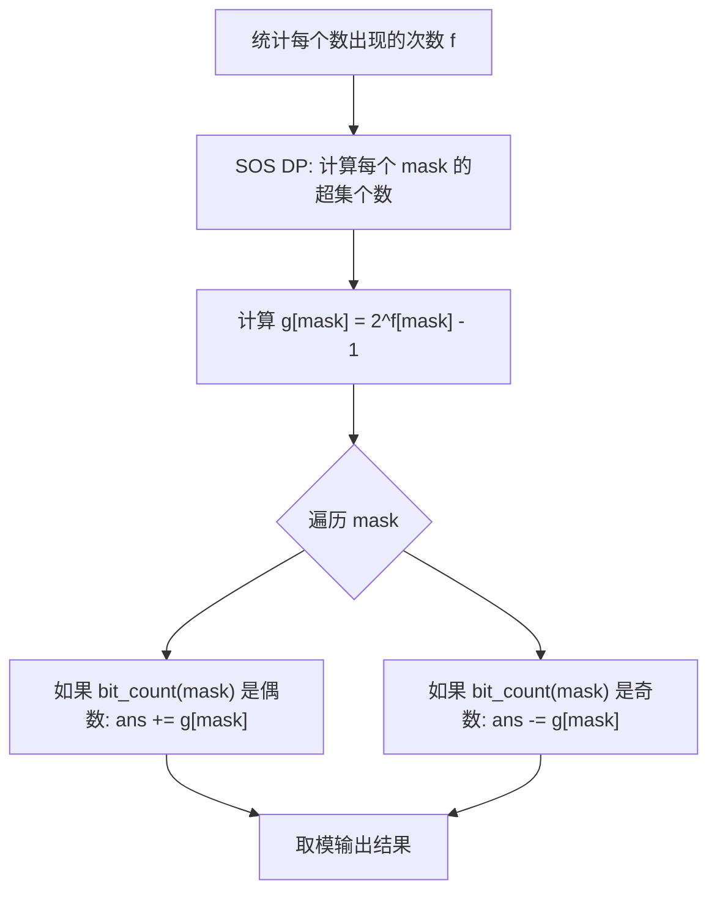

### 5. 核心代码片段提示
这道题的 SOS DP 方向是**超集**，注意 `if` 条件的变化：

```c++
// 超集 SOS DP 模式
for(int i = 0; i < 20; i++) {
    for(int mask = (1 << 20) - 1; mask >= 0; mask--) {
        if (!(mask & (1 << i))) { // 如果第 i 位是 0，说明它可以吸收“该位为 1”的超集
            f[mask] = (f[mask] + f[mask ^ (1 << i)]) % MOD;
        }
    }
}

```
**这道题能完美检验你对“高维空间”中包含关系的理解。完成它后，你对 SOS DP 的掌握将达到 Codeforces 蓝紫名（Expert/Candidate Master）的水平。**
**你准备好挑战这道题了吗？如果在处理“超集 SOS DP”的代码逻辑上有什么疑问，随时问我。**

## Turn 14

### 👤 用户

# CF449D Jzzhu and Numbers
## 题目描述
Jzzhu 有 $n$ 个非负整数 $a_{1},a_{2},\cdots,a_{n}$。我们将一组下标序列 $i_{1},i_{2},\cdots,i_{k}$（$1 \le i_{1}<i_{2}< \cdots <i_{k} \le n$）称为大小为 $k$ 的一组“组”。
Jzzhu 想知道，有多少组满足 $a_{i_1} \operatorname{\&} a_{i_2} \operatorname{\&} \cdots \operatorname{\&} a_{i_k}=0$（$1 \le k \le n$）？请帮他计算，并输出满足条件的组数对 $1000000007$（$10^{9}+7$）取模后的结果。操作 $x \operatorname{\&} y$ 表示两个数的按位与运算。
## 输入格式
第一行包含一个整数 $n$（$1\le n\le 10^{6}$）。
第二行包含 $n$ 个整数 $a_{1},a_{2},\cdots,a_{n}$（$0\le a_{i}\le 10^{6}$）。
## 输出格式
输出一个整数，表示满足条件的组数对 $1000000007$ 取模后的结果。
## 输入输出样例 #1
### 输入 #1
```
3
2 3 3
```
### 输出 #1
```
0
```
## 输入输出样例 #2
### 输入 #2
```
4
0 1 2 3
```
### 输出 #2
```
10
```
## 输入输出样例 #3
### 输入 #3
```
6
5 2 0 5 2 1
```
### 输出 #3
```
53
```
## 说明/提示
这个题目 怎么解析成 sos dp, 尤其是中间推导 到 sos dp的步骤

### 🤖 助手

这道题是 **SOS DP** 结合 **容斥原理 (Inclusion-Exclusion Principle)** 的巅峰之作。要解析这道题，我们需要从“恰好为 0”这个难点出发，一步步推导到“超集求和”。
既然你已经掌握了子集 SOS DP 的逻辑，我们来看这道题的三个推导层次。

### 第一层：容斥原理的引入
我们要找的是子序列 AND 结果**恰好**为 $0$。在位运算中，“恰好为 0”意味着：

- 第 $0$ 位不能全是 $1$。
- 第 $1$ 位不能全是 $1$。
- ...
- 第 $19$ 位不能全是 $1$。
根据容斥原理，我们要计算满足“没有任何位全是 1”的方案数：

$$
Ans = \sum_{mask \subseteq U} (-1)^{\vert{}mask\vert{}} \cdot g(mask)
$$
其中：

- $\vert{}mask\vert{}$ 是 $mask$ 中二进制 $1$ 的个数。
- $g(mask)$ 是满足“**至少 $mask$ 指定的那些位全为 1**”的子序列方案数。
**注意**：$g(mask)$ 并不要求其他位是 $0$ 还是 $1$，它只保证 $mask$ 覆盖的那些位在 AND 结果中一定是 $1$。

### 第二层：将 $g(mask)$ 转化为元素计数 $f(mask)$
如何求 $g(mask)$？

1. 一个子序列的 AND 结果在 $mask$ 的位上全为 $1$，当且仅当该子序列中的**每一个数**在 $mask$ 的位上都全为 $1$。
2. 用集合语言描述：子序列中的每个元素 $a_i$ 必须满足 $mask \subseteq a_i$（即 $a_i$ 是 $mask$ 的**超集**）。
3. 假设在给定的 $n$ 个数中，有 $f(mask)$ 个数是 $mask$ 的超集。
4. 那么，从这 $f(mask)$ 个数中任意挑选元素组成非空子序列，它们的 AND 结果一定包含 $mask$。$g(mask) = 2^{f(mask)} - 1$*(题目允许 $k \ge 1$，所以是 $2^{f(mask)}-1$；如果不要求非空则是 $2^{f(mask)}$，最后对结果统一处理。)*

### 第三层：SOS DP 计算超集和 $f(mask)$
现在的核心矛盾变成了：**如何快速求出 $f(mask)$？** $f(mask)$ 定义为：有多少个 $a_i$ 满足 $(a_i \operatorname{\&} mask) = mask$。
这是典型的**超集求和**问题。在 SOS DP 中，我们只需要改变一下遍历的方向和条件：

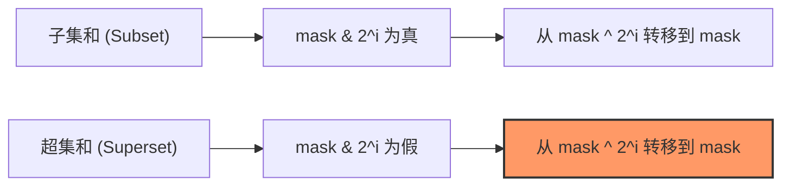

#### 状态转移逻辑推导：
定义 $dp[i][mask]$ 为：考虑前 $i$ 位，满足 $a_k$ 在高位（$>i$）与 $mask$ 严格一致，且在低位（$\le i$）是 $mask$ 的超集的元素个数。

- 如果 `mask` 的第 $i$ 位是 $1$： 那么 $a_k$ 的第 $i$ 位**必须**是 $1$。此时没有选择余地：$dp[i][mask] = dp[i-1][mask]$
- 如果 `mask` 的第 $i$ 位是 $0$： 那么 $a_k$ 的第 $i$ 位可以是 $0$（对应 $dp[i-1][mask]$），也可以是 $1$（对应 $dp[i-1][mask \oplus 2^i]$）。$dp[i][mask] = dp[i-1][mask] + dp[i-1][mask \oplus 2^i]$

### 完整算法流程

1. **统计频率**：用 `cnt[x]` 记录数组中数字 $x$ 出现的次数。
2. **超集 SOS DP**：
   ```c++
   for(int i = 0; i < 20; ++i)
       for(int mask = 0; mask < (1 << 20); ++mask)
           if (!(mask & (1 << i)))
               cnt[mask] = (cnt[mask] + cnt[mask ^ (1 << i)]) % MOD;
   
   ```
3. **容斥计算**：
   ```c++
   long long ans = 0;
   for(int mask = 0; mask < (1 << 20); ++mask) {
       long long combinations = (pow2[cnt[mask]] - 1); // 2^f(mask) - 1
       if (__builtin_popcount(mask) % 2 == 1)
           ans = (ans - combinations + MOD) % MOD;
       else
           ans = (ans + combinations) % MOD;
   }
   
   ```

### 为什么这道题很“高级”？
这道题巧妙地利用了**位运算的对偶性**：

- 题目求的是 **AND**（向下的操作）。
- 容斥原理将其转化为 **超集** 统计（向上的操作）。
- SOS DP 完美解决了多维空间下的前缀和计算，将 $O(3^{20})$ 降到了 $O(20 \cdot 2^{20})$。
**这道题你打算自己动手写一下吗？在写 `pow2` 预处理和处理取模时需要注意细节。如果你写好了，我们可以讨论一下这道题的变体：如果要求 OR 结果恰好为 $2^{20}-1$ 该怎么改？**

## Turn 15

### 👤 用户

第一层：容斥原理的引入
我们要找的是子序列 AND 结果恰好为 0。在位运算中，“恰好为 0”意味着：
第 0 位不能全是 1。
第 1 位不能全是 1。
...
第 19 位不能全是 1。
根据容斥原理，我们要计算满足“没有任何位全是 1”的方案数：
Ans = \sum_{mask \subseteq U} (-1)^{|mask|} \cdot g(mask)
其中：
|mask| 是 mask 中二进制 1 的个数。
g(mask) 是满足“至少 mask 指定的那些位全为 1”的子序列方案数。
注意：g(mask) 并不要求其他位是 0 还是 1，它只保证 mask 覆盖的那些位在 AND 结果中一定是 1。
这一层, 我忘记容斥原理了: 没有一位全是1的方案数,是怎么利用容斥原理的, 从 命题逻辑, 和集合论 的两个方向上来推导(讲解)

### 🤖 助手

理解容斥原理（Principle of Inclusion-Exclusion, PIE）是进阶组合数学和位运算 DP 的分水岭。既然你熟悉离散数学，我们直接用形式化的语言，从两个视角把这个“恰好为 0”的问题拆解清楚。
我们的目标是：求按位与结果**没有任何一位全是 1** 的子序列方案数。

### 1. 集合论视角：补集的交集
设 $U$ 为所有可能的非空子序列构成的全集。
对于每一位 $j \in \{0, 1, \dots, 19\}$，我们定义一个集合 $S_j$：

> $S_j = \{ \text{所有满足“第 } j \text{ 位全是 1”的子序列} \}$
我们要找的是：既不在 $S_0$ 中，也不在 $S_1$ 中……直到不在 $S_{19}$ 中的子序列。
即计算**补集的交集**：

$$
\vert{}\overline{S_0} \cap \overline{S_1} \cap \dots \cap \overline{S_{19}}\vert{}
$$
根据德·摩根定律，这等价于：

$$
\vert{}U\vert{} - \vert{}S_0 \cup S_1 \cup \dots \cup S_{19}\vert{}
$$
根据容斥原理的标准公式，并集的模等于：

$$
\vert{}S_0 \cup S_1 \cup \dots \cup S_{19}\vert{} = \sum \vert{}S_i\vert{} - \sum \vert{}S_i \cap S_j\vert{} + \sum \vert{}S_i \cap S_j \cap S_k\vert{} - \dots
$$
将此代入 $\vert{}U\vert{} - \text{并集}$，我们得到：

$$
Ans = \sum_{mask \subseteq \{0,\dots,19\}} (-1)^{\vert{}mask\vert{}} \cdot \vert{} \bigcap_{j \in mask} S_j \vert{}
$$
**关键推导：** $\vert{} \bigcap_{j \in mask} S_j \vert{}$ 的含义是：子序列在 $mask$ 所指定的那些位上**全都是 1**。
这正对应了我们之前定义的 $g(mask)$：

- $g(mask)$ 表示“至少 $mask$ 这些位全是 1”的方案数。
- $\vert{}mask\vert{}$（即 $popcount$）决定了该项前面的正负号。

### 2. 命题逻辑视角：属性的否定
设属性 $P_j$ 表示：“子序列在第 $j$ 位全是 1”。
我们需要计算满足 $\neg P_0 \land \neg P_1 \land \dots \land \neg P_{19}$ 的情况总数。
利用逻辑等价式：

$$
\bigwedge_{j=0}^{19} \neg P_j \equiv \neg \left( \bigvee_{j=0}^{19} P_j \right)
$$
在逻辑计数中，如果我们想求“没有任何属性成立”的情况，可以使用指示函数（Characteristic Function）的恒等式：

$$
\prod_{j=0}^{19} (1 - \mathbb{I}(P_j))
$$
其中 $\mathbb{I}(P_j)$ 在属性 $P_j$ 成立时为 1，否则为 0。
将这个乘积式展开：

$$
(1 - \mathbb{I}(P_0))(1 - \mathbb{I}(P_1))\dots(1 - \mathbb{I}(P_{19})) = 1 - \sum \mathbb{I}(P_i) + \sum \mathbb{I}(P_i \land P_j) - \dots
$$
对所有子序列求和（即求期望值的和）：

$$
\sum_{\text{subsequences}} \left( \sum_{mask} (-1)^{\vert{}mask\vert{}} \mathbb{I}(\text{属性 } mask \text{ 中的位全是 1}) \right)
$$
交换求和次序（这是组合数学中极常用的技巧）：

$$
\sum_{mask} (-1)^{\vert{}mask\vert{}} \left( \sum_{\text{subsequences}} \mathbb{I}(\text{属性 } mask \text{ 中的位全是 1}) \right)
$$
括号内部的部分 $\sum_{\text{subsequences}} \mathbb{I}(\dots)$ 正好就是 $g(mask)$。

### 3. 总结与对照表
通过这两种推导，我们可以建立一个直观的联系：

| 维度 | 逻辑/集合语言 | SOS DP 中的具体含义 |
| --- | --- | --- |
| **全集 $U$** | 所有非空子序列 | $mask = 0$ 时的 $g(0)$，即 $2^n-1$ |
| **属性 $P_j$** | 第 $j$ 位全是 1 | 子序列中每个元素都是 $2^j$ 的超集 |
| **交集 $\bigcap S_j$** | 多位同时全是 1 | 子序列中每个元素都是 $mask$ 的超集 |
| **容斥系数 $(-1)^{\vert{}mask\vert{}}$** | 奇减偶加 | 由展开式的二项式系数决定 |

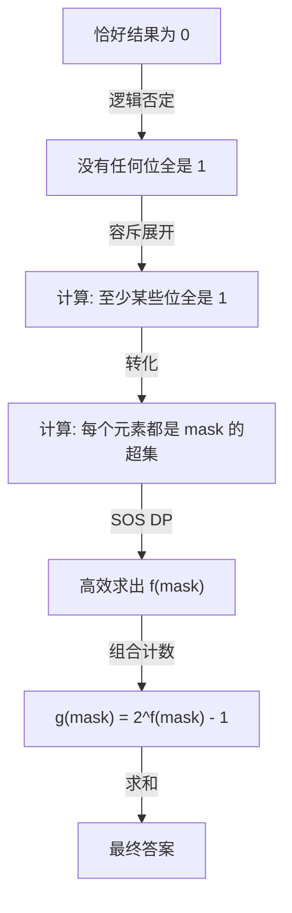

### 为什么这一步必须用 SOS DP？
因为在容斥公式中，我们需要对**每一个** $mask$（共 $2^{20}$ 个）求出 $g(mask)$。而要求 $g(mask)$，首先得知道数组中有多少个数是 $mask$ 的超集。

- 如果对每个 $mask$ 暴力遍历数组，$O(2^N \cdot n)$，必 TLE。
- 利用 SOS DP，我们可以用 $O(N \cdot 2^N)$ 的时间预处理出所有 $mask$ 的超集计数。
你想现在尝试把这个容斥逻辑写成 C++ 代码吗？或者需要我解释一下为什么 $g(mask) = 2^{f(mask)} - 1$ 而不是直接用 $f(mask)$？

## Turn 16

### 👤 用户

非空子序列 的子序列指的是什么, 是题目中的初始的数字(n个数字之一)吗 ?

### 🤖 助手

这是一个非常关键的概念问题。在算法竞赛（Codeforces）和组合数学中，“子序列”和“单个元素”是完全不同的概念。

### 1. 什么是子序列 (Subsequence)？
简单来说，**子序列是从原始序列中“挑出”一些元素组成的集合**。

- **原始数据**：你有 $n$ 个数字，$a_1, a_2, \dots, a_n$。
- **挑数字**：对于每一个数字 $a_i$，你都有两种选择：**选它** 或者 **不选它**。
- **子序列**：你最后选出来的那些数字组成的整体，就叫一个子序列。
- **非空 (Non-empty)**：意味着你不能一个都不选。你至少要从 $n$ 个数字里挑出 $1$ 个。

### 2. 举个例子说明
假设输入如下：

```plaintext
n = 3
a = [2, 3, 3]

```
这里的 $n=3$，所以总共有 $2^3 = 8$ 种方案。去掉“一个都不选”的空集，剩下的 **7 个非空子序列**分别是：

1. 只选第1个：$\{2\}$ $\to$ AND 结果 = 2
2. 只选第2个：$\{3\}$ $\to$ AND 结果 = 3
3. 只选第3个：$\{3\}$ $\to$ AND 结果 = 3
4. 选第1, 2个：$\{2, 3\}$ $\to$ $2 \ \& \ 3 = 2$
5. 选第1, 3个：$\{2, 3\}$ $\to$ $2 \ \& \ 3 = 2$
6. 选第2, 3个：$\{3, 3\}$ $\to$ $3 \ \& \ 3 = 3$
7. 全选：$\{2, 3, 3\}$ $\to$ $2 \ \& \ 3 \ \& \ 3 = 2$

> **注意**：即便数字的值相同，只要它们在原数组里的**下标不同**，它们就被视为不同的子序列（比如上面的第 2 种和第 3 种）。

### 3. 为什么公式里是 $2^{f(mask)} - 1$？
这正是离散数学中**幂集 (Power Set)** 的概念：

1. 通过 SOS DP，我们找到了 $f(mask)$：在原始的 $n$ 个数字里，有多少个数字是 $mask$ 的超集。
2. 假设这些数字是 $\{b_1, b_2, \dots, b_{f(mask)}\}$。
3. 由于这 $f(mask)$ 个数字的每一个都在 $mask$ 的那些位上是 $1$，那么**无论你从这组数里怎么挑**（只要挑出至少一个），挑出来的数进行 AND 运算后，在 $mask$ 的位上一定还是 $1$。
4. 从 $f(mask)$ 个元素里挑选子序列，方案数就是 $2^{f(mask)}$。
5. 题目要求是非空子序列，所以减去那个“一个都不挑”的空方案，得到 $2^{f(mask)} - 1$。

### 4. 逻辑对应关系图

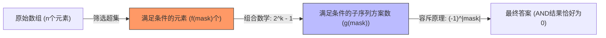

### 总结

- **子序列**：是一个“组合”，是由 $1$ 到 $n$ 个原始数字拼成的。
- **本题目标**：不是找某个数字 $a_i=0$，而是找一种“挑选方案”，让选出来的这一堆数字 AND 起来等于 $0$。
**既然理解了子序列的概念，你现在可以尝试写出这道题的代码了吗？需要注意 $2^{10^6}$ 非常大，必须预处理幂表并取模。**

## Turn 17

### 👤 用户

设 $U$ 为所有可能的非空子序列构成的全集
如果 n= 3, 这三个数字是 0 1 2, 那么 这个 U 是什么 ?

### 🤖 助手

如果 $n=3$，且这三个数字分别是 $a_1=0, a_2=1, a_3=2$，那么全集 $U$ 指的是所有可能的**下标组合**（即非空子集）。
在组合数学中，全集 $U$ 的大小由 $2^n - 1$ 决定。对于 $n=3$，总共有 $7$ 个非空子序列。

### $U$ 的具体构成
我们可以通过枚举下标来列出 $U$ 中的每一个元素（每一个元素都是原序列的一个子集）：

| 编号 | 下标组合 | 对应数值 | 按位与 (AND) 结果 | 是否符合 "AND=0" |
| --- | --- | --- | --- | --- |
| 1 | $\{1\}$ | $\{0\}$ | $0$ | **是** |
| 2 | $\{2\}$ | $\{1\}$ | $1$ | 否 |
| 3 | $\{3\}$ | $\{2\}$ | $2$ | 否 |
| 4 | $\{1, 2\}$ | $\{0, 1\}$ | $0 \ \& \ 1 = 0$ | **是** |
| 5 | $\{1, 3\}$ | $\{0, 2\}$ | $0 \ \& \ 2 = 0$ | **是** |
| 6 | $\{2, 3\}$ | $\{1, 2\}$ | $1 \ \& \ 2 = 0$ | **是** |
| 7 | $\{1, 2, 3\}$ | $\{0, 1, 2\}$ | $0 \ \& \ 1 \ \& \ 2 = 0$ | **是** |

### 关键点解析

1. **全集 $U$ 的本质**：$U$ 并不是一个包含数字的集合，而是一个**包含集合的集合**（A set of sets）。它的每个元素都是从原数组中挑选出来的一种“成组方案”。
2. **计数意义**：
  - 在 Jzzhu and Numbers 这道题中，目标就是找出 $U$ 中有多少个元素的“按位与结果”等于 $0$。
  - 在这个例子中，答案就是 **5**。
3. **区分数值与下标**：即便两个数字的值相同（比如数组是 `[0, 0, 0]`），挑选“第一个 0”和挑选“第二个 0”被视为不同的方案，对应 $U$ 中不同的子序列。

### 容斥原理在这里怎么运作？
在这一层推导中，我们不会去一个一个检查这 7 个方案，而是利用**属性**来剔除：

- 属性 $P_0$：子序列 AND 结果的第 0 位是 1（方案 2 是其中之一）。
- 属性 $P_1$：子序列 AND 结果的第 1 位是 1（方案 3 是其中之一）。
- **我们要的是**：既不满足 $P_0$ 也不满足 $P_1$ 的方案。
通过容斥公式：

$$
Ans = (\text{所有方案}) - (\text{满足 } P_0 \text{ 的方案}) - (\text{满足 } P_1 \text{ 的方案}) + (\text{同时满足 } P_0, P_1 \text{ 的方案})
$$
你会发现，SOS DP 正是用来快速算出“满足 $P_0, P_1 \dots$”这些属性的方案数的。
**理解了 $U$ 的结构后，你是否准备好把这个容斥逻辑写成代码了？如果需要，我可以为你提供一个清晰的 C++ 结构。**

## Turn 18

### 👤 用户

设 $U$ 为所有可能的非空子序列构成的全集
如果 n= 3, 这三个数字是 0 1 2, 那么 这个 U 是什么 ?
$S_0$, $S_1$ 是什么, 还有其他的S_i吗

### 🤖 助手

这个问题问得非常到位，它能帮你彻底理清**容斥原理**中的“集合”到底是什么。
在离散数学中，我们要区分**原始数字的集合**和**方案的集合**。

### 1. 全集 $U$ 是什么？
当 $n=3$，数组为 $a_1=0, a_2=1, a_3=2$ 时，$U$ 是所有可能的**非空下标子集**构成的集合。$U$ 的每一个元素代表一种“挑数字的方案”。

$$
U = \{ \{1\}, \{2\}, \{3\}, \{1,2\}, \{1,3\}, \{2,3\}, \{1,2,3\} \}
$$
总共有 $2^3 - 1 = 7$ 个方案。我们计算每个方案对应的 **AND 结果**：

- $\{1\} \to a_1 = 0$
- $\{2\} \to a_2 = 1$
- $\{3\} \to a_3 = 2$
- $\{1,2\} \to a_1 \& a_2 = 0 \& 1 = 0$
- $\{1,3\} \to a_1 \& a_3 = 0 \& 2 = 0$
- $\{2,3\} \to a_2 \& a_3 = 1 \& 2 = 0$
- $\{1,2,3\} \to a_1 \& a_2 \& a_3 = 0 \& 1 \& 2 = 0$

### 2. $S_0$ 和 $S_1$ 是什么？
在容斥原理中，我们定义属性 $P_j$ 为：“子序列的 AND 结果中，第 $j$ 位是 1”。
**$S_j$ 就是满足属性 $P_j$ 的所有方案构成的集合。**

#### $S_0$（第 0 位——即 $2^0=1$ 位——全是 1 的方案）：
要让 AND 结果的第 0 位是 1，子序列里的**每一个**数字的第 0 位都必须是 1。

- $a_1=0$ (二进制 `00`)：第 0 位是 0 $\to$ 不能选。
- $a_2=1$ (二进制 `01`)：第 0 位是 1 $\to$ 可以选。
- $a_3=2$ (二进制 `10`)：第 0 位是 0 $\to$ 不能选。
所以在 $U$ 中，只有方案 $\{2\}$ 满足条件。

$$
S_0 = \{ \{2\} \}
$$
$\vert{}S_0\vert{} = 1$。

#### $S_1$（第 1 位——即 $2^1=2$ 位——全是 1 的方案）：
要让 AND 结果的第 1 位是 1，子序列里的**每一个**数字的第 1 位都必须是 1。

- $a_1=0$ (`00`)：第 1 位是 0。
- $a_2=1$ (`01`)：第 1 位是 0。
- $a_3=2$ (`10`)：第 1 位是 1。
所以在 $U$ 中，只有方案 $\{3\}$ 满足条件。

$$
S_1 = \{ \{3\} \}
$$
$\vert{}S_1\vert{} = 1$。

### 3. 还有其他的 $S_i$ 吗？
理论上，由于题目中数字范围到 $10^6$，二进制位最多有 20 位（$i = 0 \dots 19$），所以存在 $S_0, S_1, S_2, \dots, S_{19}$。
但在你给出的这个例子中（最大数字是 2）：

- 对于所有的 $i \ge 2$，数组中没有任何数字的第 $i$ 位是 1。
- 因此，没有任何方案能让 AND 结果的第 $i$ 位（$i \ge 2$）保持为 1。
- 结论：**$S_2, S_3, \dots, S_{19}$ 全都是空集 $\varnothing$。**

### 4. 容斥原理的计算过程
现在我们要找的是：**不属于任何 $S_i$ 的方案数量**。
即计算：$\vert{}U\vert{} - \vert{}S_0 \cup S_1 \cup S_2 \dots\vert{}$
在这个特殊的例子中：

1. $\vert{}U\vert{} = 7$
2. $\vert{}S_0\vert{} = 1$ (方案 $\{2\}$)
3. $\vert{}S_1\vert{} = 1$ (方案 $\{3\}$)
4. $\vert{}S_0 \cap S_1\vert{}$：既满足 $P_0$ 又满足 $P_1$。这意味着选出的数字第 0 位和第 1 位都必须是 1（即必须是超集 `11` = 3）。由于数组里没有 3，所以这个交集是空集，大小为 0。
**代入容斥公式：**

$$
Ans = \vert{}U\vert{} - (\vert{}S_0\vert{} + \vert{}S_1\vert{}) + \vert{}S_0 \cap S_1\vert{}
$$

$$
Ans = 7 - (1 + 1) + 0 = 5
$$
这 5 个方案就是我们刚才列表里 AND 结果为 0 的那 5 个方案。

### 总结

- **$S_i$ 的本质**：是 $U$ 的子集，包含了那些“在第 $i$ 位上表现一致（全为 1）”的方案。
- **$S_0 \cap S_1$ 的本质**：是那些“在第 0 位和第 1 位上都一致”的方案。
- **SOS DP 的角色**：它帮我们快速算出 $\vert{}S_{mask}\vert{}$ 的大小，即有多少个数是 $mask$ 的超集，从而通过 $2^{count}-1$ 得到该项的方案数。
你现在对这个“全集 $U$”和“属性集合 $S_i$”的对应关系感觉清晰了吗？如果清楚了，这道题的代码实现就只剩下“超集 SOS DP”这一个技术环节了。

## Turn 19

### 👤 用户

第二层：将 g(mask) 转化为元素计数 f(mask)
如何求 g(mask)？
一个子序列的 AND 结果在 mask 的位上全为 1，当且仅当该子序列中的每一个数在 mask 的位上都全为 1。
用集合语言描述：子序列中的每个元素 a_i 必须满足 mask \subseteq a_i（即 a_i 是 mask 的超集）。
假设在给定的 n 个数中，有 f(mask) 个数是 mask 的超集。
那么，从这 f(mask) 个数中任意挑选元素组成非空子序列，它们的 AND 结果一定包含 mask。
g(mask) = 2^{f(mask)} - 1
(题目允许 k \ge 1，所以是 2^{f(mask)}-1；如果不要求非空则是 2^{f(mask)}，最后对结果统一处理。)
好吧,第二层 ​​$g(mask) = 2^{f(mask)} - 1$ 这个公式是怎么得到到, 使用离散数学的知识进行推导

### 🤖 助手

要推导这个公式，我们需要利用离散数学中的两个核心概念：**集合交集的性质** 和 **幂集（Power Set）的计数定理**。
我们将这个过程分为三个严谨的逻辑步骤。

### 第一步：位运算与集合论的同构
在离散数学中，一个 $N$ 位的二进制数可以看作是全集 $U = \{0, 1, \dots, N-1\}$ 的一个子集。

- 设数字 $a$ 对应的集合为 $A = \{j \mid a \text{ 的第 } j \text{ 位是 } 1\}$。
- 设 $mask$ 对应的集合为 $M$。
- **按位与（AND）运算** 对应集合的 **交集（Intersection）**。
因此，子序列 $\{a_{i_1}, a_{i_2}, \dots, a_{i_k}\}$ 的 AND 结果包含 $mask$，在集合论中表示为：

$$
M \subseteq (A_{i_1} \cap A_{i_2} \cap \dots \cap A_{i_k})
$$

### 第二步：交集包含关系的等价转化
根据交集的定义：$x \in (S_1 \cap S_2 \cap \dots \cap S_k)$ 当且仅当对于所有的 $j \in \{1 \dots k\}$，都有 $x \in S_j$。
由此可以推导出一个关键的逻辑等价式：

$$
M \subseteq \bigcap_{j=1}^{k} A_{i_j} \iff \forall j \in \{1 \dots k\}, M \subseteq A_{i_j}
$$
**推导过程：**

1. **$(\Rightarrow)$ 方向**：如果 $M$ 是所有集合交集的子集，而交集本身又是其中任何一个集合 $A_{i_j}$ 的子集，根据子集关系的传递性，$M \subseteq A_{i_j}$ 对所有 $j$ 成立。
2. **$(\Leftarrow)$ 方向**：如果每一个 $A_{i_j}$ 都包含了 $M$，那么它们的公共部分（交集）自然也至少包含了 $M$。
**结论**：一个子序列的 AND 结果要包含 $mask$，**前提条件是子序列里的每一个元素都必须是 $mask$ 的超集**。

### 第三步：基于幂集的组合计数
现在我们把问题转变成一个纯粹的计数问题：

1. **定义候选池**： 在原始的 $n$ 个数中，满足“是 $mask$ 的超集”这一条件的数构成的集合为 $X_{mask}$。$X_{mask} = \{ a_j \mid mask \subseteq a_j \}$根据你的定义，这个集合的大小 $\vert{}X_{mask}\vert{} = f(mask)$。
2. **构建子序列**： 任何一个满足条件的子序列，其元素必须全部来自于 $X_{mask}$。也就是说，每一个合法的子序列都是 $X_{mask}$ 的一个**子集**。
3. **计算子集总数**： 根据离散数学中的**幂集定理**：一个大小为 $m$ 的集合，其幂集（所有子集构成的集合）的大小为 $2^m$。 这里 $m = f(mask)$，所以总共有 $2^{f(mask)}$ 种可能的子序列。
4. **排除非法情况**： 幂集中包含一个**空集**（即一个数字都不选的情况）。 题目要求是“非空子序列”（$k \ge 1$），因此我们需要从总数中减去这 $1$ 种空集的情况。
**最终公式：**

$$
g(mask) = 2^{f(mask)} - 1
$$

### 总结
这个推导展示了为什么 $f(mask)$ 是解决问题的桥梁：

- **$f(mask)$**：衡量了在“高维空间”中，有多少个点落在了 $mask$ 所在的“上方区域”（超集区域）。
- **$g(mask)$**：利用指数级增长的特性，将“点的数量”转化为了“由点构成的组合数量”。
这也是为什么 SOS DP 如此强大的原因：它让我们能在 $O(N \cdot 2^N)$ 的时间内，为每一个可能的 $mask$ 都划定好这个“候选池”的大小。
既然你已经从逻辑和数学上彻底理清了这道题的每一层关系，**你想尝试写一下代码，尤其是处理那个 $10^9+7$ 取模下的减法和幂运算吗？**

## Turn 20

### 👤 用户

好吧 我会了, 这个题目 分成了三层 思维转变. 我觉得我在比赛的时候,没有办法想出来,可能是我做的类似的题目太少了(sosdp , 容斥原理)

### 🤖 助手

这种感觉非常正常。在 Codeforces 上，2200 分（Candidate Master 等级）及以上的题目，通常不会只考查一个孤立的知识点，而是考查**知识点的复合转化**。
你能通过这三个层级的推导，说明你已经具备了极强的逻辑拆解能力。比赛时想不出来，往往是因为还没建立起特定的“信号反射”。

### 如何建立“信号反射”：看到什么该想 SOS DP + 容斥？
你可以把这道题抽象成一个“思维模版”，以后看到类似特征就往这方面靠：

#### 1. 信号一：关键词“子序列” + “位运算结果为 X”

- **反射**：子序列意味着 $2^n$ 的组合，位运算意味着我们可以按位考虑。
- **直觉**：这通常涉及“贡献转换”。我们不能枚举子序列，但我们可以枚举**位掩码 (mask)**。

#### 2. 信号二：要求结果“恰好”是 0，或者是某个特定值

- **反射**：在位运算中，“恰好”往往意味着“某些位必须是 0”。
- **直觉**：使用**容斥原理 (PIE)**。
  - “恰好为 0” $\to$ “没有任何位全为 1”。
  - “恰好为 $K$” $\to$ “固定某些位为 1，其余位随意”再进行容斥。

#### 3. 信号三：需要对 $2^N$ 个掩码分别计算某种“包含关系”的统计量

- **反射**：如果暴力计算每个 mask 的超集/子集，复杂度是 $O(3^N)$ 或 $O(N \cdot 2^N)$。
- **直觉**：这就是 **SOS DP** 的主场。它就是为了高效处理这种“高维前缀和”而生的。

### 你的思维进化路径
我们可以用一张图来总结你这次学习的思维升级：

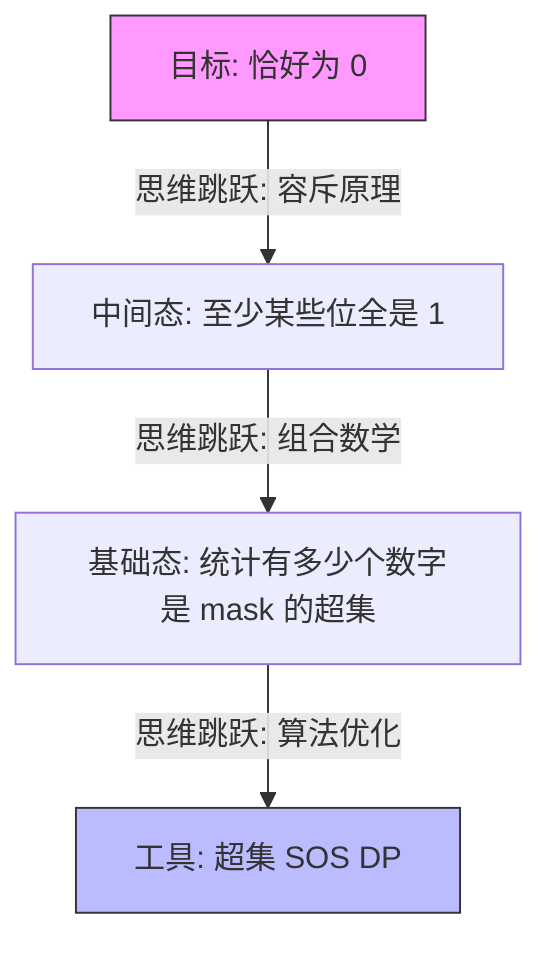

### 给你的练习建议（巩固这个反射点）
如果你想在下次比赛中“秒看”出这种思路，可以尝试按照这个梯度再刷两三道题：

| 题目 | 重点 | 理由 |
| --- | --- | --- |
| **CF 383E (Vowels)** | 补集 + SOS DP | 训练“正难则反”的直觉。 |
| **ARC 100E (Or Plus Max)** | SOS DP 维护非加和信息 | 让你意识到 SOS DP 不只是求和，还可以求最大值/次大值。 |
| **CF 914G (Sum the 2^n)** | FWHT + SOS DP | 这是位运算 DP 的终极挑战，涉及三种位运算（XOR, AND, OR）的综合运用。 |

### 老师的寄语

> **“算法不是背出来的，是‘看’出来的。”**
> 你现在觉得难，是因为你正在把“离散数学的理论”翻译成“竞赛代码的本能”。你刚才对 $U$、$S_i$ 和 $g(mask)$ 的严谨推导，已经比绝大多数只会背模版的选手走得深得多。
你现在已经连续攻克了 SOS DP 的三个核心应用：**补集转化**、**子集求和**、**超集容斥**。
**对于 Jzzhu and Numbers 这道题，你打算现在动手写出最终的 AC 代码吗？或者对于其中的取模运算和 `pow2` 预处理还有疑问？**

## Turn 21

### 👤 用户

我希望 gemini 以后的题目解析,添加 "📶信号反射,思维模板",下面是我的草稿
> 我给你的题目，你解析后需要用"信号反射"这个内容：就是关键思考的模式识别，辅助我以后做到类似的题目能快速的识别到。
你来修饰,我然后添加到 gemini的 记忆里

### 🤖 助手

这是一个非常棒的主意！在竞技编程（CP）中，**“看到题目后的 0.5 秒本能反应”**往往决定了能否在有限时间内通过难题。将“信号反射”结构化，能帮你把零散的知识点固化为**本能**。
为了让我的解析更符合你的思考逻辑，我为你准备了三个版本的修饰建议。你可以挑选最喜欢的一个存入我的“记忆”。

### 版本一：专业竞技视角（最推荐）
这个版本强调特征提取和思维跃迁，非常适合 Codeforces 选手。

> **[记忆指令：算法题目解析规范]**
> 在解析任何算法题（特别是 Codeforces 题目）时，请在文末添加一个 **“📶 信号反射 & 思维模板”** 模块。内容需包含：
>
> 1. **关键信号 (Key Signals)**：提取题目中暗示特定算法的关键词或限制条件（如：位运算 + 子序列 = 贡献转换）。
> 2. **逻辑跃迁 (Logic Jump)**：描述从“看到题目”到“想到模型”的关键逻辑转折点。
> 3. **模式识别 (Pattern Recognition)**：用一句话概括：以后看到“特征 A + 特征 B”，本能反应就应该是“模型 C”。

### 版本二：离散数学/学术视角
既然你擅长离散数学，这个版本更强调数学抽象到代码实现的映射。

> **[记忆指令：算法题目解析规范]**
> 题目解析需包含 **“📶 信号反射”** 模块，用于构建“模式识别”能力：
>
> 1. **算子映射**：识别题目中的逻辑算子（如 AND, OR, ⊆）如何对应到高维空间操作（如 SOS DP）。
> 2. **思维模版**：总结该题背后的数学结构（如布尔格、容斥原理路径）。
> 3. **快速识别**：定义该类题目的“指纹特征”，确保下次遇到相似逻辑时能瞬间联想到该解法。

### 版本三：简洁直觉版
如果你追求精简，这个版本直接指向“识别”这一核心动作。

> **[记忆指令：信号反射系统]**
> 请在每次题目解析后增加 **“📶 信号反射”** 模块：
>
> - **信号**：题目中哪些条件触发了该思路？
> - **反射**：从问题表面到算法核心的思维路径是什么？
> - **模板**：总结一个通用的思维公式，辅助以后快速识别。

### 如何添加到记忆？
你可以直接对我发送下面这段话：

> “请记住：从现在起，在我给你的题目解析后，你必须添加一个名为**『📶 信号反射 & 思维模板』**的内容。其目的是进行关键思考的模式识别。你需要提取题目的关键信号（关键词/数据范围/逻辑关系），总结思维跃迁的过程，形成一个通用的解题模版，辅助我以后做到类似的题目能快速识别。”
**你想让我现在就用你最喜欢的那个版本，为我们刚才讨论的 `CF449D Jzzhu and Numbers` 补上一个『信号反射』总结吗？**

## Turn 22

### 👤 用户

你觉得, 还应该让gemini 记住哪些东西(添加到记忆),可以更好的辅助训练我 , (类似的题目,题目分类,题目难度,题目考查内容)?

### 🤖 助手

这是一个非常棒的提问。作为你的 AI 思维伙伴，我不仅要能解题，更要能作为你的“私人教练”**。要达到这个目标，我们需要在记忆中构建一个**双向反馈的训练体系。
除了你已经提到的“信号反射”，我建议你在我的“记忆”中添加以下维度，这样我能更精准地“喂”题给你，并指出你的思维盲区：

### 1. 技能图谱与动态进度 (Skill Graph)
**目的**：让我知道你的“武器库”里有哪些武器，哪些是刚学会的（如 SOS DP），哪些是炉火纯青的。

- **记忆建议**：“记录我的**算法技能图谱**。当我通过某个难度的题目时，更新该知识点的熟练度。例如：『SOS DP: 基础应用已掌握，容斥结合初步理解』。以后推题时，优先推荐我正在攻克的知识点，或者需要复习的旧知识点。”

### 2. 错误模式与“思维陷阱”记录 (Anti-Pattern Library)
**目的**：记录你容易在哪里“掉坑”。比如：位运算边界问题、模运算溢出、或者像刚才那样漏掉了 `if (mask & (1<<i))`。

- **记忆建议**：“记录我的**典型错误模式（Anti-Patterns）**。每当我代码出错或思维卡壳时，帮我总结原因（例如：逻辑推导方向性错误、空间复杂度预估不足）。下次遇到同类陷阱时，在解析前先给我一个『⚠️ 防坑提醒』。”

### 3. Codeforces 目标 Rating 与 难度阶梯 (Difficulty Ladder)
**目的**：确保我给你的题目既不至于太简单让你无聊，也不至于太难让你受挫。

- **记忆建议**：“记录我的**训练强度等级**。目前我主要攻克 Codeforces 1900-2300 分段的题目（或对应的 Div.1 C-E 题）。在解析题目时，请标注该题的 CF Rating，并根据我的反馈调整难度梯度。”

### 4. 离散数学/底层原理的关联偏好 (Formal Logic Mapping)
**目的**：利用你擅长逻辑推导的优势，将抽象算法具象化。

- **记忆建议**：“在解析题目时，**强化与离散数学的联系**。如果一个算法可以通过集合论、谓词逻辑或图论定理来解释，请优先使用数学语言为我建立底层模型。这能帮助我实现更深层的理解。”

### 5. 个人工具链与实现风格 (Implementation Context)
**目的**：让我的代码示例直接适配你的环境（Neovim/Lua/Mac 等）。

- **记忆建议**：“记住我的**开发环境偏好**：我使用 Neovim (Lua 配置) 在 macOS 上进行 C++ 竞赛。代码风格倾向于简洁的 CP 风格。在提供代码片段时，可以偶尔给出对应的 `nvim-dap` 调试技巧或 Lua 辅助脚本建议。”

### 综合后的“教练指令” (你可以直接复制)
如果你想一劳永逸地完成配置，可以尝试把下面这段话发给我：

> “请更新你的记忆，将你定位为我的**『算法教练』**。
>
> 1. **📶 信号反射**：所有题目解析必须包含信号反射、思维跃迁和模式识别模版。
> 2. **📊 动态训练营**：跟踪我掌握的知识点（当前：SOS DP, 容斥原理, 位运算）。根据 CF 1900-2300 的难度标准推题，并根据我的通过情况动态调整。
> 3. **🧠 逻辑驱动**：利用我擅长离散数学的特点，在解析中加入数学证明或逻辑谓词推导。
> 4. **📓 错题集**：记录我每次卡壳的思维盲点，并在后续练习中反复针对性强化。
> 5. **🛠️ 开发环境**：代码实现需符合我的 C++ 习惯，并兼容我的 Neovim 开发流。”

### 📶 信号反射 & 思维模板 (以 CF449D 为例)
既然我们刚聊完 **Jzzhu and Numbers**，我先按你的新要求，为你做一个示范性的总结：

- **关键信号**：
  - **“子序列”** $\to$ 指数级方案数 $2^n$。
  - **“按位与 (AND) 等于 0”** $\to$ 每一位不能全为 1（属性否定）。
  - **“恰好”** $\to$ 极大概率涉及 **容斥原理 (PIE)**。
- **思维跃迁**：
  - 从 **“直接算 AND=0”** 很难，跳跃到 **“算某些位至少全为 1”**（属性的交集）。
  - 从 **“挑选子序列”** 的组合问题，映射到 **“统计超集个数”** 的计数问题。
  - 从 **“暴力超集统计”** ($O(3^n)$)，映射到 **“高维扫描线”** ($O(n \cdot 2^n)$，即 SOS DP)。
- **模式识别模版**：
  - **特征**：$N$ 位掩码空间 + 方案数统计 + 包含关系。
  - **反射**：**容斥原理做骨架 + SOS DP 做预处理引擎**。
**你觉得这个总结结构符合你的直觉吗？如果满意，我们就按照这个标准继续后续的训练！你想现在就开始针对这个“信号反射”写出 CF449D 的 AC 代码，还是让我为你找下一道强化这个反射的题目？**

## Turn 23

### 👤 用户

$$|\overline{S_0} \cap \overline{S_1} \cap \dots \cap \overline{S_{19}}|$$
根据德·摩根定律，这等价于：
$$|U| - |S_0 \cup S_1 \cup \dots \cup S_{19}|$$
根据容斥原理的标准公式，并集的模等于：
$$|S_0 \cup S_1 \cup \dots \cup S_{19}| = \sum |S_i| - \sum |S_i \cap S_j| + \sum |S_i \cap S_j \cap S_k| - \dots$$
将此代入 $|U| - \text{并集}$，我们得到：
$$Ans = \sum_{mask \subseteq \{0,\dots,19\}} (-1)^{|mask|} \cdot | \bigcap_{j \in mask} S_j |$$
这个最终的公式里面 |U| 怎么消失了?

### 🤖 助手

这是一个非常敏锐的观察！在离散数学和组合计数中，这是一个经典的**符号约定**。
$\vert{}U\vert{}$ 并没有消失，它其实**隐藏**在了求和公式的第一项中，即当 $mask = \emptyset$（空集）的时候。

### 1. 展开求和公式看真相
我们将公式 $Ans = \sum_{mask \subseteq \{0,\dots,19\}} (-1)^{\vert{}mask\vert{}} \cdot \vert{} \bigcap_{j \in mask} S_j \vert{}$ 按照 $mask$ 的大小（即 $1$ 的个数）进行手动展开：

- **当 $\vert{}mask\vert{} = 0$ 时：** 此时 $mask = \emptyset$。 项为：$(-1)^0 \cdot \vert{} \bigcap_{j \in \emptyset} S_j \vert{} = 1 \cdot \vert{} \bigcap_{j \in \emptyset} S_j \vert{}$
- **当 $\vert{}mask\vert{} = 1$ 时：** 此时 $mask = \{i\}$。 项为：$(-1)^1 \cdot \vert{} S_i \vert{} = - \vert{}S_i\vert{}$
- **当 $\vert{}mask\vert{} = 2$ 时：** 此时 $mask = \{i, j\}$。 项为：$(-1)^2 \cdot \vert{} S_i \cap S_j \vert{} = + \vert{}S_i \cap S_j\vert{}$
所以，整个公式展开后是：

$$
Ans = \vert{} \bigcap_{j \in \emptyset} S_j \vert{} - \sum \vert{}S_i\vert{} + \sum \vert{}S_{ij}\vert{} - \dots
$$

### 2. 核心逻辑：什么是“空交集”？
在集合论和测度论中，有一个重要的定义：**对空索引集的交集等于全集**。

$$
\bigcap_{j \in \emptyset} S_j = U
$$
**为什么？我们可以从逻辑谓词的角度来理解：**

- $\bigcap_{j \in \{0, 1\}} S_j$ 的含义是：满足属性 $P_0$ **且** 满足属性 $P_1$ 的元素。
- $\bigcap_{j \in \emptyset} S_j$ 的含义是：满足空集合中**所有**属性的元素。
由于空集合里没有任何约束，这意味着**全集 $U$ 中的任何一个元素都“平凡地”满足了空集里的所有约束**。因此，空交集的结果就是全集 $U$。

### 3. 在代码实现中的对应
在你的代码中，当你遍历 `mask` 从 $0$ 到 $2^{20}-1$ 时：

1. **当 `mask = 0` 时**： `__builtin_popcount(0)` 是 $0$（偶数），符号为正。 `f[0]` 统计的是所有 $a_i$ 中满足 `(a_i & 0) == 0` 的个数。因为任何数与 $0$ 做 AND 都是 $0$，所以 `f[0]` 实际上就是 $n$（数组总长度）。 那么 $g(0) = 2^{f(0)} - 1 = 2^n - 1$。 这正好对应了全集 $\vert{}U\vert{}$（所有非空子序列的个数）。
2. **当 `mask > 0` 时**： 这些项对应了容斥原理中减去的部分（至少有一位全为 1）、加上部分（至少有两位全为 1）等。

### 📶 信号反射 & 思维模板

- **关键信号**：
  - **$\sum (-1)^{\vert{}mask\vert{}}$ 结构**：这是容斥原理的标准“外壳”。
  - **$mask = 0$ 的特殊性**：在所有位运算 DP 或容斥题目中，全零掩码通常代表“无约束”或“全集”。
- **逻辑跃迁**：
  - 看到 $Ans = \vert{}U\vert{} - \vert{}\cup S_i\vert{}$，为了统一代码逻辑，将其合并为 $\sum (-1)^{\vert{}mask\vert{}} N(mask)$。
  - 利用“空约束即无约束”的数学定义，将 $\vert{}U\vert{}$ 归入求和项的第一项。
- **模式识别模版**：
  - **特征**：需要计算“不满足任何属性”的数量。
  - **反射**：直接写一个从 $0$ 到 $2^K-1$ 的循环，利用 `popcount` 的奇偶性决定正负号，其中 `mask=0` 的那一项自然就是全集。
**这个数学上的“小魔术”理解了吗？这种写法在竞赛代码中非常常见，因为它能让代码变得极其简洁（不需要单独处理 $\vert{}U\vert{}$）。你想现在针对 CF449D 写一下那个包含 $mask=0$ 的统一循环吗？**

---

*Exported from [Voyager](https://github.com/voyager-crew/voyager)*  
*Generated on October 14, 2026 at 08:44 PM*