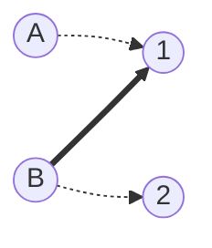

[[TOC]]

本文回答一个问题：匈牙利算法的 `dfs` 里如果没有 `vis` 数组会发生什么。算法主体见：[匈牙利算法](./index.md)。

## 先看这两行在防什么

`dfs` 的核心是：

```cpp
for (int v : g[u]) {
    if (vis[v]) continue;
    vis[v] = 1;
    if (match[v] == 0 || dfs(match[v])) {
        match[v] = u;
        return true;
    }
}
```

记号与正文一致：`match[v]` 表示右部点 $v$ 当前匹配的左部点，`0` 表示空闲；`vis[v]` 表示本轮搜索中右部点 $v$ 是否已经问过。

去掉 `if (vis[v]) continue;` 和 `vis[v] = 1;` 这两行，程序会出两个问题：

1. 递归可能绕回同一个右部点，永远出不来；
2. 即使不死循环，同一个右部点在一轮里会被反复搜索，白白变慢。

## 死循环是怎么发生的

用一个最小的例子。左部点 $A,B$，右部点 $1,2$，边是 $A-1$、$B-1$、$B-2$。当前匹配已经有一条边 $B-1$，即 `match[1] = B`。下图中粗边表示当前匹配，虚线表示普通边：



现在执行 `dfs(A)`，给 $A$ 找位置：

1. $A$ 看中右部点 $1$，`match[1] = B` 非空，于是递归调用 `dfs(B)`，问 $B$ 能不能挪走。
2. `dfs(B)` 枚举 $B$ 的边，第一条是 $B-1$。没有 `vis` 的拦截，它照样检查 `match[1]`，发现非空，于是再次调用 `dfs(match[1])`，也就是 `dfs(B)`。
3. 这次调用与上一步的状态完全相同：同样的 `match`，同样的第一条边。于是无限递归，直到爆栈。

根源在于：右部点 $1$ 正处在争议中心，递归离开它之后又沿着 `match[1]` 绕了回来，而没有任何东西记录“这个点这轮已经问过了”。

加上 `vis` 后，同一个场景变成：

1. `dfs(A)`：问 $1$，置 `vis[1] = 1`；`match[1] = B`，递归 `dfs(B)`。
2. `dfs(B)`：问 $1$，`vis[1]` 已置位，跳过；问 $2$，置 `vis[2] = 1`，`match[2] = 0`，于是 `match[2] = B`，返回 true。
3. `dfs(A)`：收到 true，说明 $B$ 已经挪到 $2$，于是 `match[1] = A`，返回 true。

结果是 $A-1$、$B-2$，匹配数从 $1$ 增加到 $2$。路径 $A\to 1\to B\to 2$ 正是一条增广路：`vis` 把“回头路”堵死，逼着递归向前找到新的出口。

## vis 的准确定义

`vis[v]` 不是“右部点 $v$ 以后不能再用”，而是“本轮为某个左部点搜索增广路的过程中，$v$ 已经问过了”。

- 每个右部点在一轮 `dfs` 中至多被访问一次，每条边至多被扫描一次，这是单轮复杂度 $O(E)$ 的来源。
- 每轮结束后整体清空 `vis`。下一名左部点搜索时匹配状态已经变化，之前问不通的右部点可能重新可用；清空的必要性见正文中的说明。

!!! note 能不能少清几次
可以。`vis` 只要求“同一轮里不重复问”，于是一轮清空之前，可以连续为多个未匹配左部点找增广路，找到一条就增广一条。每轮仍然只扫 $O(E)$，而总轮数不超过当前匹配数加一，实践中往往更快。正文的标准写法坚持每轮清空，是为了把“一轮 = 一次完整的增广路搜索”讲清楚。
!!!
