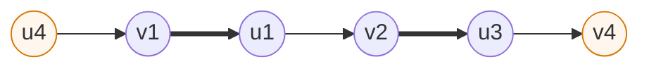
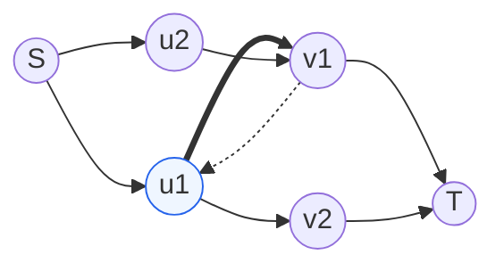
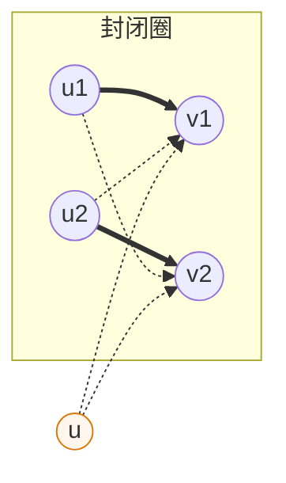
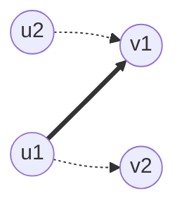
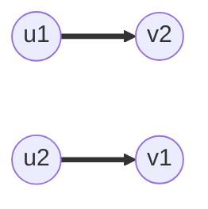

[[TOC]]

算法主体见：[匈牙利算法](./index.md)。本文把关于外层 `for` 与递归的常见疑问整理成"问题—解释"，每问配一张图。逐轮模拟见[通过数据理解 dfs 过程](./通过数据理解dfs过程.md)，失败点的集合论证见[外层循环为什么正确](./参考.md)。

!!! note 阅读约定
`match[v]` 表示右部点 $v$ 当前匹配的左部点。图中粗边是匹配边，细边是普通边，虚线是"回头看"的反向关系。
!!!

## 问题 1：为什么一个 for 加一个 dfs 就能求出最大匹配？

### 解释

`dfs(u)` 成功，等于找到了一条从未匹配左部点 $u$ 到空闲右部点的交替路，也就是增广路；翻转整条链，匹配数 $+1$。外层把每个左部点都当一次起点后，任何未匹配左部点都找不到增广路，由增广路定理（Berge 引理）：没有增广路，当前匹配就是最大匹配。

以[通过数据理解 dfs 过程](./通过数据理解dfs过程.md)例二第 4 轮的链为例，粗边是路径上的匹配边：

$u_4$ 和 $v_4$ 都未匹配（橙色），翻转后 $u_4\to v_1$、$u_1\to v_2$、$u_3\to v_4$ 成为匹配边，匹配数加一。

## 问题 2：递归让别人"挪位置"，到底在做什么？

### 解释

匈牙利可以看作单位容量网络上的朴素增广路算法：源点 $S$ 连所有左部点、右部点连汇点 $T$，容量全是 $1$。匹配边就是满流边；`dfs(match[v])` 等价于沿反向边把旧主人的流量撤回（退流），再给它另找出口：

$u_2$ 想走 $v_1$，就先沿橙色思路走 $v_1\to u_1$ 的反向边撤销 $u_1\to v_1$ 的流量，让 $u_1$ 改走 $v_2$。Dinic/EK 的反向边写在邻接表里看得见；匈牙利把它压缩进 `match` 数组、藏进递归里，代码短了，代价是难想象。

## 问题 3：为什么外层 for 只跑一轮？失败的点为什么不用再试？

### 解释

失败的 $u$ 说明：它沿交替路够得到的右部点全部有人占，占位者也都挪不动，形成一个封闭圈。后续增广只会让已占的右部点换主人，永远不会变空（增广路终点吃掉的是空闲点），所以这个圈永远解不开：

反过来想：如果后来真出现一条以 $u$ 为起点的增广路，它的终点当时也空闲、用到的边全程不变，那 $u$ 那一轮就该找到它了——矛盾。所以失败的点一生只需试一次。更形式化的集合论证见[外层循环为什么正确](./参考.md)。

## 问题 4：成功的点为什么以后不再当起点？

### 解释

增广路的定义要求起点是未匹配点。$u$ 成功后已经持有匹配，从定义上就丧失了当起点的资格——不是"算法不想试"，是"不可能"。

要区分两件事：$u$ 不再当**外层起点**，但仍会在别人的递归里被调用（作为链上被迫换位的中间点），这完全正常。

## 问题 5：成功的点后来被拆掉旧边，会不会变回未匹配、需要回头再试？

### 解释

不会。翻转增广路时，旧匹配边被拆掉的每个左部点会立刻接到下一个右部点：**拆的是边，不是人**。代码里 `match[v] = u` 只在成功分支的回溯里写，没有任何一行把左部点"置空"，已匹配左部点只增不减：

上图是换位前，下图是换位后：$u_1$ 从 $v_1$ 换到 $v_2$，两张图里 $u_1$ 都持有粗边，从未变回未匹配点。就算把中间过程直觉地看成"短暂未匹配"，让 $u_1$ 换位的那条链起点也是别人；若此刻真有以 $u_1$ 为起点的增广路，按问题 3 的论证，它在 $u_1$ 当起点的那一轮就存在了。

## 小结

| 情形 | 以后还当外层起点吗 | 还会出现在递归里吗 |
|-----|----------------|----------------|
| 失败 | 不会：封闭圈永远解不开 | 不会：它没有匹配，递归进不来 |
| 成功 | 不会：已匹配，不是合法起点 | 会：被要求换位，但始终有匹配 |

所以每个左部点一生只当一次起点，外层 for 一轮就够。
