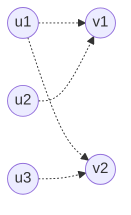
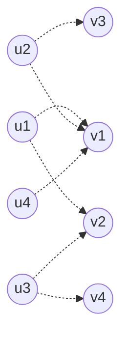

[[TOC]]

本文回答一个问题：匈牙利算法的 `dfs` 在真实数据上如何递归、如何回溯，`match` 数组每一步变成什么样。算法主体见：[匈牙利算法](./index.md)；`vis` 防重复的原理见：[没有 vis 会怎样](./vis的作用.md)。

## 约定

模拟用的代码以正文的实现为准，核心部分是：

```cpp
bool dfs(int u) {
    for (int v : g[u]) {
        if (vis[v]) continue;
        vis[v] = 1;
        if (match[v] == 0 || dfs(match[v])) {
            match[v] = u;
            return true;
        }
    }
    return false;
}
```

- `match[v]`：右部点 $v$ 当前匹配的左部点，`0` 表示空闲。
- `vis[v]`：本轮搜索是否问过右部点 $v$，每轮开始前清空。
- 邻接表按输入顺序枚举。枚举顺序影响最后得到哪一组最大匹配，但不影响匹配数。
- 左部点记作 $u_1,u_2,\ldots$，右部点记作 $v_1,v_2,\ldots$。

## 例一：三种基本情况

左部点 $u_1,u_2,u_3$，右部点 $v_1,v_2$，边为：

| 左部点 | 可连的右部点 |
|-------|------------|
| $u_1$ | $v_1, v_2$ |
| $u_2$ | $v_1$ |
| $u_3$ | $v_2$ |



这份数据覆盖三种情形：直接匹配、冲突后协商成功、冲突后协商失败。

### 第 1 轮：dfs(u1) 直接匹配

`vis` 清空后执行 `dfs(u1)`：

1. 枚举 $v_1$：`vis[v1]` 未置位，先置位，再检查 `match[v1] = 0`。
2. $v_1$ 空闲，令 `match[v1] = u1`，返回 true。

本轮结束，`match[v1] = u1`，匹配数 $1$。

### 第 2 轮：dfs(u2) 协商成功

`vis` 清空后执行 `dfs(u2)`：

1. 枚举 $v_1$：置 `vis[v1]`；`match[v1] = u1` 非空，递归调用 `dfs(u1)`，请 $u_1$ 挪位置。
2. 进入 `dfs(u1)`：
   - 枚举 $v_1$：`vis[v1]` 本轮已置位，跳过。这一步正是 [vis 的作用](./vis的作用.md)：$v_1$ 是当前争议点，绕回去只会死循环。
   - 枚举 $v_2$：置 `vis[v2]`；`match[v2] = 0`，令 `match[v2] = u1`，返回 true。
3. 回到 `dfs(u2)`：递归返回 true，说明 $u_1$ 已挪到 $v_2$，于是令 `match[v1] = u2`，返回 true。

本轮结束，`match[v1] = u2`、`match[v2] = u1`，匹配数 $2$。注意改写顺序：递归先改内层，回溯到哪一层，哪一层才改写自己盯上的右部点。

### 第 3 轮：dfs(u3) 协商失败

`vis` 清空后执行 `dfs(u3)`：

1. 枚举 $v_2$：置 `vis[v2]`；`match[v2] = u1`，递归 `dfs(u1)`。
2. 进入 `dfs(u1)`：
   - 枚举 $v_1$：置 `vis[v1]`；`match[v1] = u2`，递归 `dfs(u2)`。
   - 进入 `dfs(u2)`：枚举 $v_1$，`vis[v1]` 已置位，跳过；没有其他边，返回 false。
   - 回到 `dfs(u1)`：递归失败，继续枚举 $v_2$；`vis[v2]` 已置位，跳过。没有其他边，返回 false。
3. 回到 `dfs(u3)`：递归失败，没有其他边，返回 false。

本轮失败，`match` 一个字都没变。`match[v] = u` 只写在成功分支里，所以递归链上任何一层失败，整条链都不会留下改动。

三轮的结果：

| 轮次 | 发起的左部点 | 结果 | 本轮后的 match |
|-----|-----------|-----|--------------|
| 1 | $u_1$ | 成功 | `v1: u1` |
| 2 | $u_2$ | 成功，$u_1$ 挪到 $v_2$ | `v1: u2`，`v2: u1` |
| 3 | $u_3$ | 失败 | 不变 |

匹配数为 $2$。$u_3$ 失败是正确的：它的唯一出路 $v_2$ 被 $u_1$ 占着，$u_1$ 的另一条路 $v_1$ 又被 $u_2$ 占着，而 $u_2$ 无处可去，整条协商链走投无路。

## 例二：连锁腾挪

再看一个递归更深的例子。边为 $u_1: v_1,v_2$；$u_2: v_1,v_3$；$u_3: v_2,v_4$；$u_4: v_1$。注意 $u_4$ 只有 $v_1$ 一条边，它是引爆连锁反应的人。



前三轮的过程与例一同类，只列结果：

| 轮次 | 发起的左部点 | 结果 | 本轮后的 match |
|-----|-----------|-----|--------------|
| 1 | $u_1$ | 成功 | `v1: u1` |
| 2 | $u_2$ | 成功，$u_1$ 挪到 $v_2$ | `v1: u2`，`v2: u1` |
| 3 | $u_3$ | 成功，连锁两层 | `v1: u1`，`v2: u3`，`v3: u2` |

第 3 轮值得留意：$u_3$ 要 $v_2$，$u_1$ 只能退回 $v_1$，而 $v_1$ 的原主 $u_2$ 被挤到 $v_3$。$u_1$ 从 $v_2$ 又换回 $v_1$，说明回溯时每层只关心“自己能不能拿到一个位置”，并不保留之前的位置。

### 第 4 轮：dfs(u4) 连锁腾挪

此时 `match` 是 `v1: u1`、`v2: u3`、`v3: u2`、`v4: 空`。`vis` 清空后执行 `dfs(u4)`：

1. $u_4$ 只有 $v_1$ 一条边：置 `vis[v1]`；`match[v1] = u1`，递归 `dfs(u1)`。
2. 进入 `dfs(u1)`（第 2 层）：
   - 枚举 $v_1$：`vis[v1]` 已置位，跳过。
   - 枚举 $v_2$：置 `vis[v2]`；`match[v2] = u3`，递归 `dfs(u3)`。
3. 进入 `dfs(u3)`（第 3 层）：
   - 枚举 $v_2$：`vis[v2]` 已置位，跳过。
   - 枚举 $v_4$：置 `vis[v4]`；`match[v4] = 0`，令 `match[v4] = u3`，返回 true。整条链找到出口。
4. 回到第 2 层 `dfs(u1)`：递归成功，令 `match[v2] = u1`，返回 true。
5. 回到 `dfs(u4)`：递归成功，令 `match[v1] = u4`，返回 true。

最终 `match` 是 `v1: u4`、`v2: u1`、`v3: u2`、`v4: u3`，匹配数 $4$。

回看这条递归链：

$$
u_4 \to v_1 \to u_1 \to v_2 \to u_3 \to v_4
$$

起点 $u_4$ 未匹配，终点 $v_4$ 空闲，中间经过两条旧匹配边 $v_1-u_1$、$v_2-u_3$，这就是一条增广路。回溯时的三次改写（`match[v4] = u3`、`match[v2] = u1`、`match[v1] = u4`）正是沿着这条路翻转匹配边与非匹配边，匹配数因此增加 $1$。

## 小结

1. `dfs` 的递归链就是“我抢你的位置、你去抢他的位置”的协商链，它在图上就是一条交替路。
2. 出口是空闲右部点。找到出口后，`match` 的改写沿回溯从内向外逐层进行，每层把自己盯上的右部点登记为当前左部点。
3. 任何一层失败，整条链立即返回 false 且不留下任何改动，之前坐好的人全部原位不动。
4. `vis` 保证一轮里每个右部点只被问一次，这既堵死回头路，也让单轮复杂度保持在 $O(E)$。
