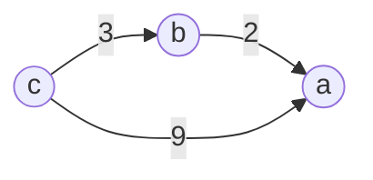

[[TOC]]

## 一句话算法

**把 $x_v-x_u\leqslant w$ 看成三角不等式 $dis[v]\leqslant dis[u]+w$，建一条 $u\to v$ 权为 $w$ 的边；跑最短路得到每个差值的上限，跑出负环就是约束自相矛盾。**

## 问题模型

给定 $n$ 个变量 $x_1,\dots,x_n$ 和 $m$ 个约束，每个约束形如

$$
x_v-x_u\leqslant w,
$$

其中 $w$ 是常数，**可以为负**。要求两件事：

1. 判断这个不等式组有没有解；
2. 有解时，求出某个差值 $x_s-x_t$ 的最大可能值，或任意给出一组可行解。

注意约束比较的永远是**两个变量之差**，所以单独一个变量的绝对值没有意义。若 $\{x_i\}$ 是一组解，任何 $d$ 都让 $\{x_i+d\}$ 同样是解——差值里 $d$ 被减掉了。这也是后面“任意一组可行解”总是能得到的原因。

## 核心直觉：最短路自己就是一串不等式

单源最短路跑完之后，每条边都满足

$$
dis[v]\leqslant dis[u]+w.
$$

这个式子不用额外证明：跑完之后若还有 $dis[v]>dis[u]+w$，那这条边就该被松弛。**最短路的结果天然满足一组“差不超过边权”的约束。**

反过来把方向对上：给出的约束是 $x_v-x_u\leqslant w$，也就是 $x_v\leqslant x_u+w$，形状与 $dis[v]\leqslant dis[u]+w$ 完全一样。于是把每个变量当成点，每条约束当成一条 $u\to v$ 权 $w$ 的边，那么只要能跑出最短路，`dis` 就是一个满足全部约束的解。

### 为什么最短路上界最紧

看三个变量、三条约束：

$$
a-b\leqslant 2,\qquad b-c\leqslant 3,\qquad a-c\leqslant 9.
$$

建图后 $c$ 到 $a$ 有两条路：直接 $c\to a$ 长 $9$，以及 $c\to b\to a$ 长 $3+2=5$。两条路都对应一个 $a-c$ 的上界，实际能取到的是**较小的那个**：

$$
a-c\leqslant\min(9,\,3+2)=5.
$$

任取一条 $t\to s$ 的路径，把路径上的约束逐个相加，就得到 $x_s-x_t$ 的一个上界。约束必须全部成立，所以上界要取所有路径里**最紧**的那个，而最紧的那个正是最短路。



所以第一句话可以拆成两个动作：

- **求差值上界** → 跑最短路，答案是 `dis[s]`（在 $t$ 为源点、边按 $u\to v$ 建好之后）。
- **判断有没有解** → 跑最短路时若出现负环，约束矛盾。

## 算法步骤

### 求 $x_s-x_t$ 的最大值

1. 对每条 $x_a-x_b\leqslant c$，建边 $b\to a$，权值为 $c$。
2. 先做**全局可行性检查**：所有点距离初始化为 $0$，全部入队，跑 SPFA。若出现负环，说明约束自相矛盾，无解。
3. 再以 $t$ 为源点跑一次普通单源最短路（其余点距离为 `INF`）。
4. `dis[s]` 就是答案；若它仍是 `INF`，说明没有路径约束 $x_s-x_t$，差值可以任意大。

### 求任意一组可行解

1. 同样建图。
2. 所有点距离初始化为 $0$，全部入队跑一次 SPFA。
3. 若出现负环，无解；否则 `dis[1..n]` 就是一组可行解。

## 算法证明

**关键不变量：** 当所有点距离初始为 $0$ 且队列排空时，每条边都满足 $dis[v]\leqslant dis[u]+w$。

1. 队列排空意味着没有任何边还能松弛，即 $dis[v]\leqslant dis[u]+w$ 对全部边成立。
2. 每条边对应一条约束 $x_v-x_u\leqslant w$，取 $x_i=dis[i]$ 后，每条约束都被满足。所以 `dis` 是一组可行解。
3. 若过程中出现负环，沿环把环上约束相加：环的边权和为负，而每个 $x_{i+1}-x_i\leqslant w_i$ 相加后得到 $0\leqslant$ 负数和，矛盾。所以负环存在即无解。

再说明为什么 $t$ 出发的最短路给的是**最大**的 $x_s-x_t$。记 $d(u)$ 为 $t$ 到 $u$ 的最短路。

1. **上界**：任取一组可行解 $x$ 和一条 $t\to s$ 的路径，路径上每条边都是一个已成立的约束 $x_{v}-x_{u}\leqslant w$。把路径逐边相加，就得到 $x_s-x_t\leqslant$ 这条路径的长度。所有路径里最短的那条给出最紧的上界，所以任何可行解都满足 $x_s-x_t\leqslant d(s)$。
2. **可取到**：取 $x_i=d(i)$（不可达的点随便取值），每条边都满足 $d(v)\leqslant d(u)+w$，即 $x_v-x_u\leqslant w$，约束全部成立。而这时 $x_s-x_t$ 正好等于 $d(s)$。
3. **结论**：$d(s)$ 既是一个上界，又能被某组可行解取到，所以它就是最大值。

第 2 步说明：**最短路跑出来的距离本身就是一组可行解**，这也是“求最短路”与“求最大值”能互相转化的原因。

### 为什么必须判负环

若图中存在负环，可以沿环无限绕圈让距离不断变小，`dis` 没有下限，“最短距离”根本不存在，上一步的论证也就整体失效——**不是答案变成某个很负的数，而是题目无解**。

## 复杂度分析

SPFA 最坏时间复杂度为 $O(nm)$，空间复杂度为 $O(n+m)$。两步（可行性 + 求最短路）各跑一次，常数翻倍但不改变阶。

当图的结构允许时，可以换成更稳定的算法：

| 情形 | 可以选择 | 时间复杂度 |
| --- | --- | --- |
| 一般差分约束，含负权边 | SPFA | 最坏 `O(nm)` |
| 只有权值不小于 0 的约束 | Dijkstra | `O(m log m)` |
| 约束全形如“不小于”且无环 | 拓扑序 DP | `O(n+m)` |

第三种就是“缩点后是 DAG”的常见优化，[P3275](#4-p3275-scoi2011-糖果) 会用到它。

## 不等式标准化速查

只看两种写法：$\leqslant$ 走最短路，$\geqslant$ 走最长路。选定一种后**全部约束都要统一到同一侧**，混用就是方向错误。

| 题面写法 | 归一到“不超过”（跑最短路） | 归一到“不小于”（跑最长路） |
| --- | --- | --- |
| `x_u - x_v <= c` | 不变，边 `v -> u` 权 `c` | `x_v - x_u >= -c`，边 `u -> v` 权 `-c` |
| `x_u - x_v >= c` | `x_v - x_u <= -c`，边 `u -> v` 权 `-c` | 不变，边 `v -> u` 权 `c` |
| `x_u == x_v` | 两个方向各一条 `0` 权边 | 同左 |
| `x_u < x_v`（整数） | `x_u - x_v <= -1`，边 `v -> u` 权 `-1` | `x_v - x_u >= 1`，边 `u -> v` 权 `1` |
| `x_u / x_v <= c`（变量均为正） | 取对数后归入第一行 | 取对数后归入第二行 |

对照方法：**最短路**一侧的边 `p -> q` 权 `w` 代表 $x_q-x_p\leqslant w$；**最长路**一侧的边 `p -> q` 权 `w` 代表 $x_q-x_p\geqslant w$。

最后一行提醒：**遇到乘法或除法先想取对数**，把 $\log x$ 当成新变量，问题就回到标准形式；区间计数则先想前缀和。

## 代码模板

两个版本接口一一对应：`add_leq`、`add_geq`、`add_eq` 负责把不同写法的不等式统一成 $u\to v$ 权 $w$；`feasible()` 做全局可行性检查并留下可行解；`shortest(s)` 求 $s$ 出发的最短路。

:::: code-tabs
::: tab C++
`feasible()` 与 `shortest(s)` 分开，是因为很多题只要求某个点在自己连通块里无矛盾，分开写才能自由选择检查范围。两者都用 `cnt` 记录当前距离对应的路径边数，达到 $n$ 就判定为环。

@include-code(/code/graph/diff_constraints.cpp, cpp)
:::

::: tab Python
Python 版把两个函数返回成 `bool`，`dis` 与 `cnt` 挂在对象上；`shortest` 里不需要像 C++ 那样先判断相加是否溢出，`int` 是任意精度。

@include-code(/code/graph/diff_constraints.py, python)
:::
::::

## 代码实现

下面的程序读入一组约束，输出 $x_s-x_t$ 的最大值、`NO`（矛盾）或 `UNBOUNDED`（没有上界）。

**输入：** 第一行 `n m s t`；接下来 $m$ 行 `a b c`，表示 $x_a-x_b\leqslant c$，点编号 $1\sim n$。

**输出：** 一个整数、`NO` 或 `UNBOUNDED`。

:::: code-tabs
::: tab C++
@include-code(./code/main.cpp, cpp)
:::

::: tab Python
@include-code(./code/main.py, python)
:::
::::

## 测试用例

### 普通情况：两条路径取更紧的

$$
x_2-x_1\leqslant2,\quad x_3-x_1\leqslant7,\quad x_4-x_1\leqslant8,\quad
x_3-x_2\leqslant3,\quad x_4-x_3\leqslant2.
$$

```text
4 5 4 1
2 1 2
3 1 7
4 1 8
3 2 3
4 3 2
```

输出：

```text
7
```

$x_4-x_1$ 有三个上界：$8$、$2+7=9$、$2+3+2=7$，取最小得 $7$。

### 三角不等式的最小例子

$$
a-b\leqslant2,\qquad b-c\leqslant3,\qquad a-c\leqslant9.
$$

这里求 $a-c$，编号记 $c=1,\ b=2,\ a=3$：

```text
3 3 3 1
2 1 2
3 2 3
3 1 9
```

输出：

```text
5
```

### 边界情况：矛盾与无上界

矛盾的约束：

```text
2 2 2 1
1 2 1
2 1 -3
```

$x_1-x_2\leqslant1$ 与 $x_2-x_1\leqslant-3$ 相加得到 $0\leqslant-2$，无解，输出 `NO`。

只有单个变量时：

```text
1 0 1 1
```

输出 `0`。

从 $s$ 反向到不了 $t$ 时，差值没有任何上界：

```text
3 1 3 1
2 1 5
```

输出 `UNBOUNDED`。

## 应用分类详解

差分约束本身不是求某个具体答案，而是**把一堆“差不超过多少”翻译成一张图**。判断题目是否适用时，先找“差”，再统一不等号方向。

### 一、判断不等式组是否有解

**识别信号：** 给出若干大小关系，问“能否同时满足”、“是否存在一种方案”。答案只有 Yes/No 两种。

这类题不需要求具体数值，只要建图后跑一次全点入队的 SPFA，看会不会出现负环。全点入队而不是单源，是因为题目要求所有约束都成立，不连通的部分也要检查。

### 二、求两个量的最大差

**识别信号：** 要求“$A$ 比 $B$ 最多多多少”、“最远距离”、“最大收益差”。

把约束写成 $x_v-x_u\leqslant w$，建图后求 $t$ 到 $s$ 的最短路。求 `dis[s]` 是 `INF` 时要按题意处理成“无上界”或题面指定的标记，不能直接输出一个巨大的数。

### 三、求两个量的最小差

**识别信号：** 要求“至少相差多少”、“最短距离”、“最少需要多少”。

两条路都可以走：

- 把约束统一成 $x_v-x_u\geqslant w$（即边 $u\to v$ 权 $w$），跑**最长路**，出现正环则无解。
- 或者全部乘 $-1$ 换成 $\leqslant$，仍然跑最短路。

两者是同一个系统的对偶写法。选定一种后**全部约束都要换到同一侧**，混用会出现方向错误。

> 口诀：$\leqslant$ 求最短路得到最大值，无解是负环；$\geqslant$ 求最长路得到最小值，无解是正环。

### 四、区间计数类（前缀和建模）

**识别信号：** 题目出现“区间 $[l,r]$ 内至少/至多选 $k$ 个”。

设 $S_i$ 为前 $i$ 个位置被选中的个数，那么“区间 $[l,r]$ 至少选 $k$ 个”就是 $S_r-S_{l-1}\geqslant k$。再加上 $0\leqslant S_i-S_{i-1}\leqslant1$ 这两条自然约束，整个问题就变成了差分约束，并且通常只需要求 $S_n-S_0$ 的最小值（跑最长路）。

识别关键是**把“选了多少个”变成前缀差**，一旦变成前缀差，区间约束就自动成了两个变量之差。

### 五、比值约束（取对数）

**识别信号：** 约束形如 $\dfrac{x_i}{x_j}\leqslant c$，且所有 $x_i>0$。

两边取对数：$\log x_i-\log x_j\leqslant\log c$。把 $\log x_i$ 当作新变量，就回到标准形式。代价是浮点误差，需要按题面精度要求设置比较误差。

## 经典例题

### 1. P5960 【模板】差分约束

[[problem: luogu,P5960]] [题解](https://pcs2.roj.ac.cn/problems/luogu/P5960)

直接求任意一组可行解。重点是建边方向（$x_c-x_{c'}\leqslant y$ 建 $c'\to c$）和**全点入队**的初始化——只要漏掉一个连通块，就会把无解误判成有解。

### 2. P1993 小 K 的农场

[[problem: luogu,P1993]] [题解](https://pcs2.roj.ac.cn/problems/luogu/P1993)

三种输入分别是“至少”、“至多”、“相等”，正好对应三种不等式的统一动作：

| 题意 | 转化 | 建边 |
| --- | --- | --- |
| `x_a - x_b >= c` | `x_b - x_a <= -c` | `a -> b` 权 `-c` |
| `x_a - x_b <= c` | 不变 | `b -> a` 权 `c` |
| `x_a == x_b` | 两个方向的差都不超过 `0` | `a -> b`、`b -> a` 各一条 `0` 权边 |

只输出 `Yes`/`No`，所以只跑可行性检查。这道题适合练习“先把题面三种说法翻译成同一种不等号”：模板的 `add_geq(a, b, c)`、`add_leq(b, a, c)`、`add_eq(a, b)` 正好对应上表三行。

### 3. 「一本通 3.4 练习 2」排队布局

[[problem: roj,1512]]

这道题有“必须按顺序站”、“两人距离不超过 $D$”、“两人距离至少 $D$”三类约束，输出还分三种情况：无解 `-1`、无上界 `-2`、否则输出最大值。正好把本文的两步完整用一遍：

- 顺序约束 $x_i\leqslant x_{i+1}$ 建边 $i+1\to i$ 权 $0$；
- 上限约束建 $A\to B$ 权 $D$；
- 下限约束 $x_B-x_A\geqslant D$ 变成 $x_A-x_B\leqslant-D$，建 $B\to A$ 权 $-D$。

先全点入队判负环（无解输出 `-1`），再以 $1$ 为源点求 $1\to N$ 最短路；`INF` 说明 $x_N-x_1$ 无上界，输出 `-2`。这道题的三种输出正好对应本文的三种结局。

### 4. P3275 [SCOI2011] 糖果

[[problem: luogu,P3275]] [题解](https://pcs2.roj.ac.cn/problems/luogu/P3275)

要求每人至少一颗糖，并满足五类大小关系，求最小总糖果数。这是“求最小差”那一类，约束统一写成 $x_v\geqslant x_u+w$：

| 输入 | 含义 | 建边 |
| --- | --- | --- |
| `X=1` | 两人一样多 | 两个方向各一条 `0` 权边 |
| `X=2` | `x_A < x_B` | `A -> B` 权 `1`（整数下“小于”就是“至少差 1”） |
| `X=3` | `x_A >= x_B` | `B -> A` 权 `0` |
| `X=4` | `x_A > x_B` | `B -> A` 权 `1` |
| `X=5` | `x_A <= x_B` | `A -> B` 权 `0` |

$X=2,4$ 是本题最容易错的地方：变量是整数，所以“少于”必须写成“至少差 $1$”的正环检测形式 $x_B\geqslant x_A+1$，不能直接当成 $\leqslant$ 处理。注意方向：$X=2$ 是 $A\to B$，$X=4$ 是 $B\to A$，两者恰好相反（**“谁更大”决定边的箭头**）。此外 $X=2$ 与 $X=4$ 同时给出时就是典型的正环无解。

本题 $n,m\leqslant10^5$，直接 SPFA 会被卡。标准做法是把权 $1$ 的边单独拿出来：若同一强连通分量里存在权 $1$ 边，则分量内形成正环、无解；否则缩点后是 DAG，从每个分量的值 $1$ 出发按拓扑序做最长路，分量内所有点取相同值。这一步把 $O(nm)$ 降到 $O(n+m)$，也就是复杂度一节表格的第三行。
