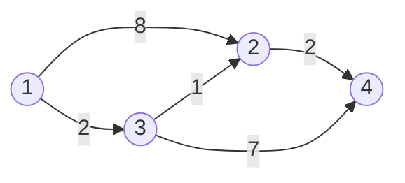

[[TOC]]

## 一句话算法

**每次确定还没定下来的点中离起点最近的一个，再用它更新邻居；边权非负，绕到后面再回来不会更近。**

## 问题模型

给定有 $n$ 个点、$m$ 条边的有向图，点编号为 $1\sim n$，边权 $w\geqslant 0$。给定源点 $s$，求从 $s$ 到每个点的最短距离。

允许零权边、重边和自环；不可达的点单独标记。无向图的每条边存成两个方向即可。

这里比较的是**整条路径的边权之和**，不是经过的边数，也不是最后一条边的长度。边权全为 $1$ 时可以用 BFS；边权各不相同时，先发现的路径未必最短。

代码使用[邻接表](../save/index.md)存图，并用[小根堆](../../data_structure/heap/index.md)取出当前最小距离。

## 核心直觉：先发现，不等于已确定

设 `dis[v]` 为目前找到的从 $s$ 到 $v$ 的最短路径长度。它是一个**暂定距离**：对应一条已经找到的路线，后面可能找到更短的。

沿边 $u\to v$ 尝试更新：

$$
\begin{aligned}
dis[u]+w&<dis[v]\\
\Rightarrow\quad dis[v]&\gets dis[u]+w.
\end{aligned}
$$

这一步叫作**松弛**，意思是“经过 $u$ 去 $v$，会不会更省？”

例如，以 $1$ 为起点：



从 $1$ 出发，先发现到 $2$ 的路线长 $8$，到 $3$ 的路线长 $2$。如果一发现 $2$ 就认定答案是 $8$，便会漏掉 $1\to3\to2$ 这条长 $3$ 的路线。

因此要区分两个动作：

- **发现路线**：得到一个候选距离，还可以改小。
- **确定答案**：已经能证明没有更短路线，以后不必再改。

现在最有希望确定的是 $3$：已知走到它只要 $2$，其他候选路线更长，后续又不能靠负权边把费用减回来。于是先确定 $3$，把到 $2$ 的距离更新成 $3$，再确定 $2$。

还有一个疑问：**某条尚未发现的绕路，会不会比当前最小值还短？** 证明中会沿着那条绕路，找到第一个尚未确定的点，说明它一定早就提供了一个更小的候选值。

## 算法步骤

先看不依赖堆的版本。用集合 $S$ 表示已经确定答案的点。

1. 初始化 `dis[s] = 0`，其他距离为无穷大，$S$ 为空。
2. 在 $S$ 外选择 `dis` 最小的点 $u$。若没有这样的点，或最小距离仍为无穷大，结束。
3. 确定 $u$ 的距离，把它加入 $S$。
4. 枚举 $u$ 的所有出边，用 `dis[u] + w` 松弛终点。
5. 回到第 2 步。

上图的过程如下，表中距离是本轮松弛结束后的值：

| 本轮确定的点 | `dis[1]` | `dis[2]` | `dis[3]` | `dis[4]` |
| --- | --- | --- | --- | --- |
| 初始化 | 0 | ∞ | ∞ | ∞ |
| 1 | 0 | 8 | 2 | ∞ |
| 3 | 0 | 3 | 2 | 9 |
| 2 | 0 | 3 | 2 | 5 |
| 4 | 0 | 3 | 2 | 5 |

**确定顺序按距离排列，不按点编号排列。** 距离相同时，任取一个都可以。

## 算法证明

**不变量：已经确定的点，其 `dis` 就是真正的最短距离。** 每个有限的 `dis` 都来自实际路线，所以不可能小于真正的最短距离。

源点首先被选中。所有边权非负，从 $s$ 到自身的最短距离就是 $0$，不变量成立。

假设前面确定的点都正确，现在选中 $u$。记真正的最短距离为 $\delta(u)$。

在一条从 $s$ 到 $u$ 的最短路径上，找到**第一个尚未确定的点** $y$，它的前一个点记为 $x$：

$$
s\longrightarrow\underbrace{\cdots\longrightarrow x}_{\text{已经确定}}
\longrightarrow y\longrightarrow\cdots\longrightarrow u.
$$

后半段中可以再次经过已确定的点；我们只用到 $y$ 是第一个尚未确定的点。

1. $x$ 已确定并松弛过 $x\to y$。到 $x$ 的最短距离不会超过这条路径的前缀长度，因此 `dis[y]` 不会超过这条路径到 $y$ 的前缀长度。
2. 剩余边权非负，所以该前缀长度不超过整条路径长度 $\delta(u)$。
3. $u$ 是尚未确定的点中 `dis` 最小的，所以 $dis[u]\leqslant dis[y]$。

记到 $y$ 的这段前缀长度为 $L$。候选路线不会优于真正的最短路，合在一起：

$$
\delta(u)\leqslant dis[u]\leqslant dis[y]\leqslant L\leqslant\delta(u).
$$

两端相同，所有不等号只能取等号，得到 $dis[u]=\delta(u)$。因此每一步都能安全确定一个点。

若仍有可达点尚未确定，在它的一条路径上取第一个尚未确定的点，同样会发现它已经被前驱更新成有限距离。因此算法结束后，剩下的无穷大距离恰好对应不可达点。

### 为什么不能有负权边

考虑 $s\to a$ 权值为 $2$，$s\to b$ 权值为 $5$，$b\to a$ 权值为 $-4$。算法会先想确定 $a$，但绕过 $b$ 后，到 $a$ 的距离其实是 $1$。

负权边破坏了“剩余路程不会减少费用”这一步，即使图中没有负环也一样。零权边只会让不等式取等号，不影响证明。

本文堆版本允许距离改小后再次入堆，在某些负权图上也可能算出正确结果，但此时“每个点只扩展一次”和复杂度保证已经失效，遇到可达负环还可能不断更新。**不能用偶然算对的例子放宽非负边权的条件。** 负权图应另看 [Bellman-Ford](../bellman-ford/index.md)。

## 堆优化：保存候选距离，跳过旧记录

朴素版本每轮扫描全部点找最小值，需要 $O(n)$。小根堆可以直接取出最小候选。

堆中存 `(距离, 点编号)`，距离在前。每次成功松弛，就把新记录放入堆。C++ 的 `priority_queue` 不方便修改堆内已有记录，所以**保留旧记录，出堆时再判断它是否过期**。

前面的例子中，到 $2$ 的距离从 $8$ 降到 $3$ 后，堆里同时存在 `(8, 2)` 和 `(3, 2)`。先弹出 `(3, 2)`，以后弹出 `(8, 2)` 时，发现它与 `dis[2] = 3` 不一致，直接跳过：

```cpp
auto [du, u] = q.top();
q.pop();
if (du != dis[u]) continue;
```

堆里始终保留着每个有限、尚未确定的距离的最新记录。跳过旧记录后，取出的有效记录就是算法要求的最小值。

本文只在距离**严格变小**时入堆，所以同一点不会产生两条相同距离的新记录；在非负权条件下，有效出堆后也不会再被改小。因此不必额外维护 `vis`。也可以使用“出堆时检查并设置 `vis`”的写法，但不能在入堆时就标记完成。

!!! warning 三个容易写错的地方
- 使用小根堆：`priority_queue` 默认是大根堆，需要指定 `greater`。
- 松弛条件用 `<`，不要用 `<=`；零权环上的相等距离反复入堆会让程序无法结束。
- 跳过过期记录后再扫描出边，否则大量旧记录会反复扫描同一点的邻接表。
!!!

若只查询终点 $t$，可以在跳过过期记录之后、有效弹出 $t$ 时提前结束。**第一次把 $t$ 放入堆时不能结束。** 本文模板求所有点的距离，所以会跑到堆空。

## 复杂度分析

这里 $m$ 表示邻接表中存储的有向边条数；无向边拆成两条后只增加常数倍。

| 实现 | 找最小值的方法 | 时间复杂度 | 总空间复杂度 |
| --- | --- | --- | --- |
| 朴素版，邻接表存图 | 每轮扫描全部点 | O(n²+m) | O(n+m) |
| 本文堆版本 | 小根堆，允许旧记录 | O(n+m log(m+2)) | O(n+m) |

堆版本的计数依据是：初始化 $O(n)$；每个可达点有效扩展一次，所以每条边最多尝试一次松弛；每次成功松弛增加一条堆记录，总记录数至多 $m+1$，每次堆操作需要 $O(\log(m+2))$。

简单图有 $m=O(n^2)$，通常把堆版本写成 $O((n+m)\log n)$。允许大量重边时，保留 $\log m$ 的写法更准确。**堆里可能同时存在同一点的多条记录，堆空间是 $O(m+1)$，不是 $O(n)$。**

稀疏图通常选择堆版本。若 $m$ 接近 $n^2$，朴素版本的 $O(n^2)$ 可以省去堆操作；若使用邻接矩阵存图，其空间也会变为 $O(n^2)$。

## 代码模板

两个版本都按 $1\sim n$ 编号，都用 `INF` 表示不可达、用 `pre` 记录前驱，接口一一对应：C++ 版把图和状态收进 `Dijkstra` 结构体，Python 版换成两个纯函数 `build_graph` 与 `dijkstra`。

:::: code-tabs
::: tab C++
C++17 版里 `add_edge` 添加一条有向边，无向边调用两次；`run(s)` 会重置距离与前驱，可以在同一张图上更换源点重复运行。

距离和边权使用 `long long`；要求所有需要表示的有限最短距离严格小于 `INF = 2^62`。代码在相加前跳过结果不小于 `INF` 的候选，避免大边权导致整数溢出。该判断依赖边权非负，不负责检测负权输入。

@include-code(/code/graph/dijkstra.cpp, cpp)
:::

::: tab Python
Python 版用 `heapq` 代替 `priority_queue`。存放的是 `(距离, 点编号)` 元组，元组按字典序比较，距离在前才能按距离出堆；这正对应 C++ 里 `pair<long long, int>` 加 `greater` 的写法。

`int` 是任意精度，不必担心溢出，`INF = 1 << 62` 只是与 C++ 版对齐的哨兵。`build_graph(n, edges, directed=False)` 一次把无向图的双向边展开，省去手写两次 `add_edge`。

@include-code(/code/graph/dijkstra.py, python)
:::
::::

### 还原一条最短路径

成功松弛 $u\to v$ 时记录 `pre[v] = u`。运行结束后调用 `path_to(t)`，从终点顺着前驱回走，再翻转即可（Python 版用 `path[::-1]` 完成翻转）。

不可达时返回空数组；源点的路径只有源点自身。若存在多条最短路径，模板返回其中一条，不保证字典序最小。零权边下仍只在严格改善时修改前驱，前驱指向更早确定的点，因此不会形成前驱环。

## 代码实现

下面是可单独编译运行的完整程序。

**输入：** 第一行 `n m s`，接下来 $m$ 行 `u v w`，表示有向边 $u\to v$。输入满足模板的非负边权与数值范围约定。

**输出：** 按点编号输出从 $s$ 出发的最短距离，不可达输出 `-1`。具体 OJ 的不可达标记可能不同，提交时按题面调整。

@include-code(./code/main.cpp, cpp)

## 测试用例

### 普通情况：后来找到更短路线

输入对应前面的示意图：

```text
4 5 1
1 2 8
1 3 2
3 2 1
2 4 2
3 4 7
```

输出：

```text
0 3 2 5
```

到 $4$ 的最短路径是 $1\to3\to2\to4$，长度 $2+1+2=5$。堆中的 `(8, 2)`、`(9, 4)` 最后都会作为旧记录跳过。

### 边界情况：重边、零权环与不可达

```text
5 6 1
1 2 9
1 2 4
2 3 0
3 2 0
3 3 0
4 5 1
```

输出：

```text
0 4 4 -1 -1
```

重边自然取更优的距离；零权环与零权自环不会触发严格改善；$4$、$5$ 虽然有边相连，却都无法从源点到达。

### 距离超出 32 位整数

```text
3 2 1
1 2 2000000000
2 3 2000000000
```

输出：

```text
0 2000000000 4000000000
```

只有一个点且没有边时，输入 `1 0 1`，输出应为 `0`。

## 应用分类详解

Dijkstra 维护的是“从起点到各个状态的最小累计代价”。识别问题时，先确定状态是什么，再检查每次转移是否增加非负代价。

### 一、单源最小费用

**识别信号：** 一个起点，要求到多个位置的最短距离、最少时间或最低费用；费用可以累加，而且非负。

把位置当点，允许的移动当边，费用当边权。一次运行求出所有终点的答案，不需要对每个终点重新跑。若要求输出路线，再维护前驱。

### 二、所有点到同一个终点

**识别信号：** 多个出发点去同一个地点，或要求往返距离。

将每条 $u\to v$ 反向为 $v\to u$，权值不变。原图中从 $v$ 到 $t$ 的每条路径，都对应反图中从 $t$ 到 $v$ 的同长度路径。

所以在反图从 $t$ 跑一次，就得到所有点到 $t$ 的距离。求往返时，在原图和反图各跑一次，再按题意组合，不能把有向图的去程距离直接当作回程距离。

### 三、多个起点，求最近的一个

**识别信号：** 多个仓库、医院或出口，求每个点与其中最近一个设施之间的距离。

如果求的是“任一源点到 $v$”，把所有源点的距离设为 $0$ 并全部入堆，其余流程相同。等价做法是增加超级源点，向每个源点连一条零权边。本文模板按 $1\sim n$ 编号，超级源点可以用新编号 $n+1$。

若有向图问的是“从 $v$ 去最近的出口”，先反向建图，再把所有出口当源点。方向决定你算的是“从哪里来”还是“到哪里去”。

### 四、带使用次数的状态最短路

**识别信号：** 最多使用 $k$ 次免费机会、折扣或特殊操作；到达同一地点时，剩余机会不同会影响后续选择。

只记 `dis[u]` 不够。改用状态 $(u,j)$ 表示“到达 $u$，已经用了 $j$ 次机会”。对于一条费用为 $w$ 的边：

- 正常走：$(u,j)\to(v,j)$，代价 $w$。
- 免费走：若 $j<k$，则 $(u,j)\to(v,j+1)$，代价 $0$。

所有转移仍非负，便能在新状态图上运行 Dijkstra。若允许**至多** $k$ 次，答案是 $\min_{0\leqslant j\leqslant k}dis[t][j]$，不能只看第 $k$ 层。复杂度按扩展后的点数、边数计算。

## 经典例题

### 1. P4779 【模板】单源最短路径（标准版）

[[problem: luogu,P4779]] [题解](https://pcs2.roj.ac.cn/problems/luogu/P4779)

非负权有向图的直接应用。重点练习小根堆、严格松弛、跳过过期记录，以及使用足够宽的整数类型。先把这道题写熟，再考虑改变建图方式。

### 2. P1629 邮递员送信

[[problem: luogu,P1629]]

每次从 $1$ 出发，送一件物品后返回。道路有方向，所以分别在原图和反图从 $1$ 跑最短路，答案为

$$
\sum_{v=2}^{n}\bigl(dis_{\text{原图}}[v]+dis_{\text{反图}}[v]\bigr).
$$

这道题练习“多起点到同一终点”转换为反图单源最短路。题目保证任意两点互相可达。

### 3. P4568 [JLOI2011] 飞行路线

[[problem: luogu,P4568]] [题解](https://pcs2.roj.ac.cn/problems/luogu/P4568)

把“用了几次免费机会”加入状态，按上一节的两类转移运行 Dijkstra。原图是无向图，两个方向都要考虑；题目按 $0\sim n-1$ 编号，使用本文模板时需要统一转换编号，或相应修改存储约定。

关键练习是分清“到达同一城市”与“到达同一状态”，并对终点的所有允许层数取最小值。
