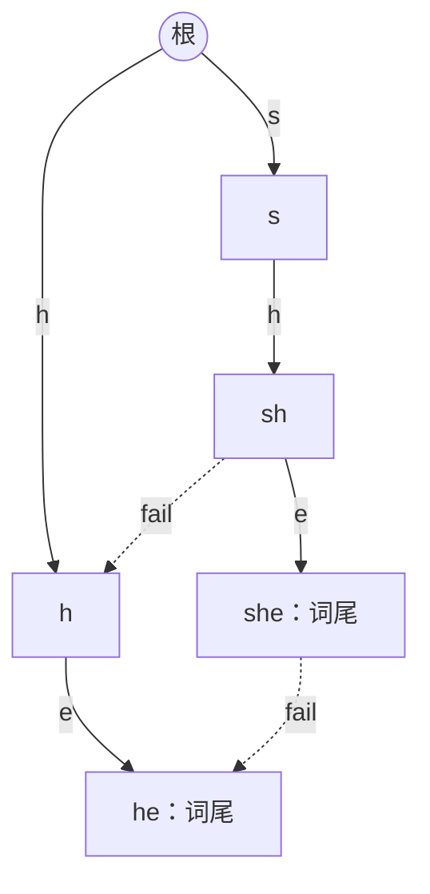

[[TOC]]

## 一句话算法

把多个模式串放进一棵 Trie；接不上下一个字符时，保留已经匹配部分中还能继续用的最长后缀，文本始终向前读。

## 问题模型

给定 $n$ 个非空模式串 $P_1,\ldots,P_n$ 和文本串 $S$，求每个模式串在文本中的出现次数。允许重叠，也允许两个模式串内容相同；答案按输入顺序分别输出。

本文代码的字符集固定为小写字母 `a` 到 `z`。

例如模式串是 `atc、cat、gcg、acc`，文本是 `gcatcg`：

```text
文本：g c a t c g
        c a t       命中 cat，起点为 2
          a t c     命中 atc，起点为 3
```

按模式串输入顺序，答案为 `1、1、0、0`。两个匹配共享了一段文本，但都应计入答案。

这里有三种容易混淆的问法：

| 问法 | 模式串为 `a、a、aa`，文本为 `aaa` 时的答案 |
|---|---|
| 每个模式串分别出现几次 | `3、3、2` |
| 有多少个模式串编号出现过 | `3`，两个 `a` 编号不同 |
| 有多少种不同内容的模式串出现过 | `2`，这次需要去重 |

本文先求出第一种答案，第二种只需统计答案中大于零的项数。**模式串插入了几次，与它在文本中出现了几次，是两件事。**

## 核心直觉

### 多个模式串，为什么适合 Trie？

对每个模式串单独运行 [KMP](../kmp/index.md)，就要反复扫描同一个文本。设所有模式串总长为 $M$，文本长为 $L$，总时间为 $O(M+nL)$。

[Trie](../trie/index.md) 可以把公共前缀合并起来。上面的四个模式串构成如下结构，`*` 表示一个模式串在这里结束：

```text
根（空串）
├─ a
│  ├─ t
│  │  └─ c  * atc
│  └─ c
│     └─ c  * acc
├─ c
│  └─ a
│     └─ t  * cat
└─ g
   └─ c
      └─ g  * gcg
```

节点代表从根到这里的整个字符串。例如第二层的 `c` 若位于 `g` 下面，就代表 `gc`，不是单独一个字符 `c`。

但只有 Trie 还不够：从文本的每个位置重新沿 Trie 匹配，仍会重复读取很多字符。

### 失配时，哪些信息还值得保留？

从文本 `gcatcg` 开头出发，已经匹配到 `gc`，下一个字符是 `a`。Trie 中 `gc` 只有字符 `g` 的孩子，无法直接接上 `a`。

此时已经读过的 `gc` 有一个后缀 `c`，而 `c` 恰好也是模式串 `cat` 的前缀。于是可以：

```text
已读 gc，下一字符为 a
    gc 接不上 a
    保留后缀 c
    c 接上 a，进入 ca
```

文本中的 `g、c` 都不用重读。这就是把 KMP 的失配思想用到多个模式串上。

!!! definition 当前状态的含义
读完文本的某个前缀后，当前节点代表：这个文本前缀的所有后缀中，**同时也是某个模式串前缀的最长者**。

根代表空串；当没有非空候选时，停在根。
!!!

只记最长的候选即可。其他较短候选都是它的后缀，接下来用 fail 链把它们串起来。

## fail 指针：把备用后缀串成链

设节点 $u$ 代表字符串 $x$。`fail[u]` 指向：

> $x$ 的所有真后缀中，属于某个模式串前缀的最长者所在的节点。

“真后缀”不包括 $x$ 自己，但包括空串。约定根编号为 `0`，`fail[0] = 0`；根的孩子的 fail 也都指向根。

例如：

| 当前状态 | fail 指向 | 原因 |
|---|---|---|
| `gc` | `c` | `c` 是 `gc` 的后缀，也是 `cat` 的前缀 |
| `ca` | `a` | `a` 是 `ca` 的后缀，也是 `atc、acc` 的前缀 |
| `cat` | `at` | `at` 是最长可用真后缀 |
| `atc` | `c` | `tc` 不是任何模式串前缀，`c` 是 |
| `gcg` | `g` | `cg` 不在 Trie 中，`g` 在 |

注意，`fail[gc] = c` 中的 `c` 不是 `gc` 在 Trie 上的父亲。**Trie 父亲删去末尾字符，fail 则删去前面一段字符。**

不断跳 fail，候选长度严格缩短，直到根：

```text
cat → at → 空串
atc → c  → 空串
```

fail 的落点只需是模式串的前缀，不必是完整模式串。例如 `at` 还没有结束，它仍能继续接 `c`。

## 算法步骤

整个算法分为四步：插入模式串、BFS 建 fail 并补边、扫描文本、倒序汇总计数。

### 第一步：插入模式串

按照普通 Trie 插入所有模式串，同时记录：

- `pat_node[i]`：第 $i$ 个模式串的结尾节点；
- `end[u]`：有多少个模式串编号在节点 $u$ 结束。

相同模式串会到达同一个节点。`pat_node` 保留每个输入编号，最后可以把同一份出现次数分别输出。

### 第二步：BFS 构建 fail

设 Trie 中有一条真正的树边 $u\xrightarrow{c}v$。求 `fail[v]` 时，要找一个比 $v$ 短、结尾仍为字符 $c$ 的候选：

1. 从 `fail[u]` 开始，看它是否有字符 $c$ 的树边。
2. 有，就接上 $c$，得到 `fail[v]`。
3. 没有，就继续跳 fail，尝试更短的后缀。
4. 一直到根都接不上，就令 `fail[v] = 0`。

例如求 `fail[cat]`：

```text
cat 的 Trie 父亲是 ca，最后一条边是 t
fail[ca] = a
a 有 t 这条树边，可以走到 at
所以 fail[cat] = at
```

再看求 `fail[atc]` 的过程：

```text
atc 的 Trie 父亲是 at，最后一条边是 c
fail[at] = 根
根有 c 这条树边
所以 fail[atc] = c
```

为什么用 BFS？因为 fail 一定指向更浅的节点。处理 $u$ 时，`fail[u]` 所在层已经处理完，它的失配信息和转移都可以直接使用。

!!! warning 根的孩子需要单独初始化
根的孩子的 fail 直接设为根，再将这些孩子放入 BFS 队列。

不能把根也按普通节点套入下面的递推式，否则根的孩子 $v$ 会得到 `fail[v] = v`，形成自环。
!!!

### 同时补边：把一串跳转预先算好

定义 `go(u, c)`：从状态 $u$ 读入一个字符 $c$ 后，自动机应到达的状态。

如果有真正的 Trie 孩子，就直接走过去；否则沿 fail 找下一个可用候选：

$$
go(u,c)=
\begin{cases}
\text{Trie 中的孩子}, & u\text{ 有字符 }c\text{ 的树边}\\
go(fail[u],c), & u\ne 0\text{ 且没有这条树边}\\
0, & u=0\text{ 且没有这条树边}
\end{cases}
$$

BFS 时，更浅节点的 `go` 已经求出，因此可以把递归跳转压成一次查表。代码复用 `ch` 数组保存这张表：

```cpp
int v = tr[u].ch[c];
if (v != 0) {                         // 真正的 Trie 孩子
    tr[v].fail = tr[tr[u].fail].ch[c];
    q.push(v);
} else {                              // 把缺失转移补好
    tr[u].ch[c] = tr[tr[u].fail].ch[c];
}
```

这里两种赋值的对象不同：有孩子时求**孩子的 fail**，没有孩子时求**当前节点的转移**。

例如 `gc` 没有 `a` 这条树边，而 `fail[gc] = c`，所以：

```text
go(gc, a) = go(c, a) = ca
```

以后从 `gc` 读入 `a`，就能一步到达 `ca`。这条补边不会新建节点；`ca` 仍然代表字符串 `ca`。

!!! note ch 数组的含义发生了变化
构建前，`ch[u][c]` 表示 Trie 孩子，`0` 表示没有孩子。

构建后，`ch[u][c]` 表示读入字符后的完整转移，`0` 表示转移到根。此时结构通常称为“字典图”，不能再把所有非零转移当成 Trie 树边。

因此模板要求先插完所有模式串，再调用一次 `build()`；构建后不能继续插入，也不能再次构建。
!!!

### 第三步：文本只扫描一遍

构建好转移表后，每读一个字符，只需要：

```cpp
u = tr[u].ch[c];
cnt[u]++;
```

对前面的文本 `gcatcg`，状态变化如下。表中的字符串都表示节点对应的完整前缀：

| 位置 | 读入字符 | 原状态 | 新状态 | 这一步发生了什么 |
|---|---|---|---|---|
| 1 | `g` | 根 | `g` | 沿 Trie 树边走 |
| 2 | `c` | `g` | `gc` | 沿 Trie 树边走 |
| 3 | `a` | `gc` | `ca` | 保留后缀 `c` 后接 `a` |
| 4 | `t` | `ca` | `cat` | 命中 `cat` |
| 5 | `c` | `cat` | `atc` | 保留后缀 `at` 后接 `c`，命中 `atc` |
| 6 | `g` | `atc` | `g` | `c` 接不上 `g`，回到根后接 `g` |

**命中一个模式串后也不要清空状态。** 第 4 位匹配出 `cat` 后，下一位继续从它转移，才能利用后缀 `at` 找到重叠出现的 `atc`。

### 第四步：沿 fail 汇总所有命中

扫描时的 `cnt[u]` 只统计“最长候选停在 $u$ 的次数”，还不是节点对应字符串的完整出现次数。

换一个小例子：模式串为 `he、she`，文本为 `she`。最后停在 `she`，但 `he` 也在这个位置结束。



实线是 Trie 树边，虚线是 fail；图中省略指向根的 fail 边。`she → he → 根` 说明：停在 `she` 的一次访问，也给 `he` 贡献一次出现。

从当前状态出发，沿 fail 链遇到的所有词尾，都是以当前文本位置结尾的模式串。

最直接的办法是每读一个字符就遍历这条链。但若模式串是 `a、aa、aaa、…`，文本全是 `a`，很多位置都会走一条很长的链。

只求次数时，可以把这些重复累加留到最后：

1. 扫描时只在到达节点记一次访问。
2. 扫描结束，把每个非根节点的累计值加给 `fail[u]`。
3. 必须先处理深节点，再处理浅节点，让贡献一路上传。

例如模式串为 `a、aa、aaa`，文本为 `aaaa`：

| 状态 | 扫描结束时的直接访问次数 | 上传完成后的次数 |
|---|---|---|
| `a` | 1 | 4 |
| `aa` | 1 | 3 |
| `aaa` | 2 | 2 |

先做 `aaa → aa`，得到 `1 + 2 = 3`；再做 `aa → a`，得到 `1 + 3 = 4`。

构建时已经记录了 BFS 序，倒着使用就满足这个顺序：

```cpp
// order[0] 是根；sum 初始为直接访问次数 cnt 的副本
for (int i = (int)order.size() - 1; i >= 1; i--) {
    int u = order[i];
    sum[tr[u].fail] += sum[u];
}
```

根不向自己上传。最终第 $i$ 个模式串的答案就是 `sum[pat_node[i]]`，不需要再乘 `end`。

把每条非根节点的 fail 边反向连成 `fail[u] → u`，就得到 **fail 树**。上面的过程正是在求子树和：某模式串的出现次数，等于它在 fail 树子树内所有状态的直接访问次数之和。

## 为什么叫自动机？

构建结束后，算法只需要记住一个节点编号 $u$。给定下一个字符 $c$，`ch[u][c]` 就唯一确定下一状态。

- **状态**：当前能保留的最长匹配后缀。
- **输入**：下一个文本字符。
- **转移**：查表 `u = ch[u][c]`。
- **匹配结果**：当前状态及其 fail 链上的词尾。

节点数有限，状态和输入又唯一决定下一状态，所以这是一个确定有限状态自动机。fail 指针负责帮助构建转移和收集匹配结果；补边以后，扫描文本时不用显式跳 fail。

## 算法证明

### 1. fail 链不会漏掉候选

设 $x$ 是一个节点对应的字符串，$y$ 是它最长的可用真后缀。任意更短的可用后缀 $z$，因为与 $y$ 都在 $x$ 的末尾，所以 $z$ 也一定是 $y$ 的后缀。

因此，先取最长的 $y$，再递归寻找 $y$ 的可用真后缀，就能按长度递减枚举全部候选。长度严格下降，也不会重复。

### 2. fail 的构造和补边正确

设真正的 Trie 树边为 $u\xrightarrow{c}v$，$u$ 代表 $x$，$v$ 代表 $xc$。

若 $zc$ 是 $xc$ 的一个非空可用真后缀，则：

$$
zc\text{ 是 }xc\text{ 的真后缀}
\Rightarrow |z|<|x|
\Rightarrow z\text{ 是 }x\text{ 的真后缀}。
$$

又因为 $zc$ 是模式串前缀，去掉末尾字符后的 $z$ 也在 Trie 中。于是所有候选，恰好来自 `fail[u]` 及其 fail 链上那些能够接上 $c$ 的状态。

按长度从大到小找到的第一个，就是最长候选；没有非空候选时回到根。注意，`fail[u]` 自己未必接得上 $c$，这正是需要完整转移 `go(fail[u], c)` 的原因。

对于补边，$u$ 本身接不上 $c$ 时，同样只需尝试它的更短候选，因此 `go(u, c) = go(fail[u], c)`。BFS 保证所用的浅层转移已经正确，递推成立。根与根的孩子由初始化处理。

### 3. 扫描始终保留最长可用后缀

初始文本为空，状态为根，结论成立。

假设读入新字符 $c$ 前，状态 $u$ 已是最长可用后缀。新文本的任意非空可用后缀都形如 $zc$；删去末尾的 $c$ 后，$z$ 必是旧文本的可用后缀。

因此 $z$ 一定是 $u$ 或其 fail 链上的节点。转移先尝试 $u$，再按长度递减尝试其他候选，恰好选中新的最长可用后缀。不变量保持。

### 4. 计数上传不重不漏

在每个文本位置，一个模式串出现，当且仅当它的结尾节点位于当前状态的 fail 链上，包括当前状态自身。

这等价于：当前状态位于该结尾节点的 fail 树子树内。

扫描时每个文本位置只在当前状态记一次。倒 BFS 序累加恰好求出每个子树的总访问次数，因此每个“文本结束位置、模式串编号”恰好计数一次。相同模式串的编号分别读取同一节点的答案，也符合题意。

## 复杂度分析

设模式串总长为 $M$，Trie 节点数为 $N$，文本长为 $L$，模式串个数为 $n$，字符集大小为 $\sigma$。有 $N\leqslant M+1$。

| 阶段 | 时间复杂度 |
|---|---|
| 插入模式串 | $O(M+\sigma N)$，包含每个新节点转移数组的初始化 |
| BFS 构建 fail 与补边 | $O(\sigma N)$ |
| 清空计数并扫描文本 | $O(N+L)$ |
| 倒序上传并读取各模式串答案 | $O(N+n)$ |

总时间为 $O(M+\sigma N+L+n)$。固定 $\sigma=26$、模式串非空时，可以简写为 $O(M+L)$。

自动机及计数数组占 $O(\sigma N+n)$ 空间；完整程序还保存文本，额外占 $O(L)$ 空间。Python 的列表和整数有额外内存开销，大数据时需要结合内存限制选择实现。

!!! warning 统计次数和逐项报告位置的代价不同
每个字符都遍历整条 fail 链，最坏需要 $O(LH)$ 时间，其中 $H$ 是最长模式串长度。倒序上传把“只求每个模式串次数”的统计部分降到 $O(N+L+n)$。

若必须列出所有匹配位置，答案有 $Z$ 项，就至少需要 $\Omega(Z)$ 的输出时间。可增加只跳往下一个词尾的输出链接，使扫描和报告部分做到 $O(L+Z)$；这与本文只求次数的模板用途不同。
!!!

## 代码模板

两种语言使用相同的接口：

| 接口 | 含义 |
|---|---|
| `insert(pattern)` | 插入一个非空模式串，保存其输入顺序 |
| `build()` | 所有插入完成后调用一次，构建完整转移 |
| `query(text)` | 从根扫描文本，清空上一轮的访问次数 |
| `count_each()` | 先调用 `query`，再获取按插入顺序排列的出现次数 |

`count_each()` 在计数副本上上传，可以重复调用。对新文本可以再次执行 `query` 和 `count_each`，无需重建自动机；新一轮答案与上一轮独立。

:::: code-tabs
::: tab C++
与本书其他结构体模板一样，使用前需包含标准库头文件并引入 `std` 命名空间；下节完整程序已包含这些内容。出现次数使用 `long long`。

@include-code(/code/string/ac_automaton.cpp, cpp)
:::

::: tab Python
使用 `deque` 进行 BFS，查询与统计均不使用递归。

@include-code(/code/string/ac_automaton.py, python)
:::
::::

## 代码实现

输入第一行为模式串个数 $n$，接下来 $n$ 行每行一个非空模式串，最后一行为文本。输出 $n$ 行，分别表示每个模式串的出现次数。

:::: code-tabs
::: tab C++
@include-code(./code/ac_automaton_solution.cpp, cpp)
:::

::: tab Python
@include-code(./code/ac_automaton_solution.py, python)
:::
::::

## 测试用例

### 1. 补边与重叠匹配

输入：

```text
4
atc
cat
gcg
acc
gcatcg
```

输出：

```text
1
1
0
0
```

`cat → atc` 的转移保留了后缀 `at`，两个匹配的文本位置允许重叠。

### 2. 词尾藏在 fail 链上

输入：

```text
4
he
she
his
hers
ushers
```

输出：

```text
1
1
0
1
```

读到 `she` 时，`he` 也在同一位置结束。最后由 `she` 向 `he` 上传访问次数。

### 3. 重复模式串与连续重叠

输入：

```text
4
a
aa
a
b
aaa
```

输出：

```text
3
2
3
0
```

两个 `a` 共用一个结尾节点，但都输出 `3`；`aa` 在位置 `1..2` 和 `2..3` 各出现一次。

还应检查完全不匹配（模式串 `abc`、文本 `zzz`，答案 `0`）、文本短于模式串（`abcd` 对 `abc`，答案 `0`），以及单字符恰好匹配（`a` 对 `a`，答案 `1`）。

## 应用分类详解

AC 自动机把“文本末尾还保留哪些匹配可能”压缩成一个状态。不同题目主要改变命中后的处理方式。

### 一、多个关键词的出现次数或出现情况

**识别信号：** 同一份词典对应一个长文本，需要同时查询很多关键词。

**核心建模：** 模式串建自动机，扫描并沿 fail 汇总。逐个查询返回次数；统计次数大于零的项得到出现过的模式串编号数；把这些次数相加得到按编号计算的总出现次数。

如果只需要在线累计总次数，可以在 BFS 时预处理 `out[u] = end[u] + out[fail[u]]`，其中 `out[0] = 0`，扫描时累加每个到达状态的 `out[u]`。

### 二、多个文本中的累计出现次数

**识别信号：** 词典固定，查询所有单词在多段文本中出现的次数之和。

**核心建模：** 各段文本从根开始扫描，把直接访问次数加到同一个数组，最后统一上传一次。

不能直接连接文本。例如模式串 `ab`，两个文本分别为 `a` 和 `b`，直接拼接会凭空产生一个匹配。

本文 `query` 默认清空计数。若改为多文本累计，应把清零移到所有文本扫描之前，每段只重置状态 `u = 0`。这样总时间为 $O(\sigma N+\sum |S_i|+n)$（自动机已完成插入），无需为每段单独上传一遍。

### 三、词典拼接与最长可识别前缀

**识别信号：** 要把文本前缀完整切分为词典中的单词。

**核心建模：** 设 $f[i]$ 表示前 $i$ 个字符能否完整切分，$f[0]=\text{true}$。若当前位置 $i$ 命中一个长度为 $\ell$ 的词，就有：

$$
f[i]\leftarrow f[i]\lor f[i-\ell]。
$$

自动机负责找出“哪些词在这里结束”，DP 负责检查这些词之前的部分能否切分。不能仅凭当前位置命中了某个词，就认定整个前缀可识别；也不能只检查最长词尾。

若词长上界很小，可以为每个状态保存 fail 链上的词长集合，用位集加速转移。逐位置枚举整条 fail 链仍可能很慢。

### 四、避免禁用串的计数与构造

**识别信号：** 构造长度为 $K$ 的字符串，要求其中不包含任意禁用串。

**核心建模：** 把禁用串建成自动机，在 BFS 时传播：

$$
bad[u]=(end[u]>0)\lor bad[fail[u]]。
$$

设 $dp[i][u]$ 表示构造了 $i$ 个字符、停在状态 $u$ 且始终合法的方案数。从 `dp[0][0] = 1` 开始，枚举下一个字符，只有新状态不是 `bad` 时才允许转移。

必须包含 fail 链上的词尾信息。例如禁用串为 `he` 和 `shex` 时，状态 `she` 本身不是词尾，却已经含有禁用串 `he`。

长度为 $K$ 的普通 DP 需要 $O(K\sigma N)$ 时间。长度很大而状态数较少时，可以进一步考虑转移矩阵；有数值上下界限制时，可以把自动机状态放入数位 DP。

## 经典例题

### 1. [[problem: luogu,P3808]] [题解](https://pcs2.roj.ac.cn/problems/luogu/P3808)

求有多少个模式串编号在文本中出现过。先用本文模板得到各自的次数，再统计正数项即可。即使两个模式串内容相同，也要按编号分别计入答案。

这道题练习“出现过”与“出现次数”的区别，不应直接输出每个模式串的次数。

### 2. [[problem: luogu,P5357]]

要求分别输出每个模式串的出现次数，允许重复模式串，与本文完整程序的输入输出一致。重点是倒 BFS 序上传，避免每读一个字符都遍历整条 fail 链。

### 3. [[problem: luogu,P2292]]

给定词典与若干段文章，求每段文章能被词典单词完整拼出的最长前缀。使用“当前位置的匹配词长 + 前缀可达性 DP”。题目中词长不超过 $20$，适合用位集保存匹配长度与最近的可达位置。

### 4. [[problem: luogu,P3966]]

输入的单词既组成词典，也分别作为待扫描文本，求每个单词在所有这些单词内部的出现次数之和。重复输入的单词也各自贡献文本中的出现次数。

可把所有单词分别从根扫描，汇总访问次数后统一上传。进一步观察：每个单词本来就在 Trie 上，所以扫描过程就是它的根到词尾路径；也可以在插入时记录每个非根节点被经过的次数，建好 fail 后直接倒序上传。不要把不同单词首尾连接后产生的跨边界匹配计入答案。

## 易错点

- **只检查当前节点是否是词尾。** 会漏掉 fail 链上的其他词尾，如 `she` 中的 `he`。
- **把 fail 当成 Trie 父亲。** 两者删去的是字符串的不同部分。
- **命中后回到根。** 会丢失还能参与下一次匹配的后缀，漏掉重叠出现。
- **用节点编号倒序代替 BFS 倒序。** 编号取决于插入顺序，fail 可能指向后来才创建的节点；必须使用真正的 BFS 序。
- **从浅到深上传。** 深节点后来送来的贡献无法继续向上传播。
- **把词尾标记清零来统计出现次数。** 这会丢掉后续重复出现，只适用于另行设计的“是否出现”统计。
- **混淆读入格式与字符集。** 当前模板只接受小写字母，不能直接用大写字符减 `'a'`；C 风格字符串循环也不能把结尾的 `\0` 当作字符处理。

## 关联阅读

- [Trie 字典树](../trie/index.md)：公共前缀与词尾标记。
- [KMP 字符串匹配](../kmp/index.md)：失配时保留可复用的后缀。
