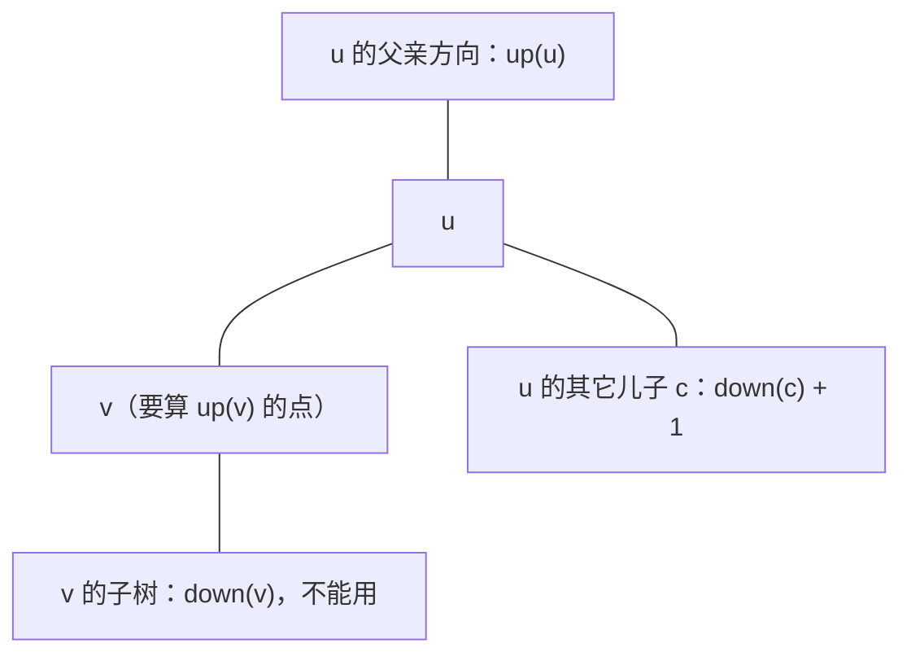

[[TOC]]

## 一句话算法

先随便选一个根，把“根在这个点”的答案算出来；再把根沿着一条边挪到相邻点，用“这条边两侧的规模”推出新答案。两次 DFS，全树每个点作为根的答案都有了。

## 什么时候需要换根

有的题目要的不是“哪一点最好”，而是**每个点作为根时的一份值**：

- 求每个点的“所有点到它距离之和”，再取最小（[[problem: luogu,P1364]]、[[problem: luogu,P1395]]）；
- 求每个点作为根时的“所有点深度之和”，取最大（[[problem: luogu,P3478]]）；
- 求每个点到其它点的最远距离，也就是它的偏心距（树的中心的基础）；
- 求每个点周围某一圈的信息，例如距离不超过 $K$ 的点权和（[[problem: luogu,P3047]]）。

最直接的做法是对每个点各跑一次 DFS，$O(n)$ 一遍、$n$ 个点，总共 $O(n^2)$。但相邻两个根之间并没有那么大差别：把根从 $u$ 挪到它的邻居 $v$，只有**这条边两侧**的点距离会变，一侧全体减一、另一侧全体加一。

换根 DP 做的就是把这个差别写成闭式，于是每个点只花 $O(1)$ 就从上一次的结果算出自己的结果。

## 从“重算一遍”到“改一笔”

先把记号固定下来。任选 `1` 为根，$S(v)$ 表示**以 $v$ 为根的子树**的规模（子树点数、子树点权和、子树最深链……按题目取），$W$ 是全树的规模。

以加权距离和为例：$D(u)=\sum_x w_x\cdot\operatorname{dist}(x,u)$。把根从 $u$ 挪到儿子 $v$：

- $v$ 子树里的点，原来要先走到 $v$ 再绕到 $u$，现在少走一步；
- 其余的点，原来到 $u$ 就停，现在要多跨一条边。

两侧人数分别是 $S(v)$ 和 $W-S(v)$，于是

$$
D(v)-D(u)=-\big(S(v)\big)+\big(W-S(v)\big)=W-2S(v)
$$

这个式子里只有 $W$ 和 $S(v)$，都是“**一条边两侧的规模**”。只要子树信息在手上，一条边就是一次加减法。

!!! note 与树的重心、树的中心不是一回事
- 让加权距离和最小的点叫**带权重心**，求法见 [树的重心](../centroid_of_tree/index.md)；
- 让“最远距离”最小的点叫**树的中心**，求法见 [树的中心](../center_of_tree/index.md)。

这两篇解决的是“找出那个点”。换根 DP 解决的是“求每个点的值”，重心和中心往往只是它算完一遍之后顺带扫出来的结论。方向上的对偶也有趣：重心关心“两侧各有多少人”，中心关心“最远的那一头有多远”。
!!!

## 两次 DFS 的框架

不管转什么量，骨架都是两次遍历，**顺序不能反**：

1. **后序 DFS（求子树信息）**：定根，回溯时把儿子的信息合并到父亲，得到每个点的 $S$，同时直接算出根自己的答案（例如根的答案 $=\sum_x w_x\cdot \operatorname{dep}(x)$）。
2. **前序 DFS（换根递推）**：从根往下走，父亲算完了才轮到儿子，用一条边的增量写出儿子的答案。

```text
第一次 DFS（后序）              第二次 DFS（前序）
  叶子 → 根：攒 S(v)              根 → 叶子：攒 ans(v)
  顺手得到 ans(root)             ans(v) = ans(u) + 增量(u → v)
```

如果反过来先换根再求子树，儿子拿到的还是没算完的子树信息；如果第二次改成后序，父亲自己也没定值。这个顺序错误在代码里不会报错，只会算出无意义的大数。

## 三类常见转移

换根 DP 的变体多，卡点几乎都在“**增量怎么写**”。按被转移的量分三类。

### 求和型：增量和两侧规模差成正比

代表是距离和、深度和。上面已经推过：

$$
\operatorname{ans}(v)=\operatorname{ans}(u)+W-2S(v)
$$

无权版把点权全当 $1$，$W=n$、$S(v)$ 是子树点数，于是变成 $\operatorname{ans}(v)=\operatorname{ans}(u)+n-2\operatorname{subtree\_size}(v)$。[[problem: luogu,P1364]]、[[problem: luogu,P1395]]、[[problem: luogu,P3478]] 都是这一条式子，区别只在“权值指什么”“取最小还是取最大”。

这类题唯一要小心的是数值范围：点权和 $\times$ 距离容易超过 `int`，直接用 `long long`。

### 最值型：要“换出半边”，所以得存次大值

求和型的增量是两个数相加，天然可减；最值型不行。求每个点的偏心距（到其它点的最远距离）时，需要把两个方向合起来：

$$
\operatorname{ecc}(u)=\max\big(\underbrace{\text{子树内最远}}_{\operatorname{down}(u)},\ \underbrace{\text{往父亲方向最远的}}_{\operatorname{up}(u)}\big)
$$

$\operatorname{down}(u)$ 第一次 DFS 就得到了。麻烦在 $\operatorname{up}(v)$：从 $v$ 出发往上走，先到 $u$，再从 $u$ 继续走一条**不经过 $v$ 子树**的最长路。



$u$ 手上“可用的最长路”集合 = { $\operatorname{up}(u)$ } ∪ { 每个儿子的 $\operatorname{down}+1$ }。给 $v$ 传递时要**把 $v$ 自己那一份踢掉**：如果 $v$ 恰好提供了最长的那条，就只能改用次长的那条。所以每个点要记**最大和次大**两个值（来自不同的儿子），然后

$$
\operatorname{up}(v)=1+\max\big(\operatorname{up}(u),\ \text{不含 } v \text{ 的最长 }\operatorname{down}+1\big)
$$

!!! warning 只存最大值会算错
只记最大值、遇到“最大值来自 $v$ 自己”就退化成 $0$，会把答案算大。次大值不是优化，是正确性的一部分。
!!!

### 计数型：增量的写法是容斥

[[problem: luogu,P3047]] 要求每个点周围距离不超过 $K$ 的点权和。设 $f(u,k)$ 表示**子树内**与 $u$ 距离恰为 $k$ 的点权和（$f(u,0)=w_u$），第二遍 DFS 把“全树版本” $g(v,k)$ 推出来：

$$
g(v,k)=f(v,k)+\big(g(u,k-1)-f(v,k-2)\big)
$$

减去的 $f(v,k-2)$ 是容斥：$g(u,k-1)$ 里已经含了“从 $u$ 往 $v$ 方向走 $k-1$ 步”的点，而它们正是 $v$ 子树内距离 $v$ 为 $k-2$ 的那批，重复算了一次（$k\le 1$ 时那一项按 $0$ 处理）。最后把 $k=0\sim K$ 加起来就是答案。

计数型的通用套路是：**先在后序里把子树内的分布算清楚，再在前序里用父亲的“全树答案”减去“自己子树那份”**。增量不一定简单，但只要“能减掉自己那一份”，换根就成立。

## 复杂度分析

- 时间复杂度：$O(n)$。第一次 DFS 每条边处理一次，第二次 DFS 每条边也是常数次；计数型带一个 $K$，是 $O(nK)$。
- 空间复杂度：$O(n)$。子树信息、答案数组和递归栈都是线性的；计数型是 $O(nK)$。

和“每个点重新扫一遍”的 $O(n^2)$ 相比，省下来的正是“重复计算了 $n-1$ 次公共部分”。

## 代码模板

求和型：求每个点作为根时的加权距离和，点权放在 `weight[]`，无权版全填 `1`。

:::: code-tabs
::: tab C++
@include-code(/code/tree/tree_reroot_sum.cpp, cpp)
:::

::: tab Python
@include-code(/code/tree/tree_reroot_sum.py, python)
:::
::::

最值型：求每个点的偏心距，答案里最小的那个点就是树的中心。

:::: code-tabs
::: tab C++
@include-code(/code/tree/tree_reroot_max.cpp, cpp)
:::

::: tab Python
@include-code(/code/tree/tree_reroot_max.py, python)
:::
::::

## 正确性

以求和型为例，归纳证明 $\operatorname{ans}(v)$ 都算对。

1. **根**：第一次 DFS 把 $\sum_x w_x\cdot\operatorname{dep}(x)$ 全部加起来，$\operatorname{ans}(1)$ 就是根的真实答案。
2. **一步转移**：设 $\operatorname{ans}(u)$ 正确。把根从 $u$ 挪到儿子 $v$，树上每个点到根的距离只会变 $1$：$v$ 子树内的点（共 $S(v)$ 个）各减一，其余（$W-S(v)$ 个）各加一，所以真实答案正好是 $\operatorname{ans}(u)+W-2S(v)$，与递推式一致。
3. **沿路径归纳**：第二次 DFS 从根出发按前序走，父亲先于儿子确定，于是任意点都能沿“根到它”的路径一步步推过去。

单向的推导已经够用了，反向看一眼也能佐证式子没写反：从 $v$ 挪回 $u$，增量为 $W-2S(u)=W-2(W-S(v))=2S(v)-W$，正好抵消。

## 经典例题

### 1. [[problem: luogu,P1364]] [题解](https://pcs2.roj.ac.cn/problems/luogu/P1364)

医院设置：每个点有居民数，选一个点使居民走的总路程最小。枚举 $n$ 个候选点各做一次 BFS 就能过（$n\le 100$），而换根写法是上面的求和型模板，$O(n)$ 且顺便得到每个点的代价。

### 2. [[problem: luogu,P1395]] [题解](https://pcs2.roj.ac.cn/problems/luogu/P1395)

会议：无权版的距离和最小。因为权重全为 $1$，最优位置就是树的重心，可以先求重心再一次 BFS；换根版则直接把所有点的距离和推出来取最小。

### 3. [[problem: luogu,P3478]] [题解](https://pcs2.roj.ac.cn/problems/luogu/P3478)

STA-Station：求使“所有点深度之和”最大的根。增量仍是 $n-2\operatorname{subtree\_size}(v)$，只是最后取最大值而不是最小值——同一套骨架换一个比较方向。

### 4. [[problem: luogu,P2986]] [题解](https://pcs2.roj.ac.cn/problems/luogu/P2986)

Great Cow Gathering：边带长度、点带奶牛数，求最小的“奶牛数 $\times$ 距离和”。把增量的两侧规模换成“奶牛数”，距离变化换成“边权”，公式形状不变。

### 5. [[problem: luogu,P3047]] [题解](https://pcs2.roj.ac.cn/problems/luogu/P3047)

Nearby Cows：计数型换根，增量靠容斥写出来，见上文第三类。

### 6. [[problem: luogu,P5666]] [题解](https://pcs2.roj.ac.cn/problems/luogu/P5666)

CSP-S 2019 树的重心：枚举删掉的每条边、求两侧连通块的重心。单次换根不够，要把“沿最大部分走”和倍增、换根信息结合起来，属于这套骨架的进阶用法。

## 实践思考与扩展

1. **先写暴力再换根。** 换根公式写错时，输出往往是个“看起来合理”的大数。先用 $O(n^2)$ 的逐点 DFS 拿到正确答案，再和换根版对拍，能立刻发现增量写反、忘记次大值、边界没清空这类问题。
2. **数值范围。** 求和型的答案通常是“点权 $\times$ 距离”的累加，$10^5$ 级的权值乘上 $10^5$ 级的距离就超过 `int`，一律用 64 位。
3. **多解时的取舍。** 重心、中心这类“只有一个最优值”的题目，直接用结论更短；一旦题目要“每个点的答案”或者加了点权、边权，换根 DP 的形态更稳。
4. **递归深度。** 链状数据下递归深度可达 $n$。判题机通常给足栈空间；若目标环境栈很小，可以把两次 DFS 改成“先迭代求父亲与遍历序，再逆序/正序扫”，逻辑与递归版完全对应。

## 参考

- [树的重心](../centroid_of_tree/index.md)
- [树的中心](../center_of_tree/index.md)
- [树的直径](../diameter_of_tree/index.md)
